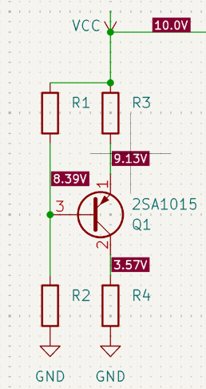
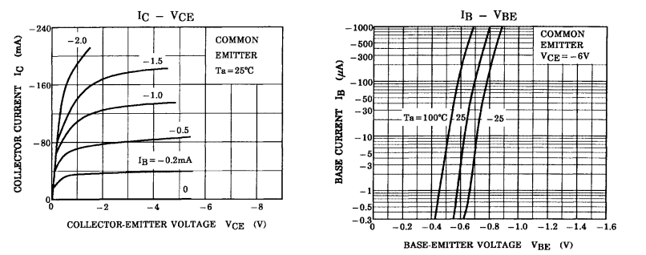
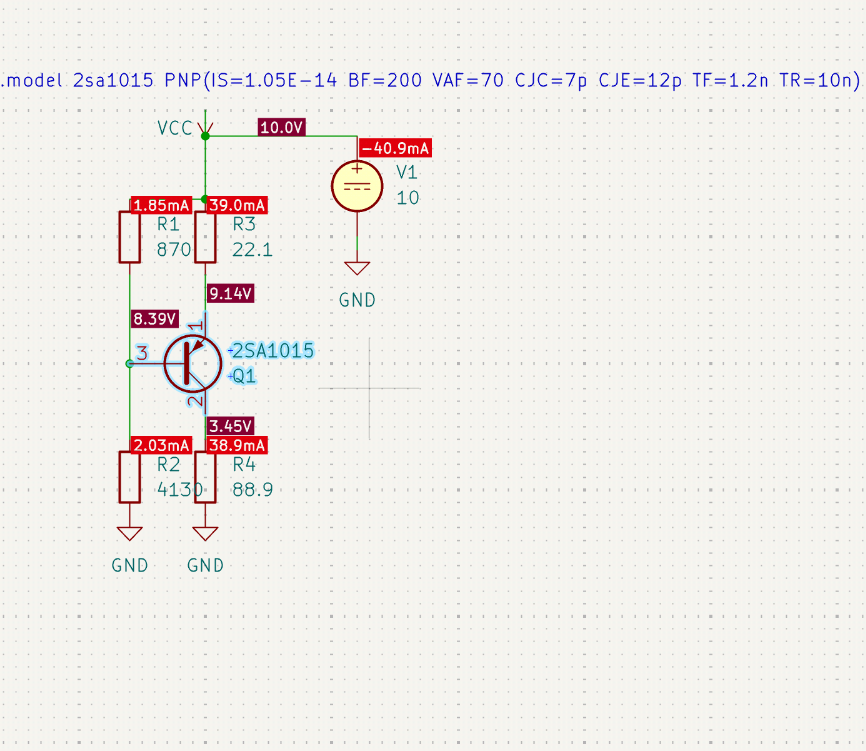
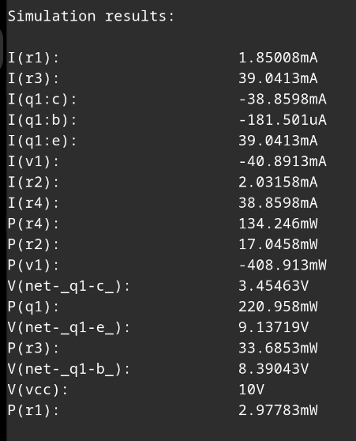
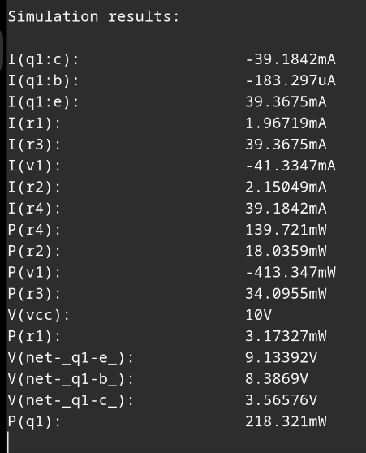

# Практичне завдання №1
**Тема:** Розрахунок кола зміщення біполярного транзистора за постійним струмом та вибір робочої точки  
**Виконав:** студент Стецюк Костянтин  
**Номер варіанта:** $N = 17$  

---

## 1. Вихідні дані варіанта

Згідно з індивідуальним варіантом $N = 17$:
- Параметри варіанта: $n_1 = 7$, $n_2 = 10$
- Напруга живлення схеми: $V_{CC} = 10\text{ В}$
- Тип транзистора: **2SA1015 (A1015)**
- Структура транзистора: **PNP**, кремнієвий

### Паспортні граничні параметри транзистора 2SA1015 (з даташиту)
- Максимальна напруга колектор-емітер: $V_{CEO(\max)} = -50\text{ В}$
- Максимальна напруга колектор-база: $V_{CBO(\max)} = -50\text{ В}$
- Максимальна напруга емітер-база: $V_{EBO(\max)} = -5\text{ В}$
- Максимальний постійний струм колектора: $I_{C(\max)} = -150\text{ мА}$
- Максимальна розсіювана потужність: $P_{D(\max)} = 400\text{ мВт}$
- Діапазон статичного коефіцієнта підсилення: $h_{FE} = 70 \dots 400$ (типово $\approx 200$)

---

## 2. Вихідна схема підсилювального каскаду

Для забезпечення високої температурної стабільності робочої точки використовуємо класичну схему зі **спільним емітером (СЕ)** з базовим дільником напруги та емітерною термостабілізацією.

Оскільки транзистор у нас **PNP**, полярність живлення відносно NPN перевернута:
- Емітер підключається через резистор термостабілізації $R_E$ ($R_3$) до плюсової шини живлення $+V_{CC} = +10\text{ В}$.
- Колектор підключається через резистор навантаження $R_C$ ($R_4$) до «землі» ($\text{GND} = 0\text{ В}$).
- Базовий дільник складається з двох резисторів: верхнього $R_1$ (до $+V_{CC}$) та нижнього $R_2$ (до $\text{GND}$).



---

## 3. Схема для моделювання ВАХ транзистора та зняття характеристик

Для зняття сімейства характеристик біполярного транзистора в режимі СЕ у SPICE (KiCad / ngspice) збирається вимірювальне коло з двома незалежними джерелами:
1. Джерело постійного вхідного струму $I_B$, підключене до бази транзистора.
2. Джерело постійної напруги $V_{CE}$, підключене між колектором та емітером.

### Статичні вольт-амперні характеристики з даташиту 2SA1015



З графіків вихідної $I_C(V_{CE})$ та вхідної $I_B(V_{BE})$ характеристик знімаємо координати для нашої робочої точки.

---

## 4. Вибір робочої точки транзистора $Q$

Робоча точка спокою транзистора визначається парою координат $Q = (U_{ECQ};\, I_{CQ})$.

1. **Напруга спокою $U_{ECQ}$:**  
   Щоб отримати максимальний симетричний розмах сигналу без зрізання амплітуди, обираємо напругу колектор-емітер приблизно на рівні половини напруги живлення:
   $$U_{ECQ} = \frac{V_{CC}}{2} = \frac{10\text{ В}}{2} = \mathbf{5.0\text{ В}} \quad (V_{CEQ} = -5.0\text{ В})$$

2. **Струм спокою колектора $I_{CQ}$ та бази $I_{BQ}$:**  
   Обираємо базовий струм зміщення $I_{BQ} = 0.2\text{ мА} = 200\text{ мкА}$ ($I_B = -0.2\text{ мА}$).  
   З вихідної характеристики при $V_{CE} = -5\text{ В}$ та $I_B = -0.2\text{ мА}$ отримуємо:
   $$I_{CQ} \approx \mathbf{45\text{ мА}} \quad (I_C = -45\text{ мА})$$

3. **Спад напруги на переході емітер-база $|U_{BEQ}|$:**  
   З вхідної характеристики $I_B(V_{BE})$ при кімнатній температурі ($T_A = 25^\circ\text{C}$) та струмі $I_B = 200\text{ мкА}$:
   $$|U_{BEQ}| = \mathbf{0.74\text{ В}} \quad (U_{EBQ} = 0.74\text{ В},\; V_{BEQ} = -0.74\text{ В})$$

4. **Коефіцієнт підсилення струму:**
   $$h_{FE} = \frac{I_{CQ}}{I_{BQ}} = \frac{45\text{ мА}}{0.2\text{ мА}} = \mathbf{225}$$

5. **Перевірка потужності розсіювання:**
   $$P_Q = U_{ECQ} \cdot I_{CQ} = 5.0\text{ В} \cdot 45\text{ мА} = 225\text{ мВт}$$
   $$P_Q = 225\text{ мВт} < P_{D(\max)} (400\text{ мВт}) \quad \text{— транзистор не перегрівається.}$$

---

## 5. Аналітичний розрахунок пасивних компонентів

### Крок 1. Вибір потенціалів у вузлах схеми
- Для надійної температурної стабілізації спад напруги на емітерному резисторі приймаємо $\Delta U_E = 1.0\text{ В}$.
- **Потенціал емітера:**
  $$\phi_E = V_{CC} - \Delta U_E = 10\text{ В} - 1.0\text{ В} = \mathbf{9.0\text{ В}}$$
- **Потенціал бази:**
  $$\phi_B = \phi_E - |U_{BE}| = 9.0\text{ В} - 0.74\text{ В} = \mathbf{8.26\text{ В}}$$
- **Потенціал колектора:**
  $$\phi_C = \phi_E - U_{ECQ} = 9.0\text{ В} - 5.0\text{ В} = \mathbf{4.0\text{ В}}$$

### Крок 2. Розрахунок струмів схеми
- **Струм емітера:**
  $$I_E = I_C + I_B = 45\text{ мА} + 0.2\text{ мА} = \mathbf{45.2\text{ мА}}$$
- **Струм дільника напруги бази:**  
  Щоб потенціал бази мінімально залежав від струму бази і розкиду $h_{FE}$, беремо коефіцієнт запасу дільника $k = 10$:
  $$I_D = k \cdot I_B = 10 \cdot 0.2\text{ мА} = \mathbf{2.0\text{ мА}}$$

### Крок 3. Розрахунок номіналів резисторів

1. **Верхній резистор дільника бази $R_1$:**
   $$R_1 = \frac{V_{CC} - \phi_B}{I_D} = \frac{10\text{ В} - 8.26\text{ В}}{2.0\text{ мА}} = \frac{1.74\text{ В}}{2.0\text{ мА}} = 870\,\Omega$$
   *Найближчий стандартний номінал з ряду **E24**:* **$R_1 = 820\,\Omega$**

2. **Нижній резистор дільника бази $R_2$:**
   $$R_2 = \frac{\phi_B}{I_D} = \frac{8.26\text{ В}}{2.0\text{ мА}} = 4130\,\Omega = 4.13\text{ кОм}$$
   *Найближчий стандартний номінал з ряду **E24**:* **$R_2 = 3.9\text{ кОм}$**

3. **Емітерний резистор термостабілізації $R_3$ ($R_E$):**
   $$R_3 = \frac{V_{CC} - \phi_E}{I_E} = \frac{1.0\text{ В}}{45.2\text{ мА}} \approx 22.1\,\Omega$$
   *Найближчий стандартний номінал з ряду **E24**:* **$R_3 = 22\,\Omega$**

4. **Колекторний резистор навантаження $R_4$ ($R_C$):**
   $$R_4 = \frac{\phi_C}{I_C} = \frac{4.0\text{ В}}{45\text{ мА}} \approx 88.9\,\Omega$$
   *Найближчий стандартний номінал з ряду **E24**:* **$R_4 = 91\,\Omega$**

### Зведена відомість пасивних компонентів (E24)

| Елемент | Призначення в схемі | Розрахункове значення | Номінал E24 | Спад напруги | Розсіювана потужність |
| :--- | :--- | :--- | :--- | :--- | :--- |
| **$R_1$** | Базовий дільник (верхнє плече) | $870\,\Omega$ | **$820\,\Omega$** | $1.74\text{ В}$ | $3.7\text{ мВт}$ |
| **$R_2$** | Базовий дільник (нижнє плече) | $4.13\text{ кОм}$ | **$3.9\text{ кОм}$** | $8.26\text{ В}$ | $17.5\text{ мВт}$ |
| **$R_3$ ($R_E$)** | Емітерна термостабілізація | $22.1\,\Omega$ | **$22\,\Omega$** | $1.0\text{ В}$ | $45\text{ мВт} < 0.25\text{ Вт}$ |
| **$R_4$ ($R_C$)** | Колекторне навантаження | $88.9\,\Omega$ | **$91\,\Omega$** | $4.1\text{ В}$ | $184\text{ мВт} < 0.25\text{ Вт}$ |

---

## 6. Схема та результати моделювання за постійним струмом (DC Operating Point)

Моделювання виконано у середовищі **KiCad 10** з симулятором **ngspice** за допомогою аналізу постійного струму (`.op`).  
Для моделі транзистора використано директиву:
```spice
.model 2sa1015 PNP(IS=1.05E-14 BF=200 VAF=70 CJC=7p CJE=12p TF=1.2n TR=10n)
```

### 6.1. Змодельована принципова схема в KiCad
На схемі відображено розставлені пробники постійних напруг у вузлах та струмів у вітках схеми:



---

### 6.2. Результати симуляції для точних розрахункових значень опорів
*(При $R_1 = 870\,\Omega$, $R_2 = 4130\,\Omega$, $R_3 = 22.1\,\Omega$, $R_4 = 88.9\,\Omega$)*



| Параметр | Теорія (розрахунок) | SPICE (точні номінали) | Коментар |
| :--- | :--- | :--- | :--- |
| **$V_E$** | $9.0\text{ В}$ | **$9.137\text{ В}$** | Відхилення $+1.5\%$ |
| **$V_B$** | $8.26\text{ В}$ | **$8.390\text{ В}$** | Відхилення $+1.6\%$ |
| **$V_C$** | $4.0\text{ В}$ | **$3.455\text{ В}$** | Лінійний діапазон збережено |
| **$U_{EB}$** | $0.74\text{ В}$ | **$0.747\text{ В}$** | Збіг з ВАХ практично ідеальний ($+0.9\%$) |
| **$U_{EC}$** | $5.0\text{ В}$ | **$5.682\text{ В}$** | Активний підсилювальний режим |
| **$I_C$** | $45\text{ мА}$ | **$38.86\text{ мА}$** | Нормальне відхилення через ВАХ моделі |
| **$I_B$** | $200\text{ мкА}$ | **$181.5\text{ мкА}$** | $-9.2\%$ |
| **$I_E$** | $45.2\text{ мА}$ | **$39.04\text{ мА}$** | Виконується $I_E = I_C + I_B$ |
| **$h_{FE}$** | $225$ | **$214.1$** | Узгоджується з $BF = 200$ |
| **$P_Q$** | $225\text{ мВт}$ | **$221.0\text{ мВт}$** | Безпечно ($< 400\text{ мВт}$) |

---

### 6.3. Результати симуляції для стандартних номіналів ряду E24
*(При $R_1 = 820\,\Omega$, $R_2 = 3.9\text{ к}\Omega$, $R_3 = 22\,\Omega$, $R_4 = 91\,\Omega$)*



| Параметр | Теорія (розрахунок) | SPICE E24 (моделювання) | Коментар |
| :--- | :--- | :--- | :--- |
| **$V_E$** | $9.0\text{ В}$ | **$9.134\text{ В}$** | $+1.5\%$ |
| **$V_B$** | $8.26\text{ В}$ | **$8.387\text{ В}$** | $+1.5\%$ |
| **$V_C$** | $4.0\text{ В}$ | **$3.566\text{ В}$** | $-10.9\%$ |
| **$U_{EB}$** | $0.74\text{ В}$ | **$0.747\text{ В}$** | Точний збіг ($+1.0\%$) |
| **$U_{EC}$** | $5.0\text{ В}$ | **$5.568\text{ В}$** | Ближче до $5\text{ В}$, ніж при точних номіналах |
| **$I_C$** | $45\text{ мА}$ | **$39.18\text{ мА}$** | $-12.9\%$ |
| **$I_B$** | $200\text{ мкА}$ | **$183.3\text{ мкА}$** | $-8.4\%$ |
| **$I_E$** | $45.2\text{ мА}$ | **$39.37\text{ мА}$** | Виконується $I_E = I_C + I_B$ |
| **$h_{FE}$** | $225$ | **$213.8$** | Відповідає моделі |
| **$P_Q$** | $225\text{ мВт}$ | **$218.3\text{ мВт}$** | Безпечно ($< 400\text{ мВт}$) |

---

## 7. Порівняльний аналіз робочої точки та розрахунок похибок

### 7.1. Порівняння координат робочої точки $Q = (U_{ECQ};\, I_{CQ})$
- **Теоретично розрахована точка:**  
  $$Q_{\text{теор}} = (5.00\text{ В};\, 45.00\text{ мА})$$
- **Точка, отримана при моделюванні в SPICE (ряд E24):**  
  $$Q_{\text{SPICE}} = (5.57\text{ В};\, 39.18\text{ мА})$$

---

### 7.2. Формули для розрахунку похибок
- **Абсолютна похибка:**
  $$\Delta X = |X_{\text{SPICE}} - X_{\text{теор}}|$$
- **Відносна похибка:**
  $$\delta_X = \frac{|X_{\text{SPICE}} - X_{\text{теор}}|}{X_{\text{теор}}} \cdot 100\%$$

#### Зведена таблиця розрахунку похибок:

| Параметр | Теорія $X_{\text{теор}}$ | SPICE $X_{\text{SPICE}}$ (E24) | Абсолютна похибка $\Delta X$ | Відносна похибка $\delta$ |
| :--- | :--- | :--- | :--- | :--- |
| **$U_{ECQ}$** (напруга емітер-колектор) | $5.000\text{ В}$ | $5.568\text{ В}$ | $0.568\text{ В}$ | **$11.36\%$** |
| **$I_{CQ}$** (струм колектора) | $45.00\text{ мА}$ | $39.18\text{ мА}$ | $5.82\text{ мА}$ | **$12.93\%$** |
| **$I_{BQ}$** (струм бази) | $200.0\text{ мкА}$ | $183.3\text{ мкА}$ | $16.7\text{ мкА}$ | **$8.35\%$** |
| **$U_{EBQ}$** (напруга емітер-база) | $0.740\text{ В}$ | $0.747\text{ В}$ | $0.007\text{ В}$ ($7\text{ мВ}$) | **$0.95\%$** |
| **$V_E$** (потенціал емітера) | $9.000\text{ В}$ | $9.134\text{ В}$ | $0.134\text{ В}$ | **$1.49\%$** |
| **$V_B$** (потенціал бази) | $8.260\text{ В}$ | $8.387\text{ В}$ | $0.127\text{ В}$ | **$1.54\%$** |
| **$V_C$** (потенціал колектора) | $4.000\text{ В}$ | $3.566\text{ В}$ | $0.434\text{ В}$ | **$10.85\%$** |
| **$h_{FE}$** (коефіцієнт підсилення) | $225$ | $213.8$ | $11.2$ | **$4.98\%$** |

---

### 7.3. Причини виникнення розбіжностей

1. **Дискретність ряду номіналів E24:**  
   Розраховані аналітично опори замінили найближчими стандартними резисторами ($870 \to 820\,\Omega$, $4130 \to 3900\,\Omega$, $22.1 \to 22\,\Omega$, $88.9 \to 91\,\Omega$). Це одразу дещо змістило подільник бази та спад на колекторному резисторі.
2. **Графічне наближення при зчитуванні ВАХ:**  
   Значення $I_{CQ} = 45\text{ мА}$ та $|U_{BE}| = 0.74\text{ В}$ знімалися «на око» за графіками з даташиту. Графічний метод завжди має суб'єктивну похибку через товщину ліній та інтерполяцію між кривими.
3. **Складність нелінійної фізичної моделі SPICE (Гуммеля-Пуна):**  
   - У теорії ми вважаємо вихідні характеристики горизонтальними ($I_C$ не залежить від $U_{EC}$). Модель SPICE враховує **ефект Ерлі** ($VAF = 70\text{ В}$), тобто реальний нахил вихідних ліній через зміну ширини бази під дією колекторної напруги.
   - Вольт-амперна характеристика переходу емітер-база експоненційна. Зміна $U_{EB}$ лише на $7\text{ мВ}$ ($0.740 \to 0.747\text{ В}$) викликає відчутну зміну струму емітера і колектора.
4. **Вплив навантаження дільника струмом бази:**  
   Хоча струм дільника обрано з десятикратним запасом ($I_D \approx 10 I_B$), базовий струм $I_B \approx 183.3\text{ мкА}$ все одно відгалужується у транзистор і зменшує реальний потенціал бази на $\approx 1.5\%$ порівняно з ідеальним дільником без навантаження.

---

## 8. Висновки

1. У ході виконання практичнї було розраховано та змодельовано схему зміщення за постійним струмом підсилювального каскаду зі спільним емітером на кремнієвому PNP транзисторі **2SA1015** при однополярному живленні $V_{CC} = 10\text{ В}$.
2. За допомогою графіків статичних ВАХ обрано оптимальну робочу точку спокою $Q = (5.0\text{ В};\, 45\text{ мА})$. Вибір напруги $U_{ECQ} \approx \frac{V_{CC}}{2}$ забезпечує симетричний динамічний діапазон підсилювача та унеможливлює раннє відсікання або насичення сигналу.
3. За аналітичними формулами розраховано пасивні компоненти каскаду ($R_1, R_2, R_3, R_4$) та обрано їхні стандартні значення з номінального ряду **E24** ($820\,\Omega$, $3.9\text{ к}\Omega$, $22\,\Omega$, $91\,\Omega$). Схема емітерної термостабілізації з $\Delta U_E = 1.0\text{ В}$ гарантує стійкість робочої точки до температурних коливань.
4. Проведено моделювання за постійним струмом у середовищі **KiCad / ngspice**:
   - Робоча точка для номіналів ряду E24 склала $U_{EC} = 5.568\text{ В}$, $I_C = 39.18\text{ мА}$, $I_B = 183.3\text{ мкА}$.
   - Транзистор перебуває в активному лінійному режимі підсилення ($U_{EC} \gg U_{EC,\text{sat}}$, $V_C < V_B$, тобто перехід емітер-база відкрито, а колектор-база надійно закрито).
   - Розсіювана потужність становить $P_Q \approx 218\text{ мВт}$, що у майже два рази менше гранично допустимої ($400\text{ мВт}$).
5. Відносна похибка між аналітичним розрахунком та SPICE-моделюванням склала $11.36\%$ за напругою та $12.93\%$ за струмом колектора. Такі розбіжності є абсолютно прийнятними в інженерній практиці і зумовлені переходом до ряду E24 та похибці самого SPICE симулятора.
