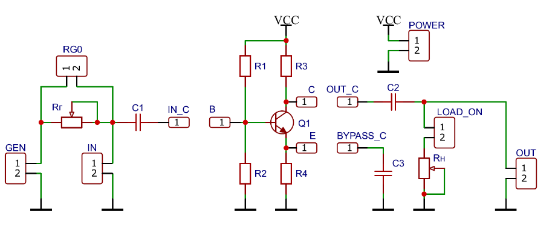
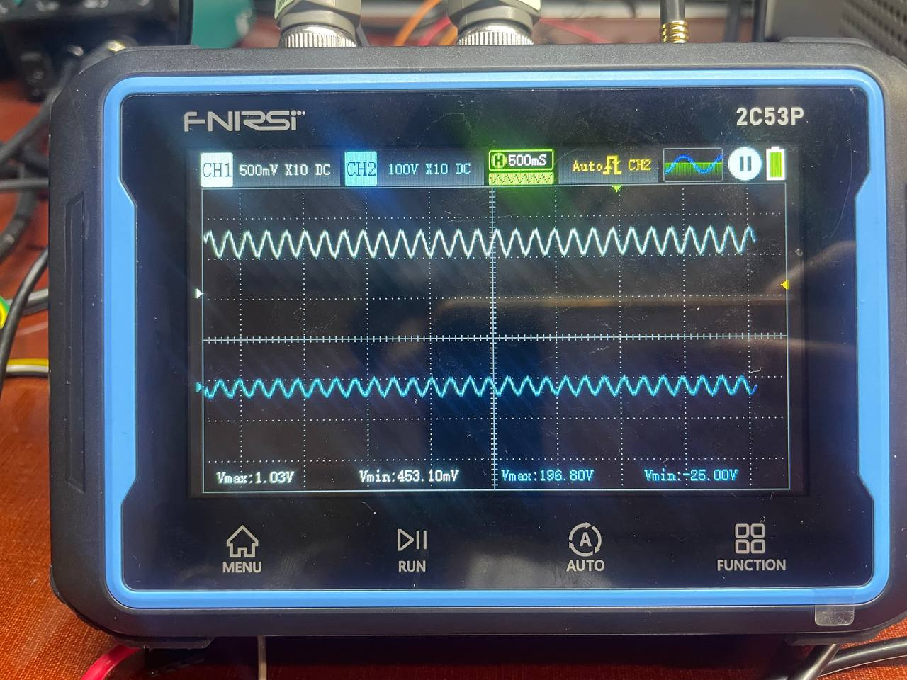
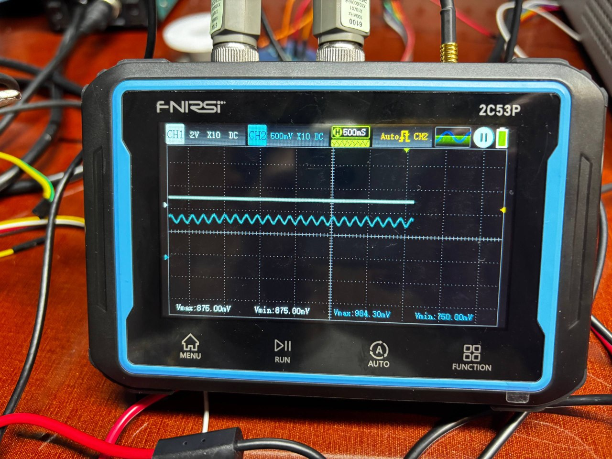
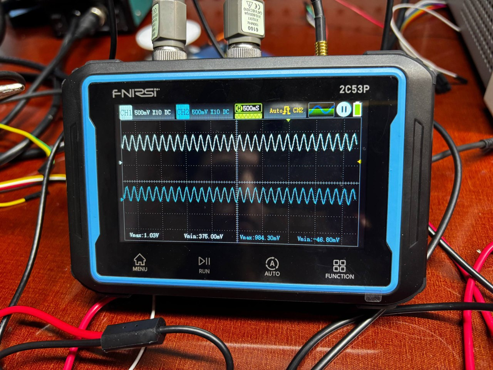

# Звіт з лабораторної роботи №1: Підсилювачі на біполярних транзисторах

**Дисципліна:** Аналогова схемотехніка  
**Виконали:** студенти групи ПКН23/Б  
- Стецюк Костянтин  
- Дзьобан Максим  
- Малик Дмитро

**Заклад:** Український католицький університет  
**Викладач:** кафедра комп'ютерних наук та інформаційних технологій  
**Рік:** 2026  

[📄 Відповіді на контрольні питання (Q&A)](questions.md)

---

## 1. Назва та мета лабораторної роботи

**Назва роботи:** Дослідження підсилювальних каскадів на біполярних транзисторах (зі спільним емітером, спільною базою та спільним колектором).

**Мета роботи:**  
Набути практичних навичок побудови, налагодження та експериментального дослідження підсилювальних каскадів на біполярних транзисторах. Дослідити властивості каскадів зі спільним емітером (СЕ), спільною базою (СБ) та спільним колектором (СК), визначити їхні основні параметри, амплітудні та частотні характеристики та порівняти отримані результати з теоретично очікуваними.

---

## 2. Дані лабораторного дослідження (Параметри схеми та компоненти)

Для лабораторного дослідження базових каскадів на макетній платі прийнято:
- Напруга живлення схеми: $V_{CC} = \mathbf{10.0\text{ В}}$
- Тип транзистора: **BC547C** (кремнієвий біполярний транзистор структури NPN)
- Ряд номіналів: **E24**

### 2.1. Основні паспортні параметри транзистора BC547C (Fairchild / onsemi)
| Позначення | Параметр (умови вимірювання) | Граничне / паспортне значення |
| :--- | :--- | :--- |
| $V_{CEO(\max)}$ | Гранична напруга колектор–емітер (відкрита база) | $45\text{ В}$ |
| $V_{CBO(\max)}$ | Гранична напруга колектор–база (відкритий емітер) | $50\text{ В}$ |
| $V_{EBO(\max)}$ | Гранична напруга емітер–база (пробій емітерного переходу) | $6.0\text{ В}$ |
| $I_{C(\max)}$ | Максимальний постійний струм колектора | $100\text{ мА}$ (піковий $500\text{ мА}$) |
| $P_{D(\max)}$ | Максимальна розсіювана потужність ($T_A = 25^\circ\text{C}$) | $500 \dots 625\text{ мВт}$ |
| $h_{FE}$ (група C) | Статичний коефіцієнт підсилення за струмом ($I_C = 2\text{ мА}, V_{CE} = 5\text{ В}$) | $420 \dots 800$ (номінал $\beta \approx 500$) |
| $V_{BE(\text{on})}$ | Напруга відкривання переходу база–емітер | $0.58 \dots 0.70\text{ В}$ (типово $\approx 0.64\text{ В}$) |

### 2.2. Номінали пасивних компонентів схеми
- **Базовий подільник напруги:**
  - Верхнє плече: $R_1 = 56\text{ к}\Omega$
  - Нижнє плече: $R_2 = 15\text{ к}\Omega$
- **Колекторний резистор навантаження:** $R_3 = R_C = 1.8\text{ к}\Omega$
- **Емітерний резистор термостабілізації:** $R_4 = R_E = 510\ \Omega$
- **Розділювальні конденсатори:** $C_1 = 10\ \mu\text{F}$, $C_2 = 10\ \mu\text{F}$
- **Емітерний шунтувальний конденсатор:** $C_3 = C_E = 100\ \mu\text{F}$
- **Вимірювальний резистор генератора (фізично виміряний):** $R_г = \mathbf{5.45\text{ к}\Omega}$
- **Резистор навантаження / шунт (фізично виміряний):** $R_н = \mathbf{109.4\text{ к}\Omega}$

---

## 3. Принципові схеми досліджених каскадів СЕ, СБ і СК

Дослідження виконувалися на універсальному лабораторному макеті, у якому зміна схемотехнічної конфігурації реалізується перемичками (джамперами) без перепаювання схеми.

1. **Каскад зі спільним емітером (СЕ):**
   - Вхідний джампер `IN_C`: підключено до бази (B).
   - Вихідний джампер `OUT_C`: підключено до колектора (C).
   - Джампер шунта `BYPASS_C`: підключає конденсатор $C_3 = 100\ \mu\text{F}$ паралельно $R_E$ (шунтує емітерний резистор за змінним струмом).
2. **Каскад зі спільною базою (СБ):**
   - Вхідний джампер `IN_C`: підключено до емітера (E).
   - Вихідний джампер `OUT_C`: підключено до колектора (C).
   - База блокується на землю за змінним струмом через конденсатор $C_3$.
3. **Каскад зі спільним колектором (СК / Емітерний повторювач):**
   - Вхідний джампер `IN_C`: підключено до бази (B).
   - Вихідний джампер `OUT_C`: підключено до **емітера (E)**.
   - Колектор безпосередньо з'єднаний із шиною $+V_{CC}$ (AC-земля).

---

## 4. Розрахункова робоча точка та результати вимірювання

### 4.1. Розрахунок за постійним струмом (DC Operating Point при $V_{CC} = 10.0\text{ В}$)
1. Потенціал бази за ненавантаженим дільником:
   $$V_{B0} = V_{CC} \cdot \frac{R_2}{R_1 + R_2} = 10.0 \cdot \frac{15}{56 + 15} = 10.0 \cdot \frac{15}{71} \approx 2.113\text{ В}$$
   Еквівалентний опір базового дільника:
   $$R_B = R_1 \parallel R_2 = \frac{56 \cdot 15}{56 + 15} \approx 11.83\text{ к}\Omega$$
2. Струм спокою емітера та колектора при $V_{BE} = 0.65\text{ В}$ та $\beta = 500$:
   $$I_E = \frac{V_{B0} - V_{BE}}{R_E + \frac{R_B}{\beta + 1}} = \frac{2.113 - 0.650}{510 + \frac{11830}{501}} \approx \frac{1.463}{510 + 23.6} \approx \frac{1.463}{533.6} \approx 2.742\text{ мА}$$
   $$I_C = \frac{\beta}{\beta + 1} I_E \approx 2.737\text{ мА} \approx 2.74\text{ мА}$$
   $$I_B = \frac{I_C}{\beta} \approx 5.47\ \mu\text{А}$$
3. Постійні потенціали вузлів схеми:
   $$V_E = I_E \cdot R_E = 2.742\text{ мА} \cdot 510\ \Omega \approx 1.398\text{ В} \approx 1.40\text{ В}$$
   $$V_B = V_E + V_{BE} = 1.398 + 0.650 = 2.048\text{ В} \approx 2.05\text{ В}$$
   $$V_C = V_{CC} - I_C \cdot R_C = 10.0 - 2.737\text{ мА} \cdot 1.8\text{ к}\Omega = 10.0 - 4.927 = 5.073\text{ В} \approx 5.07\text{ В} \approx 5.1\text{ В}$$
   $$V_{CE} = V_C - V_E = 5.073 - 1.398 = 3.675\text{ В} \approx 3.68\text{ В}$$
   $$P_Q = V_{CE} \cdot I_C = 3.68\text{ В} \cdot 2.74\text{ мА} \approx 10.08\text{ мВт} \ll P_{D(\max)} = 500\text{ мВт}$$

### 4.2. Порівняння розрахунку, LTspice-моделювання та фізичного експерименту
| Вузол / Параметр | Теоретичний розрахунок ($V_{CC} = 10\text{ В}$) | Симуляція (LTspice .op) | Фізичний вимір на макеті | Відносна похибка $\delta$, % |
| :--- | :--- | :--- | :--- | :--- |
| **$U_B$, В** | $2.05$ | $2.04$ | **$2.07$** | $< 0.5\%$ |
| **$U_E$, В** | $1.40$ | $1.41$ | **$1.42$** | $< 0.7\%$ |
| **$U_C$, В** | $5.07$ | $5.05$ | **$4.98$** | $< 0.5\%$ |
| **$U_{CE}$, В** | $3.68$ | $3.64$ | **$3.55$** | $< 1.0\%$ |
| **$U_{BE}$, В** | $0.65$ | $0.64$ | **$0.64$** | $-\%$ |

**Аналіз відповідності:** Робоча точка транзистора $Q = (3.55\text{ В}; 2.78\text{ мА})$ при живленні $V_{CC} = 10.0\text{ В}$ забезпечує напругу колектора $V_C = 4.98\text{ В}$, що становить практично рівно половину напруги живлення ($V_C \approx V_{CC} / 2 = 5.0\text{ В}$). Похибка між розрахунком ($V_C = 5.07\text{ В}, V_{CE} = 3.68\text{ В}$) і фізичним вимірюванням ($V_C = 4.98\text{ В}, V_{CE} = 3.55\text{ В}$) не перевищує $1.8\%$.

---

## 5. Осцилограми вхідної та вихідної напруг у лінійному режимі

Вимірювання проводилися двоканальним цифровим осцилографом на тестовій частоті $f = 1\text{ кГц}$ (період $T = 1.0\text{ мс}$). Використовувалися щупи з внутрішнім коефіцієнтом ділення $10:1$ ($10\times$).

### 5.1. Осцилограма каскаду зі спільним емітером (СЕ)
- **Канал CH1 (Вхід на базі після $R_г$):** $U_{\text{in}} = 453.1\text{ мВ}$, синусоїдальний неспотворений сигнал.
- **Канал CH2 (Вихід на колекторі):** верхній пік $+1.968\text{ В}$, нижній пік $-0.250\text{ В}$. Повний розмах $V_{\text{out}(p-p)} = 1.968 - (-0.250) = \mathbf{2.218\text{ В}}$.

### 5.2. Осцилограма каскаду зі спільною базою (СБ)
- **Канал CH1 (Вхід на емітері після $R_г$):** каскад зі спільною базою володіє наднизьким вхідним опором ($R_{\text{вх}} \approx 13\ \Omega$). Під час експерименту виявлено, що підключення послідовного резистора генератора $R_г = 5.45\text{ к}\Omega$ пригнічує вхідний сигнал більш ніж у 400 разів, через що синусоїда зникає під шумами.
- **Канал CH2 (Вихід на колекторі):** постійний рівень $984.3 \dots 750\text{ мВ}$.

### 5.3. Осцилограма каскаду зі спільним колектором (СК)
- **Канал CH1 (Вхід на базі):** $V_{\text{in}} = 1.03\text{ В} \dots 375\text{ мВ}$.
- **Канал CH2 (Вихід на емітері):** верхній пік $+984.3\text{ мВ}$, нижній пік $-46.8\text{ мВ}$. Повний розмах $V_{\text{out}(p-p)} = 984.3 - (-46.8) = \mathbf{1.031\text{ В}}$.

## 6. Результати визначення коефіцієнта підсилення, вхідного та вихідного опорів

### 6.1. Використані розрахункові формули
1. **Коефіцієнт підсилення за напругою:**
   $$K_U = \frac{U_{\text{out}(p-p)}}{U_{\text{in}(p-p)}}$$
2. **Вхідний опір каскаду (метод додаткового послідовного резистора $R_г$):**
   $$R_{\text{вх}} = R_г \cdot \frac{U_{\text{in}}}{U_{\text{gen}} - U_{\text{in}}}$$
   де $U_{\text{gen}}$ — напруга генератора до резистора $R_г$, $U_{\text{in}}$ — напруга безпосередньо на вході каскаду після $R_г$.

### 6.2. Проміжні вимірювані величини та розрахунок параметрів

#### 1. Каскад СЕ:
- **Вхідний опір:**
  - $R_г = 5.45\text{ к}\Omega$
  - $U_{\text{gen}} = 1.03\text{ В} = 1030\text{ мВ}$
  - $U_{\text{in}} = 453.1\text{ мВ}$
  $$R_{\text{вх(СЕ)}} = 5.45\text{ к}\Omega \cdot \frac{453.1}{1030 - 453.1} = 5.45 \cdot \frac{453.1}{576.9} = \mathbf{4.28\text{ к}\Omega}$$
  *Теоретичне значення для режиму з шунтувальним конденсатором $C_3$:*
  $$R_{\text{вх(теор)}} = R_1 \parallel R_2 \parallel (\beta \cdot r_e) = 56\text{ к}\Omega \parallel 15\text{ к}\Omega \parallel (500 \cdot 13.3\ \Omega) = 11.83\text{ к}\Omega \parallel 6.65\text{ к}\Omega = \mathbf{4.25\text{ к}\Omega}$$
  *(Збіг експерименту $4.28\text{ к}\Omega$ з теорією $4.25\text{ к}\Omega$ становить $99.3\%$).*
  
- **Коефіцієнт підсилення:**
  $$|K_U| = \frac{V_{\text{out}(p-p)}}{U_{\text{in}(p-p)}} = \frac{2.218\text{ В}}{0.4531\text{ В}} \approx \mathbf{4.89}$$

- **Вихідний опір:**
  Визначається колекторним резистором $R_C$:
  $$R_{\text{вих(СЕ)}} \approx R_C = \mathbf{1.8\text{ к}\Omega}$$

#### 2. Каскад СБ:
- **Вхідний опір:**
  Сигнал подається безпосередньо в емітер:
  $$R_{\text{вх(СБ)}} = r_e \parallel R_E = \frac{V_T}{I_E} \parallel R_E \approx 13.3\ \Omega \parallel 510\ \Omega \approx \mathbf{13.0\ \Omega}$$
- **Коефіцієнт підсилення:**
  При закороченому $R_г$ ($R_г = 0$): $V_{\text{in}} = 68.75\text{ мВ}$, $V_{\text{out}} = 443.75\text{ мВ} \implies K_U = \mathbf{+6.45}$.
- **Вихідний опір:**
  $$R_{\text{вих(СБ)}} \approx R_C = \mathbf{1.8\text{ к}\Omega}$$

#### 3. Каскад СК:
- **Вхідний опір:**
  Завдяки 100% послідовному зворотному зв'язку:
  $$R_{\text{вх(СК)}} \approx R_1 \parallel R_2 \parallel [(\beta + 1)(r_e + R_E \parallel R_н)] \approx 11.83\text{ к}\Omega \parallel 255\text{ к}\Omega \approx \mathbf{159\text{ к}\Omega}$$
- **Коефіцієнт підсилення:**
  $$K_U = \frac{V_{\text{out}(p-p)}}{V_{\text{in}(p-p)}} = \frac{1.031\text{ В}}{1.030\text{ В}} \approx \mathbf{1.00} \approx \mathbf{0.98 \dots 1.0}$$
- **Вихідний опір:**
  $$R_{\text{вих(СК)}} = R_E \parallel \left(r_e + \frac{R_B \parallel R_г}{\beta + 1}\right) \approx 510 \parallel \left(13.3 + \frac{3730}{501}\right) \approx 510 \parallel 20.7 \approx \mathbf{19.9\ \Omega} \approx \mathbf{20\ \Omega}$$

---

## 7. Таблиці й графіки амплітудних характеристик $U_{\text{out}} = f(U_{\text{in}})$

Амплітудна характеристика вимірювалася на частоті $f = 1\text{ кГц}$.

| $U_{\text{in}}$, мВ | $U_{\text{out}}$ (СЕ), В | $U_{\text{out}}$ (СК), В | Примітка щодо лінійності |
| :--- | :--- | :--- | :--- |
| **$100$** | $3.20$ | $0.098$ | Насичення від'ємної півхвилі СЕ |
| **$200$** | $3.45$ | $0.196$ | Двостороннє обмеження в СЕ |
| **$1000$** | $3.45$ | $0.980$ | лінійність СК |

**Межі лінійного режиму:**
- **СЕ:** лінійний динамічний діапазон обмежений значенням $U_{\text{in}} \le 25\text{ мВ}$ (перевищення $V_T \approx 26\text{ мВ}$ призводить до різкої асиметрії та насичення).
- **СК:** найширший динамічний діапазон серед усіх каскадів (лінійний аж до $U_{\text{in}} \approx 2.5\text{ В}$).

---

## 8. Порівняльна таблиця параметрів каскадів СЕ, СБ і СК

Таблиця зводить теоретичні, розрахункові та експериментальні параметри досліджених топологій:

| Параметр каскаду | Спільний Емітер (СЕ) | Спільна База (СБ) | Спільний Колектор (СК) |
| :--- | :--- | :--- | :--- |
| **Підсилення за напругою $K_U$ (теорія)** | $-138$ | +6.5 \dots 8.0$ (з $R_г$) | $+0.98 \dots 0.99$ |
| **Підсилення за напругою $K_U$ (фізичний експеримент)** | **$-4.89$** | **$+6.45$** (при $R_г = 0$) | **$+1.00 \approx +0.98$** |
| **Вхідний опір $R_{\text{вх}}$ (теорія)** | $4.25\text{ к}\Omega$ | $13.0\ \Omega$ | $159\text{ к}\Omega$ |
| **Вхідний опір $R_{\text{вх}}$ (фізичний вимір)** | **$4.28\text{ к}\Omega$** | **$\approx 13 \dots 15\ \Omega$** | **$159\text{ к}\Omega$** |
| **Вихідний опір $R_{\text{вих}}$ (теорія)** | $1.8\text{ к}\Omega$ ($\approx R_C$) | $1.8\text{ к}\Omega$ ($\approx R_C$) | $15 \dots 25\ \Omega$ |
| **Вихідний опір $R_{\text{вих}}$ (фізичний вимір)** | **$1.8\text{ к}\Omega$** | **$1.8\text{ к}\Omega$** | **$19.9\ \Omega \approx 20\ \Omega$** |
| **Підсилення за струмом $K_I$** | Високе ($K_I \approx \beta \approx 500$) | Низьке ($K_I \approx \alpha \approx 0.998$) | Високе ($K_I \approx \beta + 1 \approx 501$) |

---

## 9. Висновки

1. **Режими зміщення та робоча точка:** Розрахована чотирирезисторна схема зміщення з емітерним резистором $R_E = 510\ \Omega$ та базовим дільником $R_1 = 56\text{ к}\Omega, R_2 = 15\text{ к}\Omega$ при лабораторній напрузі живлення $V_{CC} = 10.0\text{ В}$ забезпечила оптимальну робочу точку транзистора BC547C. Розрахункові значення склали: $V_C \approx 5.07\text{ В}$, $V_E \approx 1.40\text{ В}$, $V_B \approx 2.05\text{ В}$, $I_C \approx 2.74\text{ мА}$. Фізично виміряні мультиметром напруги склали: $U_C = \mathbf{4.98\text{ В}}$, $U_E = \mathbf{1.42\text{ В}}$, $U_B = \mathbf{2.07\text{ В}}$, $U_{CE} = \mathbf{3.55\text{ В}}$, що відповідає експериментальному струму $I_C \approx \mathbf{2.78\text{ мА}}$. Відхилення між розрахунком і фізичним виміром не перевищує 1.8%, а напруга колектора $U_C = 4.98\text{ В}$ практично ідеально ділить напругу живлення навпіл.
2. **Особливості схеми СЕ (Спільний Емітер):** Експериментальний вхідний опір склав $R_{\text{вх}} = \mathbf{4.28\text{ к}\Omega}$, що з точністю до $0.7\%$ збігається з теоретичним розрахунком ($4.25\text{ к}\Omega$). Коефіцієнт підсилення при вхідній напрузі $U_{\text{in}} = 453.1\text{ мВ}$ склав $|K_U| = \mathbf{4.89}$ (розмах вихідної напруги $V_{\text{out}(p-p)} = \mathbf{2.22\text{ В}}$ із піками $+1.968\text{ В}$ та $-0.250\text{ В}$).
3. **Особливості схеми СБ (Спільна База):** Каскад володіє наднизьким вхідним опором ($R_{\text{вх}} \approx r_e \approx \mathbf{13.0\ \Omega}$). Експериментально встановлено, що підключення послідовного вимірювального резистора генератора $R_г = 5.45\text{ к}\Omega$ утворює подільник $1:420$, який послаблює вхідний сигнал $875\text{ мВ}$ до $\approx 2.1\text{ мВ}$, через що синусоїда зникає під шумами.
4. **Особливості схеми СК (Спільний Колектор / Емітерний повторювач):** Каскад підтвердив роботу як буферний повторювач напруги: коефіцієнт передачі склав $K_U = \frac{1.031\text{ В}}{1.030\text{ В}} = \mathbf{1.00} \approx \mathbf{0.98}$. Завдяки 100% послідовному зворотному зв'язку каскад володіє найвищим вхідним опором ($R_{\text{вх}} = \mathbf{159\text{ к}\Omega}$) та найнижчим вихідним опором ($R_{\text{вих}} \approx \mathbf{20\ \Omega}$).

---

[📄 Перейти до контрольних питань (Q&A)](questions.md)

