# 📖 Лекція 6: Операційні підсилювачі. Макромоделі, параметри та схемотехніка сучасних ОП (на прикладі LM324)

> **Курс:** Аналогова схемотехніка  
> **Викладачі:** Євгеній Карплюк, к.т.н., Ганна Порєва, к.т.н. (КПІ ім. Ігоря Сікорського, ФЕЛ, Кафедра ЕІМБЕ, 2026)  
> **Розділ 3:** Високоточні перетворювачі електричних сигналів. Лінійні та нелінійні функціональні перетворювачі  
> **Тема 3.1:** Операційні підсилювачі  
> **Попередній матеріал:** [Лекція 5: Зворотні зв'язки у підсилювачах](../l5/index.md)  
> **Наступний матеріал:** [Лекція 7: Підсилювальні схеми на ОП нульового порядку](../l7/index.md)  
> **Шпаргалка:** [Шпаргалка до лекції 6 (Cheat Sheet)](cheat-sheet.md)  
> **Приклад розрахунку:** [🧮 Приклад розв'язання задачі (Example)](example.md)  
> **Задачі для напрацювання:** [🛠️ Практикум (10 задач)](tasks.md)  
> **Q&A:** [Запитання та Відповіді](questions.md)

---

## 📌 Навігація
- [1. Загальна характеристика та класифікація операційних підсилювачів](#1-загальна-характеристика-та-класифікація-операційних-підсилювачів)
  - [1.1 Фізична сутність, визначення та призначення ОП](#11-фізична-сутність-визначення-та-призначення-оп)
  - [1.2 Умовні графічні позначення: ЄСКД vs ANSI/IEEE](#12-умовні-графічні-позначення-єскд-vs-ansiieee)
  - [1.3 Класифікація сучасних інтегральних ОП](#13-класифікація-сучасних-інтегральних-оп)
- [2. Макромоделі та параметри операційних підсилювачів](#2-макромоделі-та-параметри-операційних-підсилювачів)
  - [2.1 Рівні моделювання: Ідеальний, Довершений та Реальний ОП](#21-рівні-моделювання-ідеальний-довершений-та-реальний-оп)
  - [2.2 Вузловий аналіз: макромодель у матриці провідностей](#22-вузловий-аналіз-макромодель-у-матриці-провідностей)
  - [2.3 «Золоті правила» ОП з негативним зворотним зв'язком](#23-золоті-правила-оп-з-негативним-зворотним-звязком)
  - [2.4 Базова схема: Повторювач напруги (Буфер)](#24-базова-схема-повторювач-напруги-буфер)
  - [2.5 Амплітудні характеристики та зони функціонування](#25-амплітудні-характеристики-та-зони-функціонування)
  - [2.6 Гранично допустимі режими безпечної роботи (Absolute Maximum Ratings)](#26-гранично-допустимі-режими-безпечної-роботи-absolute-maximum-ratings)
  - [2.7 Повна система параметрів ОП на прикладі LM324](#27-повна-система-параметрів-оп-на-прикладі-lm324)
  - [2.8 Частотні властивості: АЧХ, домінуючий полюс та швидкість наростання (Slew Rate)](#28-частотні-властивості-ачх-домінуючий-полюс-та-швидкість-наростання-slew-rate)
- [3. Схемотехніка сучасних операційних підсилювачів (на прикладі LM324)](#3-схемотехніка-сучасних-операційних-підсилювачів-на-прикладі-lm324)
  - [3.1 Класична трикаскадна архітектура інтегрального ОП](#31-класична-трикаскадна-архітектура-інтегрального-оп)
  - [3.2 Спрощена схемотехніка LM324: аналіз вузлів ДП, ПН та ПП](#32-спрощена-схемотехніка-lm324-аналіз-вузлів-дп-пн-та-пп)
  - [3.3 Повна принципова схема LM324 та схема струмового зміщення](#33-повна-принципова-схема-lm324-та-схема-струмового-зміщення)
- [📊 Зведена таблиця характеристик: Ідеальний vs LM324](#-зведена-таблиця-характеристик-ідеальний-vs-lm324)
- [❓ Питання для самоперевірки](#-питання-для-самоперевірки)

---

## 🎯 Мета та ключові питання лекції

1. **Що таке операційний підсилювач і чому він називається «операційним»?** Походження концепції від виконання математичних операцій над неперервними величинами в аналогових обчислювальних машинах (АХОМ / АОМ) до універсального будівельного блоку сучасної мікроелектроніки.
2. **Які існують рівні абстракції та схемні макромоделі ОП?** Відмінності між *довершеним* (скінченний коефіцієнт підсилення $\mu$), *ідеальним* ($K \to \infty$) та *реальним* ОП. Як макромодель інтегрується в матричні рівняння вузлового аналізу автоматизованого проектування (SPICE).
3. **Як працюють «Золоті правила» ОП у замкненому колі НЗЗ?** Фізична суть концепції віртуального замикання ($U_+ \approx U_-$) та відсутності вхідних струмів ($I_+ = I_- = 0$). Розрахунок базового повторювача напруги (буфера).
4. **Якими параметрами описується реальний ОП?** Детальний розбір статичних похибок ($V_{IO}$, дрейф $\Delta V_{IO}/\Delta T$, $I_{IB}$, $I_{IO}$), синфазних та живильних параметрів ($V_{ICR}$, $\text{CMRR}$, $\text{PSRR}$), динамічних обмежень (частота одиничного підсилення $GBW$, частотна АЧХ з домінуючим полюсом, швидкість наростання $\text{Slew Rate}$ та смуга повної потужності).
5. **Як влаштована внутрішня схемотехніка сучасного ОП на кристалі?** Деконструкція класичного чотириканального підсилювача загального призначення **LM324**: три каскади (диференційний підсилювач на PNP Дарлінгтона, підсилювач напруги з міллерівською корекцією, двотактний підсилювач потужності класу B/AB із захистом від КЗ) та секрет роботи від однополярного живлення (Single Supply).

---

## 1. Загальна характеристика та класифікація операційних підсилювачів

### 1.1 Фізична сутність, визначення та призначення ОП

**Операційні підсилювачі (ОП / Operational Amplifiers, Op-Amps)** — це інтегральні лінійні підсилювачі напруги прямого струму (DC-coupled) з диференційним входом і, як правило, несиметричним одинарним виходом, що володіють надвисоким власним коефіцієнтом підсилення ($K_U \ge 10^5 \dots 10^7$).

> 💡 **Інтуїція: «Пластилін» аналогової електроніки**  
> Сам по собі ОП без зворотного зв'язку практично непридатний для лінійного підсилення, оскільки найменша різниця напруг на входах ($\pm 100\ \mu\text{V}$) миттєво заганяє його вихід у насичення до шини живлення.  
> Проте завдяки колосальному власному коефіцієнту підсилення та зовнішнім компонентам **негативного зворотного зв'язку (НЗЗ)** властивості підсумкової схеми повністю перестають залежати від транзисторів всередині мікросхеми. Вони визначаються **виключно коефіцієнтом передачі зовнішнього зворотного зв'язку $\chi$** (формула Блека):
> $$K_{\text{нзз}} = \frac{K}{1 + K\chi} \xrightarrow{K \to \infty} \frac{1}{\chi}$$
> Змінюючи пасивні елементи в петлі НЗЗ (резистори, конденсатори, діоди), один і той самий підсилювач змушують виконувати точне масштабування, додавання, віднімання, інтегрування, диференціювання або логарифмування сигналів. Саме ця універсальність математичних перетворень і дала назву пристрою.

Основні функції сучасних ОП:
* Масштабування, нормування та фільтрація аналогових сигналів від датчиків.
* Перетворення сигналів: «струм-напруга» (TIA, трансімпедансні підсилювачі), «напруга-струм» (керовані джерела струму).
* Буферизація (ізоляція джерел із високим внутрішнім опором від низькоомного навантаження).
* Математичні операції над сигналами: алгебраїчне сумування, логарифмування, інтегрування, детектування піків.
* Побудова прецизійних активних $RC$-фільтрів будь-яких порядків (Баттерворта, Чебишова, Бесселя).

---

### 1.2 Умовні графічні позначення: ЄСКД vs ANSI/IEEE

Операційний підсилювач є багатополюсним пристроєм. Базова конфігурація містить щонайменше 5 виводів:
1. **Неінвертуючий вхід ($+$, $IN+$ або $V_+$):** Сигнал, поданий сюди, передається на вихід у тій самій фазі (без інверсії).
2. **Інвертуючий вхід ($-$, $IN-$ або $V_-$):** Сигнал, поданий сюди, передається на вихід у протифазі (зсув фази на $180^\circ$).
3. **Вихід ($OUT$):** Одинарний вихід підсиленої напруги.
4. **Виводи живлення ($+V_{CC} / +E_1$ та $-V_{EE} / -E_2$ або $GND$):** Шини позитивного та негативного живлення.

```
       Стандарт ЄСКД (ДСТУ)                  Міжнародний стандарт (ANSI/IEEE)
        ┌─────────┬───┬─────────┐                           +V_CC
  - In ─┤o        │   │         │                             │
        │         ├───┤     Out │                    - In ────\
  + In ─┤         │   ├─────────┼─ Out                        │ \
        └─────────┤   │         │                    + In ────│  >──── Out
                  ├───┤         │                             │ /
                  │+E1│         │                             │/
                  ├───┤         │                             │
                  │-E2│         │                           -V_EE
                  └───┴─────────┘
```

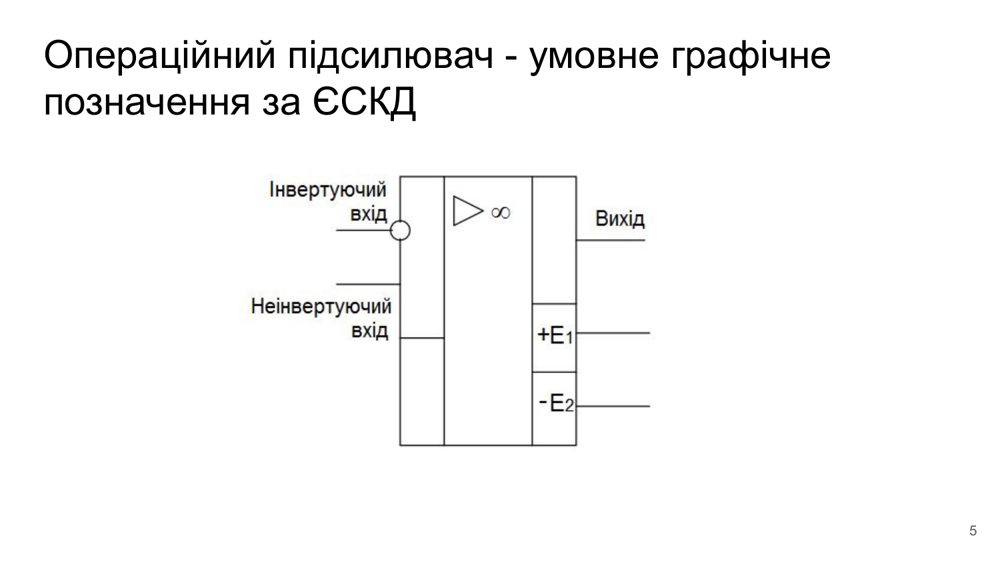

* **За стандартом ЄСКД (ДСТУ):** Підсилювач зображується прямокутником, поділеним на функційні поля. Інвертуючий вхід позначається кружечком на лінії зв'язку. У центральному полі розміщується символ підсилення $\triangleright$ та знак $\infty$ (нескінченний коефіцієнт підсилення).
* **За стандартом ANSI/IEEE/IEC:** Зображується трикутником, спрямованим вістрям у бік поширення сигналу. Входи позначаються математичними знаками «$+$» та «$-$».

---

### 1.3 Класифікація сучасних інтегральних ОП

Різноманіття сфер застосування спричинило спеціалізацію архітектур ОП:

| Клас ОП | Ключові характеристики | Фізична реалізація / Стек | Типові представники | Області застосування |
| :--- | :--- | :--- | :--- | :--- |
| **Універсальні (*General Purpose*)** | Баланс ціни та характеристик. $K_U \approx 10^5$, $GBW \approx 1\dots 3$ МГц, $V_{IO} \approx 1\dots 5$ мВ. Найдешевші на ринку. | BJT або BiCMOS технологія. | LM324 (4 канали), LM358 (2 канали), $\mu$A741, TL084 | Масова побутова та промислова автоматика, некритичні вузли. |
| **Мікропотужні (*Micropower / Nano-power*)** | Наднизький струм спокою ($I_{CC} < 10\dots 50\ \mu\text{A}$), робота від напруги батареї ($1.8\dots 3.3$ В). Статична потужність $< 1$ мВт. | КМОН (CMOS) архітектура субпорогового режиму. | LPV811 ($I_{CC} = 450$ нА), MCP6041, MAX4464 | Носимі медичні прилади, датчики IoT, автономні батарейні трекери. |
| **Прецизійні (*Precision*)** | Наднизька напруга зміщення ($V_{IO} < 10\dots 50\ \mu\text{V}$), мінімальний температурний дрейф ($< 0.5\dots 1\ \mu\text{V}/^\circ\text{C}$), високий CMRR ($> 120$ дБ). | Лазерна підгонка резисторів або автонульова модуляція (Chopper-stabilized). | OP07, OP27, ADA4077, LTC2050 (чопер) | Тензомостові ваги, термопари, геофізичні датчики, прецизійні інтегратори. |
| **З високим вхідним опором (*High Input Impedance*)** | Вхідний опір $R_{вх} > 10^{12}\ \Omega$ (1 ТОм), мікроскопічні вхідні струми баз/затворів ($I_{IB} < 1\dots 50$ пА). | Вхідний диференційний каскад на **JFET** або **MOSFET** транзисторах. | TL071/TL081 (JFET), LF356, OPA340, LMC6482 (CMOS) | Електрометричні підсилювачі, pH-метри, датчики іонізуючого випромінювання, фотодіодні TIA. |
| **Високошвидкісні (*High-Speed*)** | Велика швидкість наростання ($\text{Slew Rate} > 50\dots 2000$ В/мкс), малий час встановлення ($t_s < 50$ нс). | Комплементарні біполярні надшвидкі процеси (SiGe, Dielectric Isolation). | AD8001, LM6171, OPA656, THS3001 | Вибірка-зберігання (SHA), вхідні буфери швидких АЦП, відеоперетворювачі, драйвери лазерів. |
| **Широкосмугові (*Wideband*)** | Смуга пропускання одиничного підсилення $GBW > 50\dots 500$ МГц. | Каскодні підсилювачі або струмовий зворотний зв'язок (Current Feedback, CFA). | AD8055 ($GBW = 300$ МГц), OPA847 ($3.9$ ГГц), LMH6629 | ВЧ активні фільтри, ультразвукова діагностика, приймачі радіолокації. |
| **Високовольтні та потужні (*High Voltage / Power*)** | Напруги живлення $\pm 20\dots \pm 100$ В і вище, вихідний струм $I_{out} > 1\dots 10$ А. | Потужні гібридні або DMOS вихідні каскади з контролем кристала. | OPA541 (високовольтний), OPA549 (до 10 А), LM12 | Драйвери п'єзоактюаторів, електромагнітні клапани, підсилювачі потужності звуку. |
| **Rail-to-Rail (*RRIO*)** | Вхідні та вихідні напруги досягають безпосередньо шин живлення ($V_{EE}\dots V_{CC}$). | Спеціальна комбінація паралельних N- та P-канальних транзисторів на вході та виході. | AD8605, MCP6002, LMC6482 | Схеми з низьковольтним однополярним живленням $+3.3$ В або $+5$ В від мікроконтролерів. |

---

## 2. Макромоделі та параметри операційних підсилювачів

### 2.1 Рівні моделювання: Ідеальний, Довершений та Реальний ОП

В інженерній практиці використовують три рівні ієрархічного опису ОП:

```
        ІДЕАЛЬНИЙ ОП                      ДОВЕРШЕНИЙ ОП                      РЕАЛЬНИЙ ОП
   (Спрощений якісний розрахунок)     (Матричний вузловий аналіз)          (Фізична мікросхема)
      ┌───────────────┐                  ┌───────────────┐                  ┌───────────────┐
      │ K_U = ∞       │                  │ K_U = μ (скін.)│                 │ K_U ~ 10^5-10^7│
      │ R_вх = ∞      │                  │ R_вх = ∞      │                  │ R_вх: 1M-1TΩ  │
      │ R_вих = 0     │                  │ R_вих = 0     │                  │ R_вих: 10-100Ω│
      │ BW = ∞        │                  │ Джерело VCVS  │                  │ V_IO, I_IB ≠ 0│
      │ V_IO = 0      │                  │               │                  │ Slew Rate обм.│
      └───────────────┘                  └───────────────┘                  └───────────────┘
```

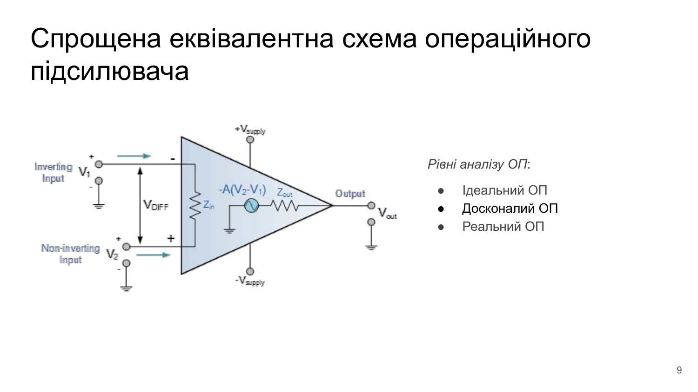

1. **Ідеальний ОП:**
   * Підсилення диференційного сигналу: $K_U = \infty$.
   * Вхідний імпеданс: $R_{вх} = \infty \implies I_+ = I_- = 0$.
   * Вихідний імпеданс: $R_{вих} = 0$ (незалежність вихідної напруги від навантаження).
   * Смуга пропускання: $BW = \infty$ (нескінченна швидкодія, відсутність фазових зсувів).
   * Придушення синфазної складової та живлення: $\text{CMRR} = \infty$, $\text{PSRR} = \infty$.
   * Напруга зміщення: $V_{IO} = 0$.

2. **Довершений ОП (*Perfect Op-Amp*):**
   * Вхідний та вихідний опори залишаються ідеальними ($R_{вх} = \infty$, $R_{вих} = 0$).
   * Проте коефіцієнт підсилення напруги $\mu$ вважається **скінченним числом** ($\mu < \infty$).
   * Це дозволяє оцінювати статичні методичні похибки передачі без ускладнення вузлових матриць.

3. **Реальний ОП:**
   * Враховує фізичні обмеження напівпровідникового кристала: розмах вихідної напруги обмежений живленням ($V_{OL}\dots V_{OH}$), скінченне підсилення ($10^5\dots 10^7$), частотний спад, струми витоку баз/затворів, паразитні зміщення та шум.

---

### 2.2 Вузловий аналіз: макромодель у матриці провідностей

Для розрахунку схем на ЕОМ методом вузлових напруг (MNA — Modified Nodal Analysis) операційний підсилювач подається макромоделлю у вигляді чотириполюсника з внутрішнім джерелом напруги, керованим напругою (VCVS).

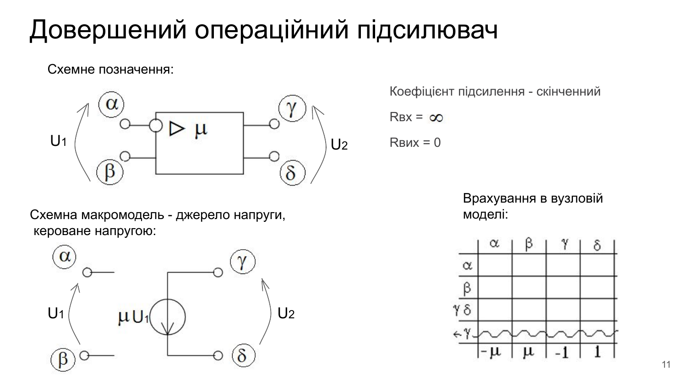
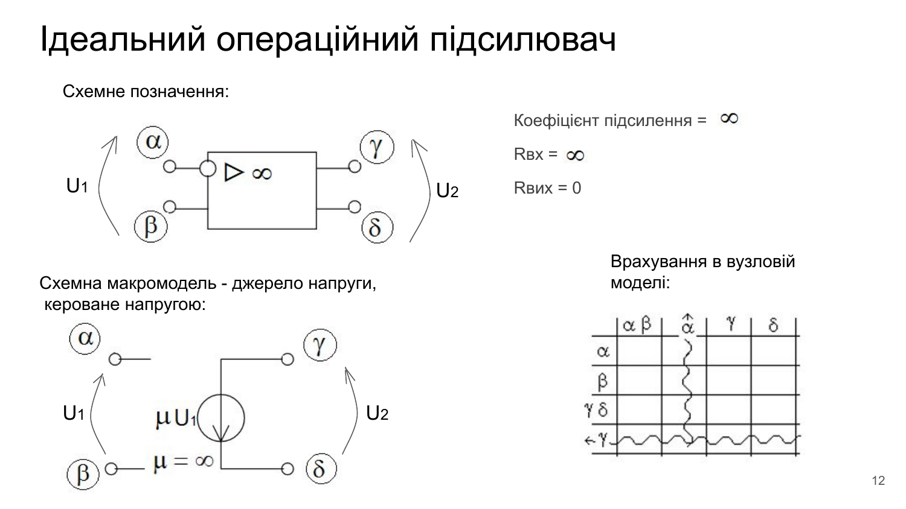

Позначимо вхідні вузли ОП як $\alpha$ (інвертуючий) та $\beta$ (неінвертуючий), а вихідні вузли як $\gamma$ та $\delta$.
Різниця напруг на вході:
$$U_1 = U_\beta - U_\alpha$$
Вихідна напруга, що генерується джерелом VCVS:
$$U_2 = U_\gamma - U_\delta = \mu U_1 = \mu (U_\beta - U_\alpha)$$

Запишемо це у вигляді лінійного алгебраїчного рівняння для вузлового вектора потенціалів:
$$-\mu U_\alpha + \mu U_\beta - U_\gamma + U_\delta = 0$$

У матриці вузлових провідностей для довершеного ОП цей зв'язок формує додатковий рядок:
```
         Вузол α     Вузол β     Вузол γ     Вузол δ
   ... [   ...         ...         ...         ...   ]
(γ-δ)  [   -μ           μ          -1           1    ] = 0
```

Якщо підсилювач є **ідеальним** ($\mu \to \infty$), розділимо весь рядок рівняння на $\mu$:
$$\lim_{\mu \to \infty} \left( -U_\alpha + U_\beta - \frac{1}{\mu} U_\gamma + \frac{1}{\mu} U_\delta \right) = 0 \implies U_\beta - U_\alpha = 0 \implies \mathbf{U_\alpha = U_\beta}$$

> 💡 **Висновок для САПР:**  
> В ідеальному ОП додаткове матричне рівняння вироджується в строгу рівність потенціалів вхідних вузлів: $U_\alpha = U_\beta$. Це математично доводить принцип віртуального замикання!

---

### 2.3 «Золоті правила» ОП з негативним зворотним зв'язком

У будь-якій лінійній схемі, де вихід операційного підсилювача з'єднаний з інвертуючим входом через пасивне коло НЗЗ, діють **два фундаментальні інженерні правила («Golden Rules»)**:

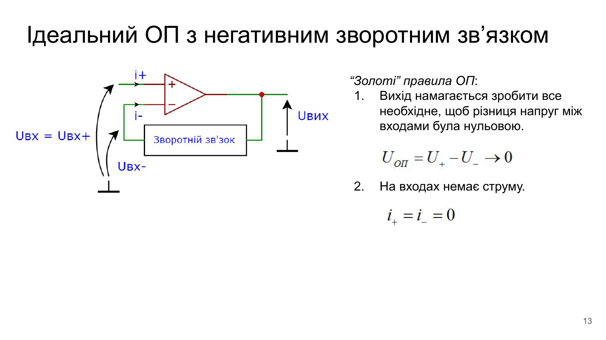


```
                       ┌──────────────────────┐
                       │   ЗОЛОТІ ПРАВИЛА     │
                       └──────────┬───────────┘
                 ┌────────────────┴────────────────┐
                 ▼                                 ▼
      ПРАВИЛО 1: ВІРТУАЛЬНЕ КЗ          ПРАВИЛО 2: ВХОДИ НЕ СПОЖИВАЮТЬ
             U_+ - U_- = 0                          i_+ = i_- = 0
         Вихід робить все можливе,          Вхідний опір нескінченний,
        щоб зрівняти напруги входів         струм у виводи ОП не затікає
```

1. **Золоте правило №1 (Віртуальне замикання / Virtual Short):**  
   *Петля негативного зворотного зв'язку змушує вихід ОП встановлювати таку напругу, щоб різниця потенціалів між неінвертуючим та інвертуючим входами прямувала до нуля:*
   $$U_{\text{оп}} = U_+ - U_- \to 0 \implies \mathbf{U_+ = U_-}$$
   * Якщо неінвертуючий вхід з'єднаний із землею ($U_+ = 0$), на інвертуючому вході утворюється **«віртуальна земля» (Virtual Ground)**: потенціал дорівнює нулю ($U_- = 0$), проте фізичного електричного замикання на землю немає!

2. **Золоте правило №2 (Відсутність вхідного струму):**  
   *Оскільки вхідний опір ідеального ОП нескінченний, електричний струм у вхідні клеми підсилювача не тече:*
   $$\mathbf{i_+ = 0, \quad i_- = 0}$$
   * Весь струм, що надходить до вхідного вузла від джерела сигналу через зовнішній резистор, повністю стікає у ланку зворотного зв'язку!

---

### 2.4 Базова схема: Повторювач напруги (Буфер)

Найпростішим і водночас фундаментальним застосуванням ОП є **повторювач напруги (Voltage Follower / Unity-Gain Buffer)**:

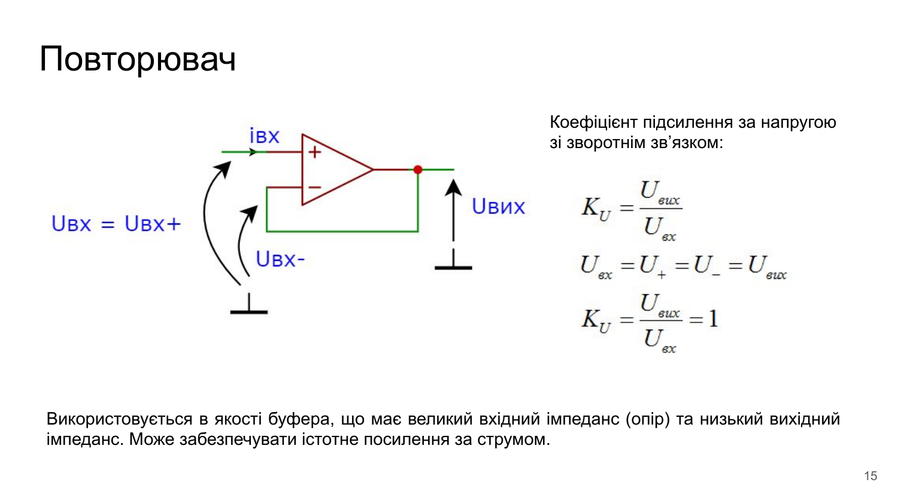

```text
               +V_CC
                 │
              ┌──┴──┐
    U_вх ────►│ +   │
              │     ├───────┬───────► U_вих
         ┌───►│ -   │       │
         │    └──┬──┘       │
         │       │          │
         │     -V_EE        │
         └──────────────────┘  (100% негативний зворотний зв'язок)
```

#### Математичний аналіз:
* Вихід з'єднаний безпосередньо з інвертуючим входом: коефіцієнт зворотного зв'язку $\chi = 1$.
* За Золотим правилом №1: $U_+ = U_-$.
* Оскільки $U_+ = U_{\text{вх}}$, а $U_- = U_{\text{вих}}$, маємо:
  $$U_{\text{вих}} = U_{\text{вх}}$$
* Коефіцієнт підсилення за напругою:
  $$\mathbf{K_U = \frac{U_{\text{вих}}}{U_{\text{вх}}} = 1}$$

#### Інженерна цінність буфера:
* **Вхідний опір:** завдяки глибокому послідовному НЗЗ за напругою вхідний опір зростає в петльове число разів:
  $$R_{\text{вх.буф}} = R_{\text{вх.диф}} \cdot (1 + K_U) \to \mathbf{\infty}$$
* **Вихідний опір:** вихідний опір знижується майже до нуля:
  $$R_{\text{вих.буф}} = \frac{R_{\text{вих}}}{1 + K_U} \to \mathbf{0}$$
* Повторювач не підсилює напругу, але забезпечує **величезне підсилення за струмом та потужністю**, запобігаючи «просіданню» сигналу при підключенні високоомних сенсорів до низькоомних навантажень.

---

### 2.5 Амплітудні характеристики та зони функціонування

Передавальна характеристика ОП без зворотного зв'язку описує залежність вихідної напруги $U_{\text{вих}}$ від диференційної вхідної напруги $U_{\text{вх.диф}} = U_+ - U_-$:

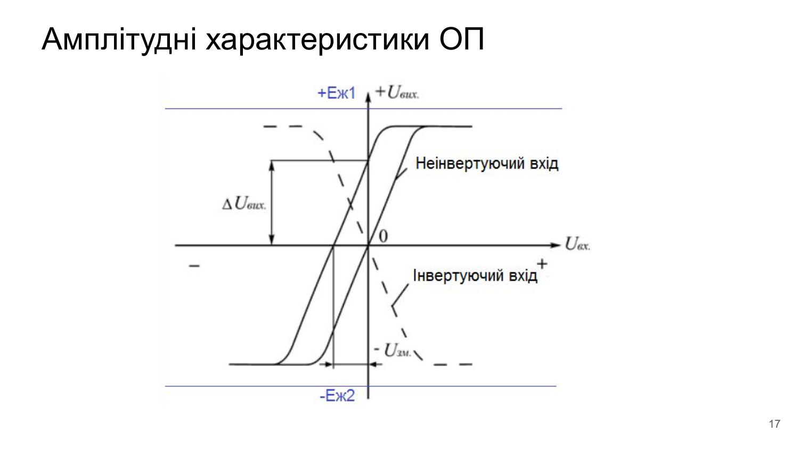

```text
         U_вих
           ▲
    +U_sat ┼───────────────────────           (Зона додатного насичення)
           │                    /
           │                   /  Нахил кривої: S = K_U (10^5...10^6)
           │                  /
     ──────┼─────────┬───────┼────────► U_вх.диф
           │        /│       │
           │       / │       │
           │      /  │       │
    -U_sat ┼─────'───┴───────┴─────           (Зона від'ємного насичення)
                     ▲
                 Зсув на V_IO (Input Offset Voltage)
```

#### Характерні області передавальної характеристики:
1. **Лінійна зона підсилення (Linear Region):**
   $$U_{\text{вих}} = K_U \cdot (U_+ - U_-) = K_U \cdot U_{\text{вх.диф}}$$
   Ширина лінійної зони надзвичайно мала:
   $$\Delta U_{\text{вх.лін}} = \frac{2 U_{\text{sat}}}{K_U} \approx \frac{2 \cdot 13\ \text{V}}{10^5} \approx \mathbf{260\ \mu\text{V}}$$
   Найменший сигнал понад $\pm 130\ \mu\text{V}$ виводить підсилювач без НЗЗ у стан компаратора.
2. **Зони додатного та від'ємного насичення (Saturation Regions):**
   * При $U_{\text{вх.диф}} > +\Delta U_{\text{вх.лін}}$ вихід фіксується на рівні $+U_{\text{вих.max}} \approx +V_{CC} - V_{\text{drop}}$.
   * При $U_{\text{вх.диф}} < -\Delta U_{\text{вх.лін}}$ вихід фіксується на рівні $-U_{\text{вих.max}} \approx -V_{EE} + V_{\text{drop}}$.
   * Для звичайних ОП (не Rail-to-Rail) залишкове падіння напруги $V_{\text{drop}} \approx 1.5\dots 2.0$ В зумовлене насиченням вихідних біполярних транзисторів.
3. **Зсув реальної характеристики (Вхідна напруга зміщення $V_{IO}$):**
   * Через технологічну асиметрію вхідної пари транзисторів крива зміщена відносно початку координат на величину $V_{IO}$ (кілька мілівольт). При нульовому диференційному вході вихід завжди звалюється в одне з насичень!

---

### 2.6 Гранично допустимі режими безпечної роботи (Absolute Maximum Ratings)

Перевищення цих меж призводить до незворотного фізичного пробою або термічної деградації кристала:

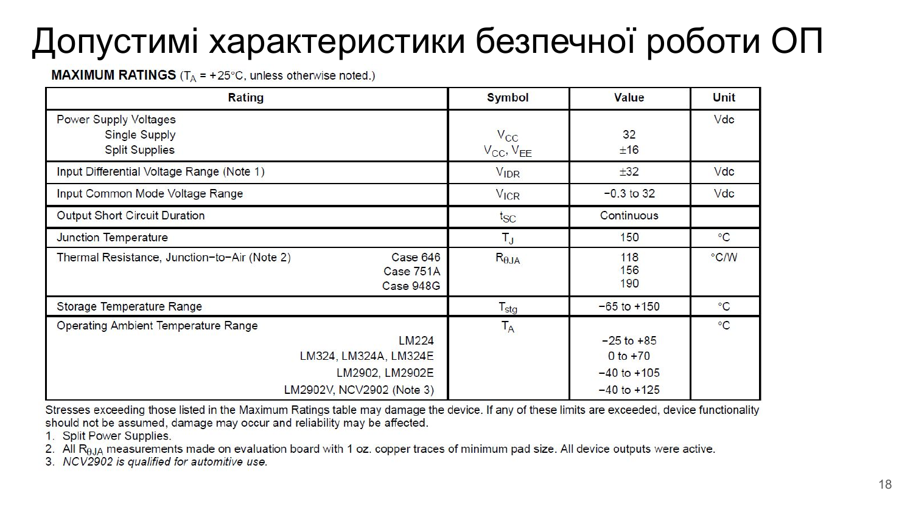

* **Напруга живлення ($V_{CC}, V_{EE}$):**
  * Однополярне живлення (*Single Supply*): до $32$ В.
  * Двополярне розщеплене живлення (*Split Supplies*): до $\pm 16$ В.
* **Діапазон вхідної диференційної напруги ($V_{IDR}$):**
  * Допустима різниця напруг між входами без захисних діодів: $\pm 32$ В (для LM324 завдяки вхідним PNP Darlington транзисторам напруга пробою переходу база-емітер не обмежує $V_{IDR}$).
* **Діапазон вхідної синфазної напруги ($V_{ICR}$):**
  * Від $-0.3$ В до $+32$ В. Дозволяє вхідному сигналу досягати потенціалу землі!
* **Тривалість короткого замикання виходу ($t_{SC}$):**
  * **Continuous (Неперервно)** — внутрішня схема захисту обмежує струм КЗ на безпечному рівні $\sim 40\dots 60$ мА, захищаючи кристал від перегорання при замиканні на GND або $V_{CC}$.
* **Температурні режими:**
  * Максимальна температура кристала (*Junction Temperature*): $T_J = +150^\circ\text{C}$.
  * Робочий температурний діапазон:
    * Комерційний (LM324): $0^\circ\text{C} \dots +70^\circ\text{C}$.
    * Індустріальний (LM224): $-25^\circ\text{C} \dots +85^\circ\text{C}$.
    * Автомобільний (LM2902 / NCV2902): $-40^\circ\text{C} \dots +125^\circ\text{C}$.

---

### 2.7 Повна система параметрів ОП на прикладі LM324

Параметри реального ОП поділяються на чотири взаємопов'язані групи:

#### 1. Статичні похибки зміщення на постійному струмі (DC Offset & Drifts):
* **Вхідна напруга зміщення ($V_{IO}$ / Input Offset Voltage):**
  * Диференційна постійна напруга, яку необхідно подати на вхід ОП, щоб на виході встановився точний нуль ($U_{\text{вих}} = 0$).
  * *Значення для LM324:* типово **$2.0$ мВ**, максимально **$7.0$ мВ** при $25^\circ\text{C}$.
* **Температурний коефіцієнт напруги зміщення ($\Delta V_{IO} / \Delta T$):**
  * Швидкість дрейфу $V_{IO}$ при зміні температури довкілля.
  * *Значення для LM324:* **$7.0\ \mu\text{V}/^\circ\text{C}$**.
* **Вхідний струм спокою / зміщення (Input Bias Current, $I_{IB}$):**
  * Постійний струм, необхідний для роботи базових (або затворних) переходів вхідного каскаду:
    $$I_{IB} = \frac{I_{B+} + I_{B-}}{2}$$
  * *Значення для LM324:* типово **$-45\dots -90$ нА**, максимум **$-250$ нА**. Знак «мінус» показує, що струм **витікає** з бази PNP транзистора.
* **Вхідний струм зсуву / різниця струмів (Input Offset Current, $I_{IO}$):**
  * Абсолютна різниця між двома вхідними струмами через технологічний розкид коефіцієнтів $\beta$ транзисторів:
    $$I_{IO} = |I_{B+} - I_{B-}|$$
  * *Значення для LM324:* типово **$5.0$ нА**, максимум **$50$ нА**.
* **Температурний дрейф струму зсуву ($\Delta I_{IO} / \Delta T$):**
  * *Значення для LM324:* типово **$10\ \text{pA}/^\circ\text{C}$**.

> 🔬 **Інженерний розрахунок резистивного балансування по постійному струму:**  
> Щоб мінімізувати вихідну похибку від вхідного струму спокою $I_{IB}$ в інвертуючому підсилювачі з резисторами $R_1$ та $R_2$, до неінвертуючого входу підключають балансувальний резистор $R_3$:
> $$R_3 = R_1 \parallel R_2 = \frac{R_1 R_2}{R_1 + R_2}$$
> У цьому випадку падіння напруги від однакових струмів $I_{IB}$ на обох входах взаємно компенсуються, і вихідна похибка визначається лише малим різницевим струмом $I_{IO} \ll I_{IB}$!

#### 2. Синфазні та живильні параметри:
* **Коефіцієнт послаблення синфазного сигналу (Common-Mode Rejection Ratio, $\text{CMRR}$):**
  * Здатність підсилювача підсилювати лише корисну різницю напруг і не реагувати на однакову напругу на обох входах:
    $$\text{CMRR} = 20 \lg \left| \frac{K_d}{K_{cm}} \right| = 20 \lg \left| \frac{\Delta V_{cm}}{\Delta V_{IO}} \right|$$
  * *Значення для LM324:* типово **$70\dots 85$ дБ** (придушення синфазної завади у $3000\dots 18000$ разів).
* **Коефіцієнт придушення пульсацій живлення (Power Supply Rejection Ratio, $\text{PSRR}$):**
  * Здатність ОП ігнорувати шуми та коливання живильної напруги:
    $$\text{PSRR} = 20 \lg \left| \frac{\Delta V_{\text{жив}}}{\Delta V_{IO}} \right|$$
  * *Значення для LM324:* типово **$65\dots 100$ дБ**.
* **Розділення каналів (Channel Separation / Crosstalk):**
  * Взаємне проникнення сигналів між 4 незалежними ОП на спільному кристалі LM324: типово **$-120$ дБ** на частотах до 20 кГц.

#### 3. Вихідні та енергетичні характеристики:
* **Підсилення великого сигналу на DC (Large-Signal Voltage Gain, $A_{VOL}$):**
  * *Значення для LM324:* типово **$100$ В/мВ** = **$100\,000$ (100 дБ)** при навантаженні $R_L = 2\ \text{k}\Omega$.
* **Розмах вихідної напруги ($V_{OH}, V_{OL}$):**
  * При однополярному живленні $+5$ В: верхня межа $V_{OH} = 3.5$ В ($V_{CC} - 1.5$ В); нижня межа $V_{OL} = 5\dots 20$ мВ (практично потенціал землі).
* **Вихідний струм навантаження:**
  * Струм джерела (*Source Current*, $I_{O+}$): типово **$40$ мА** (при $V_{ID} = +1$ В).
  * Струм споживача (*Sink Current*, $I_{O-}$): типово **$20$ мА** (при $V_{ID} = -1$ В).
* **Струм власного споживання ($I_{CC}$):**
  * Типово **$0.7$ мА** (максимум $1.2$ мА) на **весь корпус з чотирьох ОП** при $V_{CC} = 5$ В.

---

### 2.8 Частотні властивості: АЧХ, домінуючий полюс та швидкість наростання (Slew Rate)

Підсилення ОП з розімкненою петлею зворотного зв'язку ($A_{VOL}$) є сильно частотно-залежною величиною.

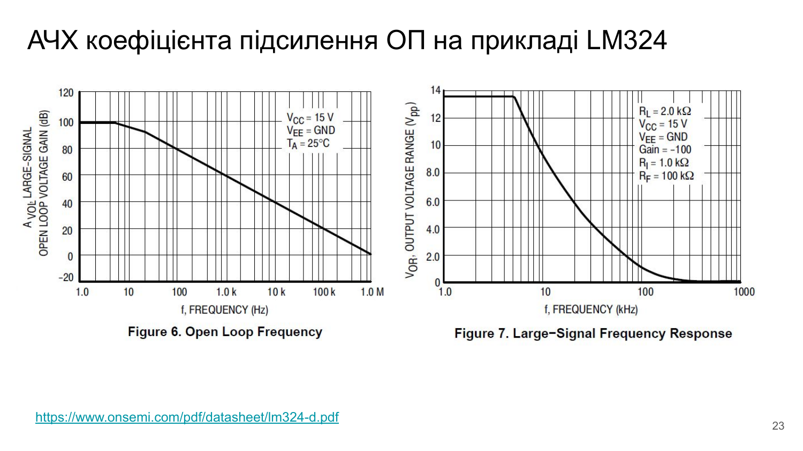

#### 1. Амплітудно-частотна характеристика (АЧХ) з домінуючим полюсом:
Для забезпечення абсолютної стійкості при будь-яких коефіцієнтах зворотного зв'язку (включно з найнебезпечнішим режимом повторювача $\chi = 1$) виробники інтегрують у схему коригуючий конденсатор $C_C$.
* На постійному струмі підсилення становить $A_0 \approx 100$ дБ ($10^5$).
* Перший **домінуючий полюс** штучно сформований на наднизькій частоті:
  $$f_p \approx \mathbf{10\ \text{Hz}}$$
* Починаючи з 10 Гц, підсилення монотонно спадає зі швидкістю **$-20$ дБ/декаду** ($-6$ дБ/октаву) за законом аперіодичної ланки 1-го порядку:
  $$A(jf) = \frac{A_0}{1 + j \frac{f}{f_p}}$$
* Лінія підсилення перетинає рівень 0 дБ ($A = 1$) на **частоті одиничного підсилення**:
  $$f_T = GBW = \mathbf{1.0\ \text{MHz}}$$

> 💡 **Закон збереження добутку підсилення на смугу (Gain-Bandwidth Product, GBW):**  
> Для підсилювача на ОП із замкненою петлею НЗЗ добуток коефіцієнта підсилення $K_{\text{нзз}}$ на смугу пропускання $f_в$ є постійною величиною:
> $$GBW = K_{\text{нзз}} \cdot f_в = \text{const} \approx 1\ \text{MHz}$$
> Якщо ми налаштуємо схему на підсилення $K_{\text{нзз}} = 100$ (40 дБ), її смуга пропускання становитиме лише $f_в = 1\ \text{MHz} / 100 = 10\ \text{kHz}$. Якщо потрібне підсилення $K_{\text{нзз}} = 1$ (буфер), смуга розширюється до повного $1\ \text{MHz}$.

#### 2. Швидкість наростання вихідної напруги (Slew Rate, SR):
При подачі на вхід великого стрибка напруги вихідний сигнал не може змінитися миттєво через обмежену швидкість перезаряджання внутрішнього коригуючого конденсатора $C_C$ струмом вхідного диференційного каскаду $I_{\text{tail}}$:

$$SR = \left. \frac{dU_{\text{вих}}}{dt} \right|_{\text{max}} = \frac{I_{\text{tail}}}{C_C}$$

Для LM324 внутрішній струм становить $I_{\text{tail}} \approx 4\dots 6\ \mu\text{A}$, а ємність $C_C = 5$ пФ:
$$SR \approx \frac{4\cdot 10^{-6}\ \text{A}}{5\cdot 10^{-12}\ \text{F}} \approx 0.8\ \frac{\text{V}}{\mu\text{s}} \quad (\text{номінально в даташиті } \mathbf{0.5\ \text{V}/\mu\text{s}})$$

#### 3. Смуга повної потужності (Power Bandwidth):
Швидкість наростання накладає жорстке обмеження на максимальну амплітуду гармонічного сигналу без появи трикутних спотворень.
Нехай $u_{\text{вих}}(t) = V_p \sin(2\pi f t)$. Максимальна швидкість зміни синусоїди при переході через нуль:
$$\left. \frac{du_{\text{вих}}}{dt} \right|_{\text{max}} = 2\pi f V_p \le SR$$

Звідси максимальна частота неспотвореного сигналу з амплітудою $V_p$:
$$\mathbf{f_{\text{max}} = \frac{SR}{2\pi V_p}}$$

*Приклад для LM324:* при повному розмаху $V_p = 10$ В максимальна частота складе лише:
$$f_{\text{max}} = \frac{0.5\cdot 10^6}{2\pi \cdot 10} \approx \mathbf{7.96\ \text{kHz}}$$
На частотах понад 8 кГц підсилювач не зможе видати повний розмах 10 В і перетворить синусоїду на трикутні імпульси меншої амплітуди!

---

## 3. Схемотехніка сучасних операційних підсилювачів (на прикладі LM324)

### 3.1 Класична трикаскадна архітектура інтегрального ОП

Більшість класичних аналогових інтегральних підсилювачів містять три функційні каскади:

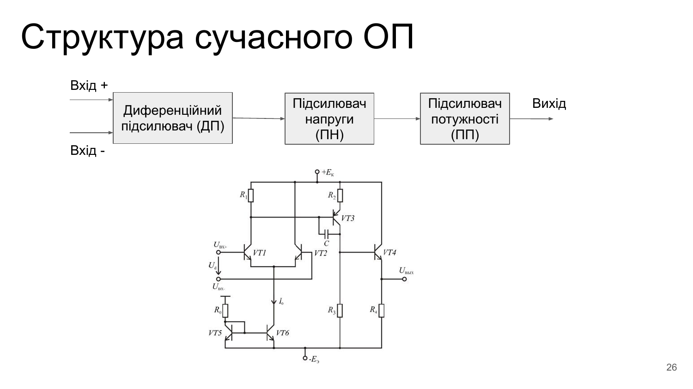

```
       Вхідний каскад:              Проміжний каскад:            Вихідний каскад:
    ДИФЕРЕНЦІЙНИЙ ПІДСИЛЮВАЧ       ПІДСИЛЮВАЧ НАПРУГИ          ПІДСИЛЮВАЧ ПОТУЖНОСТІ
             (ДП)                         (ПН)                         (ПП)
    ┌──────────────────────┐     ┌──────────────────────┐     ┌──────────────────────┐
IN+─┤ • Високий R_вх       │     │ • Основне підсилення │     │ • Низький R_вих      │
    │ • Придушення синфазної├────►│   за напругою (10^3) ├────►│ • Струмовий розгін   ├──OUT
IN-─┤   завади (CMRR)      │     │ • Корекція Міллера C_c     │ • Захист від КЗ      │
    └──────────────────────┘     └──────────────────────┘     └──────────────────────┘
```

1. **Диференційний підсилювач (ДП):**
   * Забезпечує диференційний вхід і перетворення різниці напруг у струм.
   * Має високий вхідний опір ($R_{\text{вх}}$), низький струм спокою баз ($I_{IB}$) та високий коефіцієнт придушення синфазної напруги ($\text{CMRR}$).
   * Використовує активне навантаження у вигляді струмового дзеркала для переходу від симетричної до несиметричної схеми.
2. **Підсилювач напруги (ПН):**
   * Забезпечує основний коефіцієнт підсилення схеми за напругою (понад $1000$).
   * Зазвичай побудований за схемою спільного емітера (СЕ) або спільного витоку (СВ) з активним навантаженням на генераторі стабільного струму (що дає динамічний опір навантаження у сотні кілоом).
   * Охоплений міллерівським конденсатором частотної корекції $C_C$.
3. **Підсилювач потужності (ПП / Буфер):**
   * Двотактний емітерний повторювач (клас AB або B).
   * Забезпечує низький вихідний опір ($R_{\text{вих}} \approx 10\dots 50\ \Omega$), достатню здатність віддавати струм у навантаження ($40$ мА) та містить транзисторний захист від КЗ.

---

### 3.2 Спрощена схемотехніка LM324: аналіз вузлів ДП, ПН та ПП

Розглянемо схемотехніку одного каналу популярного підсилювача LM324 за спрощеною схемою:

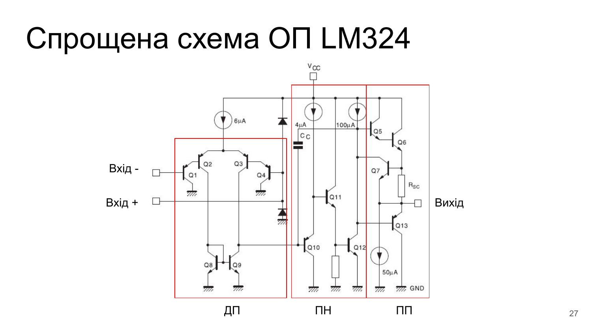

```text
                  +V_CC
                    │
            ┌───────┼──────────────────────────────┬────────────┐
            │       │                              │            │
            │     ┌─┴─┐                          ┌─┴─┐        ┌─┴─┐
            │     │ 4 │ 4 μA                     │100│ 100 μA │   │ Q5 (NPN)
            │     │μA │                          │μA │        │   │
            │     └─┬─┘                          └─┬─┘        └──┬┘
          ┌─┴─┐     │                              │             │
          │ 6 │ 6 μA│     ┌───────┐                │           ┌─┴─┐
          │μA │     ├─────┤ C_c   │                ├───────────┤   │ Q6 (NPN)
          └─┬─┘     │     │ 5.0 pF│                │           │   │
            │       │     └─┬─────┘                │           └──┬┘
       ┌────┴────┐  │       │                      │              │
       │         │  │       │                      │             ┌┴┐ R_sc
     ┌─┴─┐     ┌─┴─┐│       │                    ┌─┴─┐       Q7  │ │ 25 Ω
     │   │ Q2  │   ││Q3     │               Q11  │   │       ┌───┤ ├────┐
     │   │     │   ││       │               ┌────┤   │       │   └┬┘    │
     └─┬─┘     └─┬─┘│       │               │    │   │       │    │     │
  ┌────┼─────────┼──┘       │               │    └─┬─┘       │    │     ├──► ВИХІД
  │  ┌─┴─┐     ┌─┴─┐        │             ┌─┴─┐    │         │    │     │
  │  │   │ Q1  │   │ Q4     │        Q10  │   │    │         └───┬┴─────┤
IN-  │   │     │   │  IN+   │        ┌────┤   │    │             │      │
───► └─┬─┘     └─┬─┘ ◄──────┘        │    │   │    │           ┌─┴─┐    │
       │         │                   │    └─┬─┘    │       Q13 │   │    │
      GND       GND         ┌────────┘      │      │           │   │    │
       │         │          │              GND     │           └─┬─┘    │
     ┌─┴─┐     ┌─┴─┐        │                      │             │      │
     │   │ Q8  │   │ Q9     │                    ┌─┴─┐         ┌─┴─┐    │
     │   │     │   ├────────┴────────────────────┤   │ Q12     │50 │50μA│
     └─┬─┘     └─┬─┘                             │   │         │μA │    │
       │         │                               └─┬─┘         └─┬─┘    │
      GND       GND                               GND           GND    GND
   └─────────────────────────┘  └─────────────────────┘  └─────────────────┘
      1. ДИФЕРЕНЦІЙНИЙ ВХІД        2. ПІДСИЛЮВАЧ НАПРУГИ    3. ПІДСИЛЮВАЧ ПОТУЖНОСТІ
```

#### 1. Вхідний каскад ДП (Транзистори Q1–Q4, Q8, Q9):
* **Дарлінгтонівська PNP-структура (Q1–Q4):**
  * Вхідні сигнали подаються на бази PNP-транзисторів Q1 та Q4, увімкнених емітерними повторювачами.
  * Їхні емітери розгойдують емітери іншої пари PNP-транзисторів Q2, Q3 (каскад СЕ).
  * Колектори Q1 та Q4 підключені до підкладки (GND).
  * Струм «хвоста» $6\ \mu\text{A}$ надходить від внутрішнього стабілізатора.
* **Секрет роботи від нуля вольт (Ground-Sensing Input):**
  * У звичайних NPN-каскадах для відкриття транзистора на базу треба подати щонайменше $+0.6$ В відносно мінусової шини.
  * Для PNP-транзистора емітер має бути **більш позитивним, ніж база**: $V_E = V_B + V_{EB} \approx V_B + 0.6$ В.
  * Коли на вхід ($V_B$) подано $0$ В (земля) або навіть $-0.3$ В, емітери Q1, Q4 перебувають під потенціалом $+0.6$ В, що дозволяє струмам спокійно протікати, а транзисторам залишатися в активному лінійному режимі!
* **Активне навантаження — Струмове дзеркало (Q8, Q9):**
  * Транзистори NPN Q8 та Q9 утворюють струмове дзеркало в колекторах Q2 та Q3.
  * Колекторний струм Q2 транслюється дзеркалом у вузол бази Q10, забезпечуючи високий динамічний коефіцієнт підсилення та перехід від двох сигналів до одного несиметричного виходу ДП.

#### 2. Проміжний каскад ПН (Транзистори Q10, Q11, Q12):
* Складається з NPN транзистора Q10, з'єднаного з буферним транзистором Q11.
* Працює на активне навантаження (джерела стабільного струму $4\ \mu\text{A}$ та $100\ \mu\text{A}$).
* **Вбудований конденсатор $C_C = 5.0$ пФ:**
  * Увімкнений між виходом (колектором Q11) та входом (базою Q10) каскаду.
  * Завдяки ефекту Міллера його еквівалентна ємність на вході каскаду становить:
    $$C_{\text{in.eq}} = C_C \cdot (1 + |K_{U2}|) \approx 5\ \text{pF} \cdot 1000 \approx \mathbf{5000\ \text{pF}}$$
  * Ця величезна ємність утворює з вихідним опором ДП полюс на частоті $10$ Гц, що гарантує спад АЧХ до 0 дБ ще до появи фазового зсуву від інших паразитних ємностей (Pole Splitting).

#### 3. Вихідний каскад ПП (Транзистори Q5, Q6, Q7, Q13):
* **Верхнє плече (Витік струму / Source):**
  * Складений транзистор Дарлінгтона Q5 + Q6 (NPN). Здатний віддавати в навантаження до $40$ мА.
  * Мінімальне падіння напруги до шини живлення $V_{CC}$: складається з $V_{CE\text{sat}}(Q5) + V_{BE}(Q6) \approx 1.5$ В. Звідси випливає паспортне обмеження $V_{OH} \le V_{CC} - 1.5$ В.
* **Нижнє плече (Споживання струму / Sink):**
  * Одинарний NPN-транзистор Q13, база якого живиться струмом $50\ \mu\text{A}$.
  * Дозволяє притягувати вихід майже до самого потенціалу землі: $V_{OL} = V_{CE\text{sat}}(Q13) \approx 5\dots 20$ мВ.
* **Вузол захисту від короткого замикання (Q7, $R_{SC}$):**
  * Послідовно з емітером вихідного транзистора Q6 увімкнено резистор $R_{SC} = 25\ \Omega$.
  * База транзистора Q7 підключена до виходу, а емітер — до вихідного резистора.
  * Якщо струм через навантаження перевищує поріг:
    $$I_{\text{max}} \approx \frac{V_{BE}(Q7)}{R_{SC}} \approx \frac{0.6\ \text{V}}{25\ \Omega} \approx \mathbf{24\dots 40\ \text{mA}}$$
    Транзистор Q7 відкривається і відводить струм керування від бази драйвера Q5, обмежуючи вихідний струм і рятуючи мікросхему від вигорання!

---

### 3.3 Повна принципова схема LM324 та схема струмового зміщення

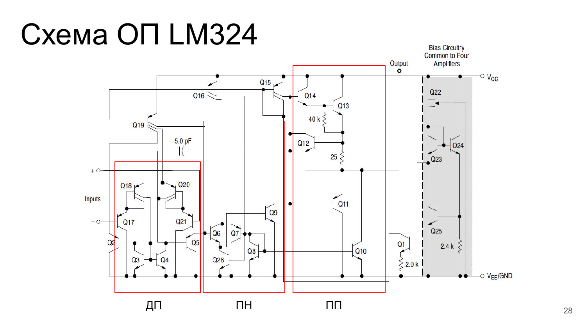

У правому кутку кристала розміщено спільний для всіх 4 підсилювачів **блок генератора опорного струму (Bias Circuitry)**:
* Складається з ланцюжка транзисторів Q22, Q23, Q24, Q25 та прецизійного резистора $2.4\ \text{k}\Omega$.
* Реалізує джерело струму Відлара з позитивним зворотним зв'язком, яке запускається при подачі напруги живлення від $+3$ В до $+32$ В.
* Струмові дзеркала транслюють стабільні мікроамперні струми зміщення (через багатоколекторні транзистори Q16, Q19) у кожен із чотирьох незалежних операційних підсилювачів мікросхеми.

---

## 📊 Зведена таблиця характеристик: Ідеальний vs LM324

| Параметр | Позначення | Ідеальний ОП | Реальний ОП (LM324) | Фізичне обмеження в кремнії |
| :--- | :---: | :---: | :---: | :--- |
| **Коефіцієнт підсилення (DC)** | $A_{VOL}$ | $\infty$ | $\sim 100\,000$ ($100$ дБ) | Обмежений вихідним динамічним опором каскадів $r_o$ |
| **Вхідний диференційний опір** | $R_{\text{вх}}$ | $\infty$ | $\sim 2\ \text{M}\Omega$ (BJT) | Скінченний опір переходів база-емітер вхідних транзисторів |
| **Вихідний опір (розімкнений)** | $R_{\text{вих}}$ | $0$ | $\sim 50\dots 100\ \Omega$ | Обмежений опором емітерів та резистором захисту $R_{SC}$ |
| **Вхідна напруга зміщення** | $V_{IO}$ | $0$ | $2\dots 7$ мВ | Технологічна неідентичність площ емітерів пари Q1/Q4 |
| **Температурний дрейф $V_{IO}$** | $\Delta V_{IO}/\Delta T$ | $0$ | $7\ \mu\text{V}/^\circ\text{C}$ | Різниця температурних коефіцієнтів $\Delta V_{BE}$ |
| **Вхідний струм зміщення (Bias)** | $I_{IB}$ | $0$ | $-45\dots -90$ нА | Струм бази вхідних PNP транзисторів для відкриття каналу |
| **Різниця вхідних струмів** | $I_{IO}$ | $0$ | $5\dots 50$ нА | Розкид коефіцієнтів підсилення за струмом $\beta_1 \neq \beta_4$ |
| **Синфазне придушення** | $\text{CMRR}$ | $\infty$ | $70\dots 85$ дБ | Скінченний внутрішній опір джерела струму в хвості ДП |
| **Придушення живлення** | $\text{PSRR}$ | $\infty$ | $65\dots 100$ дБ | Проникнення пульсацій через ємності колекторів на підкладку |
| **Смуга одиничного підсилення** | $GBW$ ($f_T$) | $\infty$ | $1.0$ МГц | Внутрішній коригуючий конденсатор Міллера $C_C = 5$ пФ |
| **Швидкість наростання** | $SR$ | $\infty$ | $0.5$ В/мкс | Швидкість перезаряджання ємності $C_C$ струмом $I_{\text{tail}}$ |
| **Розмах вихідної напруги** | $V_{out}$ | Від $-V_{EE}$ до $+V_{CC}$ | $0.02\dots (V_{CC} - 1.5)$ В | Падіння $V_{CE\text{sat}} + V_{BE}$ на вихідних транзисторах |
| **Струм власного споживання** | $I_{CC}$ | $0$ | $0.7$ мА (на 4 ОП) | Струм через внутрішні дзеркала та каскади зміщення |

---

## ❓ Питання для самоперевірки

1. **Чому операційний підсилювач називається «операційним» і в чому полягає фундаментальна відмінність його застосування порівняно зі звичайними транзисторними каскадами?**
2. **Сформулюйте два «Золоті правила» ідеального ОП. За якої обов'язкової умови схемотехнічного підключення ці правила діють?**
3. **Чому в повторювачі напруги (буфері) коефіцієнт передачі дорівнює одиниці, а вхідний опір зростає в сотні тисяч разів?**
4. **У чому полягає схемотехнічна причина того, що LM324 може працювати з сигналами рівня «землі» ($0$ В) при однополярному живленні?**
5. **Що обмежує смугу пропускання ОП на великих сигналах (Large Signal Response) і чим це обмеження фізично відрізняється від спаду АЧХ на малих сигналах?**
6. **Яку роль відіграє внутрішній конденсатор $C_C = 5.0$ пФ в LM324 і чому без нього підсилювач міг би самозбуджуватися при увімкненні буфером?**

---

[⬅️ Попередня лекція](../l5/index.md) | [🏠 Головний зміст](../../../README.md) | [⚡ Відкрити Cheat Sheet](cheat-sheet.md) | [🧮 Приклад розв'язання задачі](example.md) | [🛠️ Задачі для напрацювання](tasks.md) | [❓ Q&A](questions.md) | [Наступна лекція ➡️](../l7/index.md)

