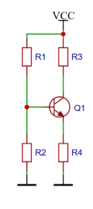

# 🔬 Лабораторна робота №1: Підсилювачі на біполярних транзисторах (BJT)

[🏠 Головний зміст](../../README.md) | [📖 Лекція 2: DC зміщення](../../lectures/l2/index.md) | [📖 Лекція 3: Базові каскади](../../lectures/l3/index.md)

---

## 1. Мета роботи
Набути практичних навичок побудови, налагодження та експериментального дослідження підсилювальних каскадів на біполярних транзисторах. Дослідити властивості каскадів зі спільним емітером (СЕ), спільною базою (СБ) та спільним колектором (СК), визначити їхні основні параметри, амплітудні та частотні характеристики та порівняти отримані результати з теоретично очікуваними.

---

## 2. Очікувані результати навчання
- Обґрунтовано вибрати робочу точку ($Q$-point) та розрахувати елементи кола зміщення біполярного транзистора за постійним струмом (DC);
- Збирати та налагоджувати підсилювальні каскади СЕ, СБ і СК на макетній платі;
- Виконувати вимірювання двоканальним осцилографом і визначати схемні функції каскадів підсилення ($K_U, R_{\text{вх}}, R_{\text{вих}}$);
- Знімати та аналізувати амплітудну характеристику і амплітудно-частотну характеристику (АЧХ) каскаду;
- Визначати межі лінійного режиму, динамічний діапазон, граничні частоти ($f_н, f_в$) та смугу пропускання ($B$);
- Аналізувати властивості базових схем ввімкнення біполярного транзистора та формулювати інженерні висновки.

---

## 3. Обладнання та компоненти
- Макетна плата під пайку (або безпайкова Breadboard), монтажні перемички, конектори BNC/RCA;
- Біполярний $n-p-n$ транзистор: **BC547C**;
- Резистори ряду **E24** ($0.25\text{ Вт}$) та електролітичні/керамічні конденсатори;
- Лабораторне джерело постійної напруги з обмеженням струму ($V_{CC} = 8\text{ В}$);
- Генератор гармонічних сигналів ($10\text{ Гц} \dots 1\text{ МГц}$);
- Двоканальний цифровий осцилограф із щупами-дільниками $1\times / 10\times$;
- Цифровий мультиметр (DMM) для вимірювання постійних напруг і опорів.

---

## 4. Теоретичні розрахунки та вибір елементів схеми зміщення

```text
                           +V_CC (+8 В)
                                │
                   ┌────────────┴────────────┐
                   │                         │
                  ┌┴┐                       ┌┴┐
               R1 │ │                    R3 │ │ (R_C)
                  └┬┘                       └┬┘
                   │       I_B               │       I_C
                   ├────────────────┬────────┼────────────► V_C (V_CEQ)
                   │                │     ┌──┴──┐
                  ┌┴┐               └─────┤ Q1  │ BC547C
               R2 │ │                     └──┬──┘
                  └┬┘                        │ I_E
                   │                        ┌┴┐
                   │                     R4 │ │ (R_E)
                   │                        └┬┘
                   └────────────┬────────────┘
                                │
                               ─┴─ GND (0 В)
```



---

### 4.1. Вихідні паспортні дані транзистора BC547C
* **Тип провідності:** $NPN$, кремнієвий (Si);
* **Напруга живлення:** $V_{CC} = 8.0\text{ В}$;
* **Максимальна напруга колектор-емітер:** $V_{CEO} = 45\text{ В}$;
* **Максимальна напруга емітер-база:** $V_{EBO} = 6.0\text{ В} \implies V_{BE(\text{rev})} = -6.0\text{ В}$;
* **Максимальний постійний струм колектора:** $I_{C(\text{max})} = 100\text{ мА}$;
* **Максимальна потужність розсіювання:** $P_{D(\text{max})} = 625\text{ мВт}$ (при $T_A = 25^\circ\text{C}$);
* **Коефіцієнт підсилення струму бази (типовий для групи C):** $h_{FE} = \beta = 600$ (діапазон групи C: $420 \dots 800$);
* **Падіння напруги на відкритому переході база-емітер:** $V_{BEQ} \approx 0.65\text{ В} \dots 0.70\text{ В}$ (приймаємо $V_{BEQ} = 0.65\text{ В}$);
* **Температурний потенціал на $T = 25^\circ\text{C}$:** $\varphi_T = \frac{k T}{q} \approx 25.86\text{ мВ} \approx 26\text{ мВ}$.

---

### 4.2. Обґрунтування та вибір робочої точки (Quiescent Point, $Q$)

Робоча точка $Q = (V_{CEQ}, I_{CQ})$ обирається в центрі лінійної активної області ВАХ для забезпечення **максимального симетричного розмаху вихідної напруги без спотворень (Maximum Undistorted Voltage Swing)**:

1. **Напруга спокою колектор-емітер ($V_{CEQ}$):**
   $$V_{CEQ} \approx \frac{V_{CC}}{2} = \frac{8\text{ В}}{2} = 4.0\text{ В}$$

2. **Обмеження струму спокою за потужністю та $I_{C(\text{max})}$:**
   $$P_Q = V_{CEQ} \cdot I_{CQ} \le P_{D(\text{max})} = 625\text{ мВт}$$
   $$I_{CQ} \le \frac{P_{D(\text{max})}}{V_{CEQ}} = \frac{625\text{ мВт}}{4.0\text{ В}} = 156.25\text{ мА}$$
   $$I_{CQ} \le \min(156.25\text{ мА}, 100\text{ мА}) = 100\text{ мА}$$

3. **Вибір струму спокою $I_{CQ}$:**
   Для малосигнальних передпідсилювачів на BJT струм колектора обирають у діапазоні $1\dots 5\text{ мА}$ для балансу між низьким внутрішнім опором $r_e$, низьким енергоспоживанням та малим власним шумом.
   **Обираємо:**
   $$\mathbf{I_{CQ} = 5.0\text{ мА}}$$

4. **Потужність розсіювання в робочій точці:**
   $$P_Q = 4.0\text{ В} \cdot 5.0\text{ мА} = 20.0\text{ мВт} \ll 625\text{ мВт}$$

5. **Перевірка умов безпечної роботи:**
   * $V_{CEQ} = 4.0\text{ В} < 45\text{ В}$ (запас більше $10\times$);
   * $I_{CQ} = 5.0\text{ мА} < 100\text{ мА}$ (запас $20\times$);
   * $P_Q = 20\text{ мВт} \ll 625\text{ мВт}$ (транзистор практично не нагрівається, $T_j \approx T_A$).

---

### 4.3. Розрахунок резисторів вихідного контуру ($R_3 = R_C$, $R_4 = R_E$)

Для забезпечення відмінної температурної стабільності робочої точки (компенсація температурного дрейфу $\Delta V_{BE} = -2\text{ мВ}/^\circ\text{C}$ та розкиду $h_{FE}$) на емітерному резисторі $R_4$ має падати $10\dots 15\%$ від напруги живлення $V_{CC}$:

1. **Падіння напруги на емітері ($V_E$):**
   $$V_{EQ} \approx 0.10 \cdot V_{CC} = 0.10 \cdot 8.0\text{ В} = \mathbf{0.80\text{ В}}$$
   *(Запас $V_{EQ} = 0.8\text{ В} \gg 25\text{ мВ}$ гарантує повну стабільність струму).*

2. **Розрахунок опору емітерного резистора $R_4$ ($R_E$):**
   Враховуючи, що $I_{EQ} = I_{CQ} + I_{BQ} \approx I_{CQ} = 5.0\text{ мА}$:
   $$R_4 = \frac{V_{EQ}}{I_{EQ}} = \frac{0.80\text{ В}}{5.0\text{ мА}} = 160\,\Omega$$
   *Найближчий стандартний номінал з ряду **E24**:*
   $$\mathbf{R_4 = 160\,\Omega}$$
   *(Уточнена напруга $V_{EQ} = 5\text{ мА} \cdot 160\,\Omega = 0.80\text{ В}$).*

3. **Розрахунок опору колекторного резистора $R_3$ ($R_C$):**
   За другим законом Кірхгофа для вихідного кола:
   $$V_{CC} = I_{CQ} R_3 + V_{CEQ} + V_{EQ}$$
   $$I_{CQ} R_3 = V_{CC} - V_{CEQ} - V_{EQ} = 8.0\text{ В} - 4.0\text{ В} - 0.8\text{ В} = 3.2\text{ В}$$
   $$R_3 = \frac{3.2\text{ В}}{I_{CQ}} = \frac{3.2\text{ В}}{5.0\text{ мА}} = 640\,\Omega$$
   *Найближчий стандартний номінал з ряду **E24**:*
   $$\mathbf{R_3 = 620\,\Omega} \quad (\text{або } 680\,\Omega)$$
   *(Приймаємо $R_3 = 620\,\Omega$. Тоді напруга на колекторі $V_C = V_{CC} - I_{CQ} R_3 = 8.0 - 5.0\text{ мА} \cdot 620\,\Omega = 4.90\text{ В}$, а $V_{CEQ} = 4.90 - 0.80 = 4.10\text{ В} \approx 4.0\text{ В}$).*

---

### 4.4. Розрахунок резистивного дільника бази ($R_1, R_2$)

1. **Струм спокою бази ($I_{BQ}$):**
   $$I_{BQ} = \frac{I_{CQ}}{h_{FE}} = \frac{5.0\text{ мА}}{600} \approx 8.333\,\mu\text{A} = 0.00833\text{ мА}$$

2. **Потенціал бази відносно землі ($V_B$):**
   $$V_{BQ} = V_{EQ} + V_{BEQ} = 0.80\text{ В} + 0.65\text{ В} = \mathbf{1.45\text{ В}}$$

3. **Струм дільника напруги ($I_{\text{діл}}$):**
   За інженерним правилом (Rule of Thumb) струм через дільник повинен бути щонайменше в $10\dots 15$ разів більшим за струм бази $I_{BQ}$, щоб базова напруга не просідала:
   $$I_{\text{діл}} = 10 \cdot I_{BQ} = 10 \cdot 8.333\,\mu\text{A} \approx 0.0833\text{ мА} = 83.33\,\mu\text{A}$$
   *(Для ще більшої жорсткості зафіксуємо $I_{\text{діл}} \approx 0.10\dots 0.15\text{ мА}$).*
   Приймемо струм нижнього плеча дільника $I_2 \approx 0.10\text{ мА} = 100\,\mu\text{A}$.

4. **Розрахунок резистора нижнього плеча $R_2$:**
   $$R_2 = \frac{V_{BQ}}{I_2} = \frac{1.45\text{ В}}{0.10\text{ мА}} = 14.5\text{ к}\Omega$$
   *Обираємо найближчий номінал з ряду **E24**:*
   $$\mathbf{R_2 = 15\text{ к}\Omega}$$
   *Уточнений струм через $R_2$:*
   $$I_2 = \frac{1.45\text{ В}}{15\text{ к}\Omega} \approx 96.67\,\mu\text{A}$$

5. **Розрахунок резистора верхнього плеча $R_1$:**
   Струм через верхній резистор:
   $$I_1 = I_2 + I_{BQ} = 96.67\,\mu\text{A} + 8.33\,\mu\text{A} = 105.0\,\mu\text{A} = 0.105\text{ мА}$$
   Падіння напруги на $R_1$:
   $$V_{R1} = V_{CC} - V_{BQ} = 8.0\text{ В} - 1.45\text{ В} = 6.55\text{ В}$$
   $$R_1 = \frac{V_{R1}}{I_1} = \frac{6.55\text{ В}}{0.105\text{ мА}} \approx 62.38\text{ к}\Omega$$
   *Обираємо найближчий номінал з ряду **E24**:*
   $$\mathbf{R_1 = 62\text{ к}\Omega}$$

6. **Перевірка еквівалентного опору Тевеніна дільника бази ($R_B$):**
   $$R_B = R_1 \parallel R_2 = \frac{62\text{ к}\Omega \cdot 15\text{ к}\Omega}{62\text{ к}\Omega + 15\text{ к}\Omega} = \frac{930}{77} \approx 12.08\text{ к}\Omega$$
   Критерій стабільності: $R_B \le 0.1 \cdot (1 + \beta) R_4$:
   $$0.1 \cdot 601 \cdot 160\,\Omega \approx 9.6\text{ к}\Omega \approx 12\text{ к}\Omega \quad (\text{умова виконується надійно}).$$

---

### 4.5. Зведена таблиця розрахованих номіналів компонентів

| Позначення на схемі | Функціональне призначення | Розраховане значення | Обраний номінал (ряд E24) |
| :---: | :--- | :---: | :---: |
| **Q1** | $NPN$ підсилювальний транзистор | BC547C ($\beta=600$) | **BC547C** |
| **R1** | Верхнє плече дільника бази | $62.38\text{ к}\Omega$ | **$62\text{ к}\Omega$** |
| **R2** | Нижнє плече дільника бази | $14.5\text{ к}\Omega$ | **$15\text{ к}\Omega$** |
| **R3 ($R_C$)** | Резистор колекторного навантаження | $640\,\Omega$ | **$620\,\Omega$** |
| **R4 ($R_E$)** | Резистор емітерної термостабілізації | $160\,\Omega$ | **$160\,\Omega$** |
| **C1, C2** | Вхідний і вихідний розділові конденсатори | $10\,\mu\text{F}$ | **$10\,\mu\text{F}$** ($16\text{ В}$, електроліт) |
| **C3 ($C_E$)**| Блокувальний / шунтуючий конденсатор емітера | $100\,\mu\text{F}$ | **$100\,\mu\text{F}$** ($16\text{ В}$, електроліт) |

---

### 4.6. Розрахунок малосигнальних параметрів каскаду зі спільним емітером (СЕ) на змінному струмі (AC)

1. **Диференційний опір емітерного переходу ($r_e$):**
   $$r_e = \frac{\varphi_T}{I_{EQ}} = \frac{26\text{ мВ}}{5.0\text{ мА}} = \mathbf{5.2\,\Omega}$$

2. **Вхідний динамічний опір бази ($r_\pi$):**
   $$r_\pi = (\beta + 1) r_e = 601 \cdot 5.2\,\Omega \approx 3125\,\Omega = \mathbf{3.125\text{ к}\Omega}$$

3. **Крутизна транзистора ($g_m$):**
   $$g_m = \frac{1}{r_e} = \frac{1}{5.2\,\Omega} \approx 0.1923\text{ См} = \mathbf{192.3\text{ мА/В}}$$

4. **Коефіцієнт підсилення напруги на холостому ході ($K_{U0}$ без $R_н$, з $C_E$):**
   $$K_{U0} = - \frac{R_3}{r_e} = - \frac{620\,\Omega}{5.2\,\Omega} \approx -119.2 \quad (\approx 41.5\text{ дБ})$$

5. **Вхідний опір каскаду СЕ ($R_{\text{вх}}$):**
   $$R_{\text{вх}} = R_1 \parallel R_2 \parallel r_\pi = 12.08\text{ к}\Omega \parallel 3.125\text{ к}\Omega = \frac{12.08 \cdot 3.125}{12.08 + 3.125} \approx \mathbf{2.48\text{ к}\Omega}$$

6. **Вихідний опір каскаду СЕ ($R_{\text{вих}}$):**
   $$R_{\text{вих}} \approx R_3 = \mathbf{620\,\Omega}$$

7. **Нижня частота зрізу за ємністю емітера ($f_{n,E}$ при $C_E = 100\,\mu\text{F}$):**
   $$R_{\tau E} = R_4 \parallel \left( r_e + \frac{R_B \parallel R_{\text{дж}}}{\beta + 1} \right) \approx 160\,\Omega \parallel \left( 5.2 + \frac{50\,\Omega}{601} \right) \approx 5.2\,\Omega$$
   $$f_{n,E} = \frac{1}{2\pi \cdot R_{\tau E} \cdot C_E} = \frac{1}{2\pi \cdot 5.2\,\Omega \cdot 100 \cdot 10^{-6}\text{ Ф}} \approx \mathbf{306\text{ Гц}}$$

---

## 5. Практичні вимірювання та експериментальна частина

*(Цей розділ заповнюється під час виконання лабораторного експерименту на макетній платі)*

### 5.1. Перевірка статичного режиму за постійним струмом (DC)

| Контрольна точка | Теоретичне значення | Виміряне значення (DMM) | Відносне відхилення, % |
| :--- | :---: | :---: | :---: |
| **Напруга живлення $V_{CC}$** | $8.00\text{ В}$ | | |
| **Потенціал бази $V_B$** | $1.45\text{ В}$ | | |
| **Потенціал емітера $V_E$** | $0.80\text{ В}$ | | |
| **Потенціал колектора $V_C$** | $4.90\text{ В}$ | | |
| **Напруга $V_{BEQ} = V_B - V_E$** | $0.65\text{ В}$ | | |
| **Напруга $V_{CEQ} = V_C - V_E$** | $4.10\text{ В}$ | | |
| **Струм спокою $I_{CQ} = \frac{V_{CC}-V_C}{R_3}$** | $5.00\text{ мА}$ | | |

---

### 5.2. Дослідження каскаду зі спільним емітером (СЕ)
* Вхідний сигнал: синусоїда $f = 1\text{ кГц}$, $V_{\text{вх(peak)}} = 10\text{ мВ}$.
* Зняти осцилограми входу/виходу, зафіксувати коефіцієнт підсилення $K_U$ та інверсію фази ($180^\circ$).
* Дослідити вплив конденсатора $C_E$ (зняти $C_E$ та виміряти зменшення $K_U \approx -R_3/R_4 = -620/160 \approx -3.88$).

---

### 5.3. Дослідження каскаду зі спільним колектором (СК / Емітерний повторювач)
* Зняти $K_U \approx 1$ ($< 1$, синфазний сигнал).
* Виміряти високий $R_{\text{вх}}$ та низький $R_{\text{вих}}$.

---

### 5.4. Дослідження каскаду зі спільною базою (СБ)
* Вхід у емітер, вихід з колектора, база заземлена через $C_1$.
* Зафіксувати відсутність інверсії фази та низький вхідний опір ($R_{\text{вх}} \approx 5.2\,\Omega$).

---

## 6. Висновки
*(Формулюються за результатами зіставлення теоретичних розрахунків та експериментальних вимірювань)*