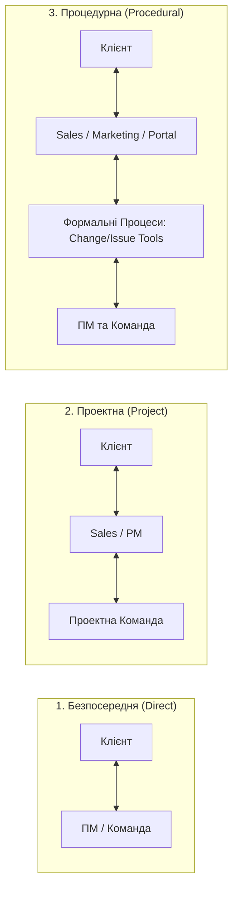
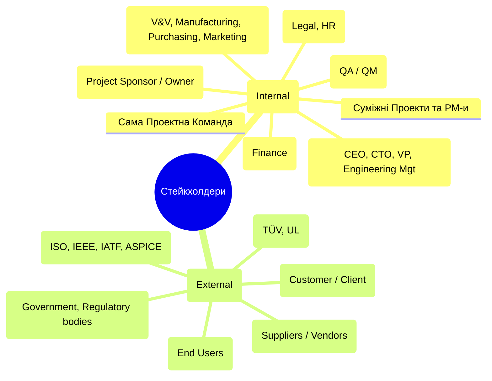
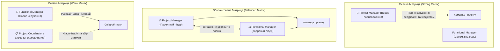
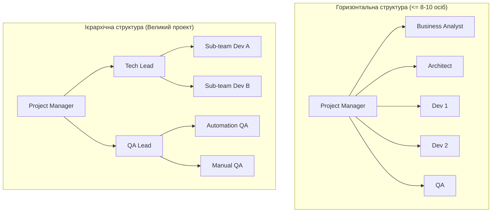
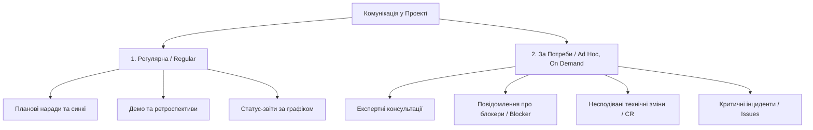
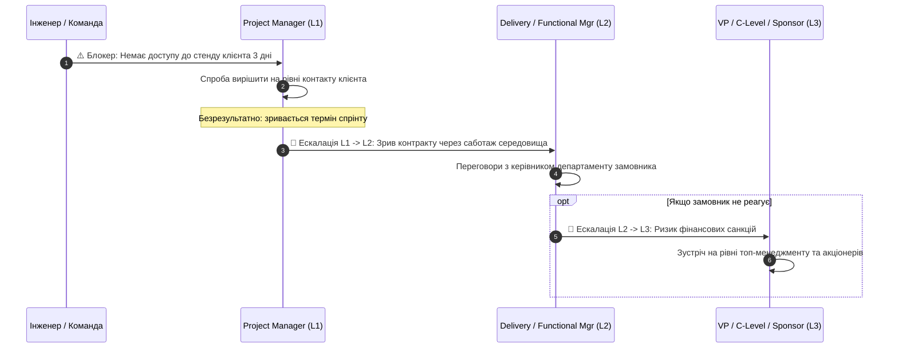

# 👥 Лекція 3: Учасники Проекту, Проектна Команда та Комунікація

> **Курс:** Проектний Менеджмент в ІТ (*Project Management in IT*)  
> **Лектор:** Ярослав Олексюк (2026)  
> **Документ:** `YO-NK01-D103_02`  
> **Попередній матеріал:** [Лекція 2: Продукти, Проекти, Життєві Цикли та Вимоги](../l2/index.md)  
> **Наступний матеріал:** [Лекція 4: Прісейл, Оцінка Проекту, Ресурси та Фінанси](../l4/index.md)  
> **Шпаргалка:** [Шпаргалка до лекції 3 (Cheat Sheet)](cheat-sheet.md)  
> **Q&A:** [Запитання та Відповіді](questions.md)

---

## 📌 Навігація
- [1. Учасники Проекту (Project Participants)](#1-учасники-проекту-project-participants)
  - [1.1 Клієнт і Постачальник (Clients & Suppliers)](#11-клієнт-і-постачальник-clients--suppliers)
  - [1.2 Промислова Ієрархія: OEM та Tier-Рівні](#12-промислова-ієрархія-oem-та-tier-рівні)
  - [1.3 Моделі Співпраці (Direct, Project, Procedural)](#13-моделі-співпраці-direct-project-procedural)
  - [1.4 Стейкхолдери (Stakeholders) та їх Класифікація](#14-стейкхолдери-stakeholders-та-їх-класифікація)
  - [1.5 Реєстр та План Залучення Стейкхолдерів](#15-реєстр-та-план-залучення-стейкхолдерів)
  - [1.6 Проектні Ролі та Матрична Організація (Weak, Balanced, Strong Matrix)](#16-проектні-ролі-та-матрична-організація-weak-balanced-strong-matrix)
- [2. Проектна Команда (Project Team)](#2-проектна-команда-project-team)
  - [2.1 Визначення та Структура (Горизонтальна vs Ієрархічна)](#21-визначення-та-структура-горизонтальна-vs-ієрархічна)
  - [2.2 Командна Сітка (Team Roster) та Матриця Компетенцій (Skills Matrix)](#22-командна-сітка-team-roster-та-матриця-компетенцій-skills-matrix)
  - [2.3 Залучення Спеціалістів: Функційні Підрозділи vs Рекрутинг](#23-залучення-спеціалістів-функційні-підрозділи-vs-рекрутинг)
- [3. Комунікація у Проекті (Project Communication)](#3-комунікація-у-проекті-project-communication)
  - [3.1 Сутність та Принципи Ефективної Комунікації](#31-сутність-та-принципи-ефективної-комунікації)
  - [3.2 Канали: Регулярна vs За Потреби (Ad Hoc)](#32-канали-регулярна-vs-за-потреби-ad-hoc)
  - [3.3 Способи та Інструментарій (Вільна, Регулярна, Формальна)](#33-способи-та-інструментарій-вільна-регулярна-формальна)
  - [3.4 Ескалація (Escalation) та Ескалаційні Шляхи (Escalation Path)](#34-ескалація-escalation-та-ескалаційні-шляхи-escalation-path)
  - [3.5 Проектний План Комунікації (Project Communication Plan)](#35-проектний-план-комунікації-project-communication-plan)
  - [3.6 Проектна Звітність (Reporting)](#36-проектна-звітність-reporting)

---

## 1. Учасники Проекту (Project Participants)

### 1.1 Клієнт і Постачальник (Clients & Suppliers)

У кожному проекті ключовими рушіями є взаємодія між суб'єктом замовлення та суб'єктом виконання:

* **Клієнти / Замовники (*Clients, Customers*)** — фізичні особи чи організації, для яких виконується проект або його складові частини.
* **Постачальники / Виконавці (*Suppliers, Vendors*)** — фізичні особи чи організації, які безпосередньо виконують проект або постачають компоненти, ресурси чи послуги.

#### Види суб'єктів:
1. **Зовнішні (*External*)** — розташовані поза межами материнської організації (зовнішній бізнес-замовник, контрактний підрядник, вендор ліцензійного ПЗ).
2. **Внутрішні (*Internal*)** — внутрішні організаційні підрозділи компанії (наприклад, внутрішній замовник — продуктовий менеджмент чи відділ маркетингу; внутрішній виконавець — R&D підрозділ чи відділ розробки прошивок).

> 💡 **Інтуїція: Робота з очікуваннями (Expectation Management)**  
> **Головна мета будь-якого проекту — відповідати очікуванням клієнта.**  
> Проте клієнти рідко приходять із чіткими, технічно коректними та реалістичними вимогами. Обов'язок постачальника (виконавця) — застосувати власну технічну та доменну експертизу, щоб **допомогти клієнту сформулювати реалістичні очікування**. Кінцевий образ продукту завжди є результатом конструктивного діалогу та взаємного компромісу між замовником і виконавцем.

---

### 1.2 Промислова Ієрархія: OEM та Tier-Рівні

У складних інженерних проектах (автомобільна промисловість *Automotive*, аерокосмічна галузь *Aerospace*, сучасна споживча електроніка) будується багатошарова ланцюгова структура постачання:

```mermaid
graph TD
    OEM["🚗 OEM (Original Equipment Manufacturer)<br/>Виробник кінцевого продукту (BMW, VW, Apple)"]
    Tier1["📦 Tier 1 Supplier (Постачальник 1-го рівня)<br/>Готові системи/модулі (Bosch, Continental, Denso)"]
    Tier2["⚙️ Tier 2 Supplier (Постачальник 2-го рівня)<br/>Спеціалізовані компоненти/чіпи/підсистеми (NXP, ST, Qualcomm)"]
    Tier3["🧱 Tier 3+ Suppliers (Матеріали, ліцензії, IP-ядра, тули)"]

    OEM -->|Замовлення та вимоги| Tier1
    Tier1 -->|Постачання готової підсистеми (ADAS, ECU)| OEM
    Tier1 -->|Вимоги до компонентів/ПЗ| Tier2
    Tier2 -->|Постачання мікроконтролерів, ОС, драйверів| Tier1
    Tier2 --> Tier3
```

#### Класифікація рівнів:
* **OEM (*Original Equipment Manufacturer*)** — виробник кінцевого ринкового продукту (наприклад, автовиробник автоконцерну).
* **Tier 1 Supplier (Постачальник 1-го рівня)** — компанія, що інтегрує складні комплексні рішення та постачає їх **безпосередньо автовиробнику (OEM)** (наприклад, готова система автономного водіння чи мультимедійна система ADAS).
* **Tier 2+ Suppliers (Постачальники 2-го та наступних рівнів)** — постачальники спеціалізованих платформ, чипсетів, мікроконтролерів, базових драйверів (BSW), сторонніх бібліотек або контрактної розробки для постачальників Tier 1.

> ⚠️ **Контекстна подвійність ролей:**  
> Одна й та сама організація одночасно виступає в ролі **Клієнта** (коли замовляє драйвери чи апаратні плати у субпідрядників) та в ролі **Постачальника** (коли здає готовий ECU контролер автоконцерну OEM). Більше того, всередині однієї компанії розробники прикладного ПЗ (*Applications*) є клієнтами для команди низькорівневих драйверів (*Drivers / Firmware*).

---

### 1.3 Моделі Співпраці (Direct, Project, Procedural)

Залежно від зрілості організації та масштабу проекту канали комунікації та взаємодії між Клієнтом та Командою суттєво відрізняються:



| Модель співпраці | Опис та взаємодія | Сфера застосування | Переваги та Ризики |
| :--- | :--- | :--- | :--- |
| **Безпосередня співпраця (*Direct Collaboration*)** | ПМ та інженери команди спілкуються безпосередньо із замовником напряму без посередників. | Малі проекти, стартапи, невеликі агенції. | ➕ Максимальна швидкість, мінімум бюрократії.<br/>➖ Ризик хаосу у вимогах, Scope Creep. |
| **Проектна співпраця (*Project Collaboration*)** | Спілкування ведеться через ПМ-а та відділ продажів (*Sales / Account Manager*). | Середні організації та проекти. | ➕ Баланс між контролем бізнес-домовленостей та гнучкістю комунікації. |
| **Процедурна співпраця (*Procedural Collaboration*)** | Спілкування відбувається строго через виділені функціональні відділи (Sales, Marketing, Legal). Будь-які запити на зміни (*CR*) або інциденти (*Issues*) проходять через формальні системи та процеси реєстрації. | Великі корпорації, enterprise, automotive, медичні проекти. | ➕ Повний аудит, суворий юридичний і фінансовий контроль.<br/>➖ Високі накладні витрати на бюрократію, сповільнення зворотного зв'язку. |

---

### 1.4 Стейкхолдери (Stakeholders) та їх Класифікація

Поняття стейкхолдера є набагато ширшим за поняття клієнта:

* **За IPMA ICB 4.0 (2015):**  
  > *«Зацікавлені сторони / стейкхолдери (*Interested parties / stakeholders*): Особи або групи, які мають інтерес до проекту (або його результатів), можуть впливати на нього або зазнають його впливу (чи його результатів).»*
* **За PMI PMBOK 7th edition (2020):**  
  > *«Зацікавлена сторона (*Stakeholder*): особа, група або організація, яка може впливати на рішення, діяльність або результат проекту, програми чи портфеля, зазнавати їхнього впливу або вважати, що зазнає такого впливу.»*



---

### 1.5 Реєстр та План Залучення Стейкхолдерів

Для системного управління стейкхолдерами Project Manager розробляє та підтримує два критичні артефакти:
1. **Реєстр Стейкхолдерів (*Stakeholders Register*)** — фіксує ідентифікаційні дані, роль, очікування, оцінку впливу та інтересу.
2. **План Залучення Стейкхолдерів (*Stakeholders Engagement Plan*)** — формулює конкретну стратегію та тактику взаємодії з кожною групою або ключовою персоною.

#### Матриця аналізу «Влада / Інтерес» (Power / Interest Grid)
Стейкхолдерів класифікують за рівнем впливу (*Power / Influence*) та рівнем зацікавленості (*Interest*):

```
       Високий |  Задовольняти потреби (Keep Satisfied) |  Керувати тісно (Manage Closely)  |
               |  (Висока влада, низький інтерес)       |  (Висока влада, високий інтерес)  |
Вплив          |  Приклад: Регулятори, Топ-менеджмент   |  Приклад: Клієнт, Спонсор проекту |
(Power)        +----------------------------------------+-----------------------------------+
               |  Моніторити (Monitor)                  |  Тримати поінформованими (Keep Informed) |
               |  (Низька влада, низький інтерес)       |  (Низька влада, високий інтерес)  |
       Низький |  Приклад: Громадськість, суміжні вендори| Приклад: Кінцеві юзери, команда  |
               +----------------------------------------+-----------------------------------+
                                  Низький                             Високий
                                            Зацікавленість (Interest)
```

#### Приклад таблиці Реєстру Стейкхолдерів (з лекційних матеріалів):
| № | Назва / Стейкхолдер | Участь у проекті | Вид | Зацікавленість в успіху | Вплив на проект | Конфліктність | Стратегія Комунікації |
| :-: | :--- | :--- | :---: | :---: | :---: | :---: | :--- |
| **1** | **Клієнт** | Замовлення продукту, фінансування | Зовнішній | Висока | Високий | Висока | **Тісна залученість (*Manage Closely*)** |
| **2** | **Спонсор Проекту** | Нагляд, адмін. та бюджетна підтримка | Внутрішній | Висока | Високий | Низька | **Партнерська залученість** |
| **3** | **Постачальники** | Продаж обладнання, контрактні поставки | Зовнішній | Середня | Низький | Висока | **Контроль та регулярні перевірки** |
| **4** | **PMO** | Нагляд за процесами, процедурна підтримка | Внутрішній | Висока | Середній | Середня | **Регулярна звітність та залучення** |
| **5** | **Зовнішні Аудитори** | Контроль відповідності процесам, сертифікація | Зовнішній | Низька | Високий | Висока | **Формальний діалог, відкритість до перевірок** |

---

### 1.6 Проектні Ролі та Матрична Організація (Weak, Balanced, Strong Matrix)

У проектному управлінні люди призначаються не просто як «працівники», а на чітко визначені **Проектні Ролі**:
* **Проектна Роль (*Project Role*)** — це сукупність визначеного **функціоналу**, наданих **повноважень**, персональної **відповідальності** та необхідних **компетенцій** у контексті виконання завдань проекту.

#### Матрична структура організації (*Matrix Organization*)
У більшості технологічних компаній застосовується розподіл влади між **Project Manager (ПМ)** та **Functional / Line Manager (ФМ / Лінійний керівник)**:
* **Project Manager (ПМ):** фокусується на питаннях *«Що робити? Коли робити? В яких межах бюджету?»*.
* **Functional Manager (ФМ):** очолює спеціалізовані підрозділи (відділ розробки, системної інженерії, тестування, UI/UX) і фокусується на питаннях *«Хто саме робитиме? Як професійно робити? Які технологічні стандарти розвивати?»*.



| Параметр порівняння | Слабка матриця (*Weak Matrix*) | Збалансована матриця (*Balanced Matrix*) | Сильна матриця (*Strong Matrix*) |
| :--- | :--- | :--- | :--- |
| **Повноваження PM** | Обмежені; виступає скоріше як **Координатор проекту (*Project Coordinator*)** або фасилітатор. | Середні; рівноцінний діалог із керівниками підрозділів. | **Високі/повні**; одноосібно керує обсягом, пріоритетами, бюджетом. |
| **Роль Лінійного менеджера (FM)** | Визначає кадри, розподіляє щоденні таски, затверджує плани. | Надає людей за узгодженням, оцінює професійний рівень. | Забезпечує пул талантів і їхній професійний розвиток (L&D). |
| **Кадрові рішення** | Одноосібно приймає FM. | Узгоджуються спільно (ПМ + ФМ). | Вирішальне слово за ПМ-ом (бере або виводить людей з проекту). |
| **Контроль бюджету** | Знаходиться у функційного директора. | Розділений / узгоджений. | Повністю контролюється Project Manager. |

---

## 2. Проектна Команда (Project Team)

### 2.1 Визначення та Структура (Горизонтальна vs Ієрархічна)

* **Проектна Команда (*Project Team*)** — тимчасова група спеціалістів, створена для досягнення цілей конкретного проекту, яка зазвичай організаційно та операційно підпорядкована керівнику проекту.
* Може бути **локалізованою** (в одному офісі) або **географічно розподіленою** (*Distributed team*).

#### Типи структур команд:
1. **Горизонтальна (*Flat / Horizontal*)** — PM безпосередньо взаємодіє з усіма спеціалістами (характерно для невеликих команд до 7–10 осіб: архітектор, системний аналітик, розробники, тестувальники).
2. **Ієрархічна (*Hierarchical*)** — на чолі функціональних напрямків стоять лідери підкоманд (*Team Leads*, *Tech Leads*, *QA Leads*), через яких комунікує PM.
3. **Програмна багаторівнева структура (*Multi-level Program Team*)** — Керівник Програми (*Program Manager*) курує декілька Project Managers, кожен з яких очолює власний проект зі своїми підкомандами.



---

### 2.2 Командна Сітка (Team Roster) та Матриця Компетенцій (Skills Matrix)

Для оперативного розподілу завдань та оцінки можливостей команди PM веде два ключові інструменти:

#### 1. Командна Сітка (*Team Roster*)
Фіксує персональний склад, ролі, грейди та контактні лінії команди.
| № | Проектна Роль (*Role*) | Рівень (*Seniority*) | ПІБ / Ідентифікатор |
| :-: | :--- | :--- | :--- |
| 1 | Керівник проекту (PM) | Senior | Ім'я_1 |
| 2 | Інженер Вимог (Requirements Engineer) | Middle | Ім'я_2 |
| 3 | Системний Архітектор (Architect) | Senior | Ім'я_3 |
| 4 | Тімлід розробки (Dev Lead) | Senior | Ім'я_4 |
| 5 | Розробник (Software Engineer) | Middle | Ім'я_5 |
| 6 | Тімлід тестування (QA Lead) | Senior | Ім'я_6 |
| 7 | Інженер з тестування (QA Engineer) | Middle | Ім'я_7 |

#### 2. Матриця Компетенцій (*Skills Matrix*)
Матриця відображає рівень володіння кожним учасником обов'язковими компетенціями.

**Шкала оцінювання компетенцій (1–5):**
* **1** — **Ознайомчий рівень (*Novice*)** — знає термінологію, бачив інструмент, не може працювати самостійно.
* **2** — **Базовий користувач (*Advanced Beginner*)** — виконує прості типові операції за інструкціями.
* **3** — **Самостійний спеціаліст (*Competent*)** — самостійно розв'язує робочі завдання без зовнішнього нагляду.
* **4** — **Професіонал / Експерт (*Proficient*)** — глибокі знання, вирішує нетривіальні проблеми, навчає інших.
* **5** — **Майстер / Гуру (*Master / Authority*)** — архітектурний рівень, задає стандарти компанії чи галузі.

```
+-----------+----------------------+--------------+--------------+---------+--------+---------+
| №         | Спеціаліст           | Пр. Процеси  | Інж. Вимог   | С/С++   | Python | Тести   |
+-----------+----------------------+--------------+--------------+---------+--------+---------+
| 1         | Ім'я_1 (PM)          | 5 (Master)   | 4            | -       | -      | 2       |
| 2         | Ім'я_2 (Req Eng)     | 4            | 5 (Master)   | 1       | 2      | 3       |
| 3         | Ім'я_3 (Architect)   | 3            | 4            | 5       | 3      | 4       |
| 4         | Ім'я_4 (Dev Lead)    | 3            | 3            | 5       | 4      | 4       |
| 5         | Ім'я_5 (Developer)   | 2            | 2            | 4       | 2      | 3       |
| 6         | Ім'я_6 (QA Lead)     | 4            | 3            | 2       | 5      | 5       |
| 7         | Ім'я_7 (QA Eng)      | 2            | 2            | 1       | 3      | 4       |
+-----------+----------------------+--------------+--------------+---------+--------+---------+
```

---

### 2.3 Залучення Спеціалістів: Функційні Підрозділи vs Рекрутинг

* **Ситуативність проектних команд:** команди створюються під конкретні проекти і розпускаються/перерозподіляються після їх завершення. (Виняток — продуктові IT-компанії, де продуктові команди можуть бути сталими протягом багатьох років).
* **Джерела залучення людей:**
  1. **Внутрішній пул (Функційні команди):** залучення розробників чи тестувальників, які вже працюють у компанії на «бенчі» або звільняються з інших проектів.
  2. **Зовнішній ринок (Рекрутинг):** найм спеціалістів під відкриті позиції конкретного проекту через HR/Recruiting відділ.
* **Роль PM при наймі:** залежно від внутрішніх процесів, PM обов'язково проводить проектну або фінальну співбесіду, оцінюючи софт-скіли, готовність працювати у предметній області та сумісність із культурою команди.

---

## 3. Комунікація у Проекті (Project Communication)

### 3.1 Сутність та Принципи Ефективної Комунікації

> *«Комунікація у проекті — це артеріальна система передачі інформації. Інформація не повинна залежуватися без руху.»*

#### 6 золотих характеристик проектної комунікації:
1. **Прозорість (*Transparency*)** — доступність даних для всіх зацікавлених сторін без приховування реального стану справ.
2. **Правдивість (*Honesty & Integrity*)** — категорична неприпустимість викривлення фактів або «прикрашання» метрик.
3. **Чіткість (*Clarity*)** — однозначність формулювань, відсутність двозначності.
4. **Цілісність (*Completeness*)** — повнота контексту, щоб отримувач міг прийняти рішення без додаткових десятків розпитувань.
5. **Вчасність (*Timeliness*)** — негайне повідомлення про зміни або затримки. Чим раніше виявлено проблему, тим дешевше її вирішення.
6. **Доречність (*Relevance*)** — надсилання інформації тільки тим, кому вона дійсно потрібна (захист від інформаційного шуму та spam-розсилок).

> 💡 **Етичне правило інженерного менеджменту:**  
> **«При виникненні проблем шукайте рішення, а не винних» (*Focus on solutions, not culprits*).**  
> Пошук винних руйнує довіру в команді та змушує людей приховувати помилки до моменту катастрофи.

---

### 3.2 Канали: Регулярна vs За Потреби (Ad Hoc)



---

### 3.3 Способи та Інструментарій (Вільна, Регулярна, Формальна)

* **Вільна комунікація (*Informal / Direct*):** усні діалоги, швидкі повідомлення в Slack/Teams, телефонні дзвінки. Використовується для оперативного вирішення робочих питань.
* **Регулярна комунікація (*Regular*):** командні синхронізаційні мітинги (*Daily / Weekly Synchs*), наради зі стейкхолдерами.
* **Формальна комунікація (*Formal*):**
  - Офіційні системи звітності (*Status Reports Systems*).
  - Системи керування змінами (*Change Management Systems* — Jira, Polarion).
  - Баг-трекери та системи реєстрації інцидентів (*Issue Tracking Systems*).
  - Формальні ескалаційні листи за протоколом.

---

### 3.4 Ескалація (Escalation) та Ескалаційні Шляхи (Escalation Path)

#### Що таке ескалація?
**Ескалація (*Escalation*)** — це санкціоноване перенесення невирішеної проблеми на вищий організаційний або управлінський рівень.

#### Коли ескалація є правомірною та необхідною:
1. Для вирішення проблеми потрібні повноваження, яких немає у Project Manager (наприклад, зміна базових умов контракту, врегулювання юридичних конфліктів, підписання штрафних угод).
2. Потрібні додаткові ресурси, які виходять за межі затвердженого бюджету або штатного розкладу проекту (фінансування, додаткове обладнання, екстрений найм).
3. Виник міжпроектний або міждепартаментний глухий кут (*Deadlock*), який неможливо вирішити на рівні менеджерів однакового рангу.



#### Правила ескалації та типові зловживання:
> ⚠️ **Підводні камені ескалацій:**  
> 1. **Зловживання тиском:** заборонено використовувати ескалацію для залякування колег або примушування їх виконувати понаднормову неоплачувану роботу.  
> 2. **Перестрибування через рівні (*Skipping Levels*):** інженер або PM не має права бігти безпосередньо до CEO компанії, оминаючи свого прямого керівника чи куратора проекту. Це ламає управлінську субординацію.  
> 3. **«Гасіння пожеж» без попередньої роботи:** перед ескалацією ініціатор повинен зібрати всі факти, оцінити вплив на проект і запропонувати 2–3 варіанти конструктивних рішень.

---

### 3.5 Проектний План Комунікації (Project Communication Plan)

Офіційний документ під відповідальністю PM, який фіксує всі точки перетину інформації в проекті.

#### Приклад матриці Плану Комунікацій (з лекційних матеріалів):
| № | Подія / Зустріч | Спосіб та Інструмент | Частота | Організатор | Учасники | Зміст та артефакти |
| :-: | :--- | :--- | :--- | :--- | :--- | :--- |
| **1** | **Планування проекту (*Project Planning*)** | Офлайн / Офіс | Щомісяця (*Monthly*) | PM | PM, Лідери напрямків, Команда | Декомпозиція Епіків, оцінка User Stories |
| **2** | **Синк Команди (*Team Synch*)** | Онлайн (MS Teams) | Пн, Ср, Пт | PM / Scrum Master | Уся команда проекту | Обговорення поточних задач, сабтасок, блокерів |
| **3** | **Координаційна нарада (*Steering Meeting*)** | Онлайн (MS Teams) | Щотижня (*Weekly*) | Project Owner (PO) | PM, PO, Sales, QA, PM-и суміжних проектів | Загальний статус проекту, аналіз ризиків |
| **4** | **Узгодження з Клієнтом (*Customer Alignment*)** | Онлайн (MS Teams) | Раз на 2 тижні (*Biweekly*) | Sales Manager (SM) | SM, PM, Клієнт, представники команди (за потребою) | Демонстрація результатів, погодження графіку, вирішення критичних питань |

---

### 3.6 Проектна Звітність (Reporting)

Регулярна діяльність PM щодо інформування керівництва, стейкхолдерів та клієнта:
* **Статус за Залізним Трикутником:** фактичне виконання Scope, графік Time, використання Budget.
* **Досягнення Майлстоунів (*Milestone tracking*):** відсоток готовності та результати рев'ю.
* **Реєстр Ризиків (*Risk Exposure*):** нові загрози, статус планів реагування.
* **Проблеми та відкриті ескалації (*Open Issues & Escalations*):** поточний статус вирішення заблокованих робіт.

---

## 🔗 Зв'язок з наступними матеріалами
На наступній лекції розглядається **Прісейл, Оцінка Проекту, Ресурси та Фінанси**: [Лекція 4](../l4/index.md).

---

[⬅️ Попередня лекція](../l2/index.md) | [🏠 Головний зміст](../../README.md) | [⚡ Cheat Sheet](cheat-sheet.md) | [❓ Q&A](questions.md) | [Наступна лекція ➡️](../l4/index.md)

