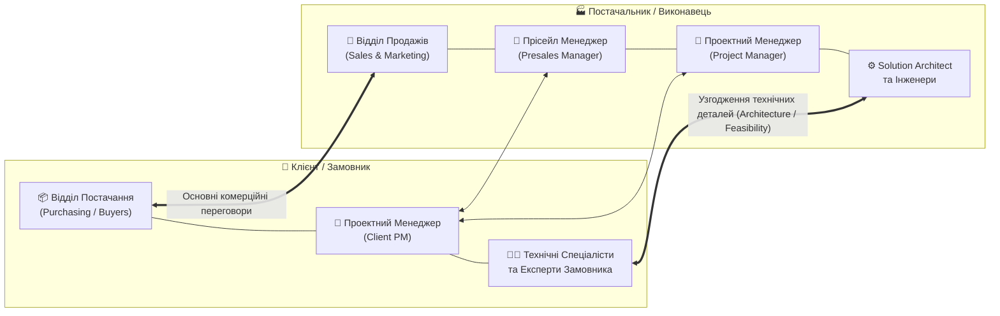
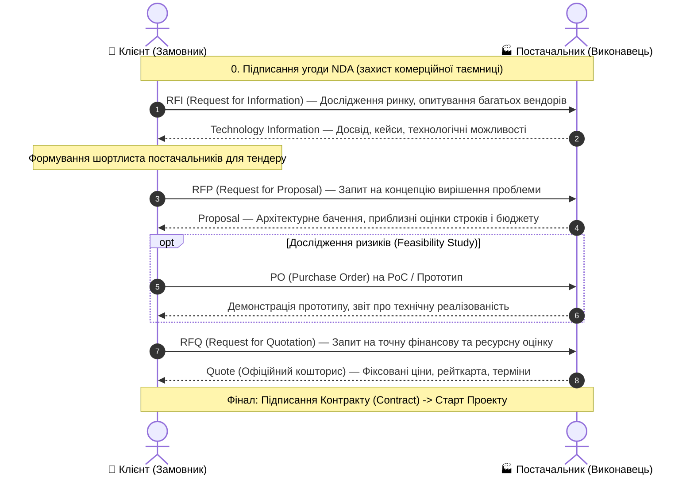
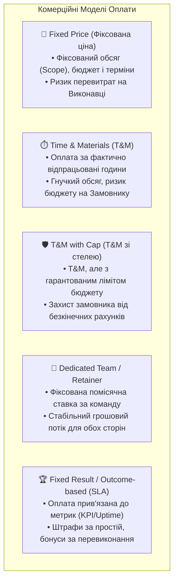
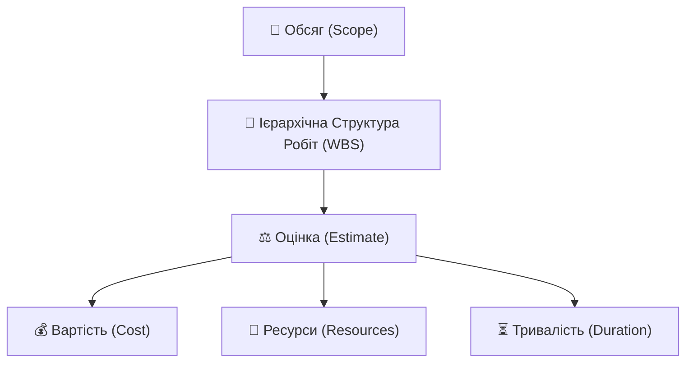
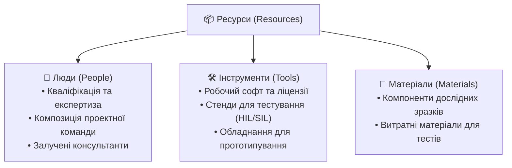
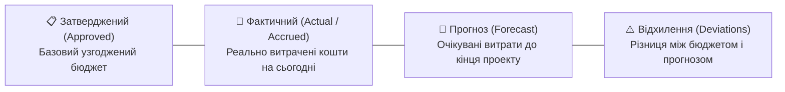
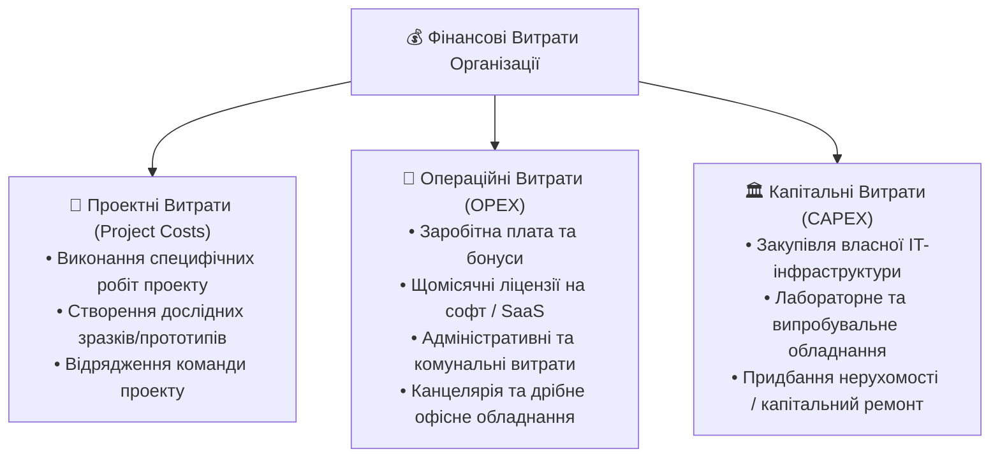

# 🤝 Лекція 4: Прісейл, Оцінка Проекту, Ресурси та Фінанси

> **Курс:** Проектний Менеджмент в ІТ (*Project Management in IT*)  
> **Лектор:** Ярослав Олексюк (2026)  
> **Документ:** `YO-NK01-D104_02`  
> **Попередній матеріал:** [Лекція 3: Учасники Проекту, Проектна Команда та Комунікація](../l3/index.md)  
> **Наступний матеріал:** [Лекція 5: Створення Проекту, Планування, Ризики та Конфігурація](../l5/index.md)  
> **Шпаргалка:** [Шпаргалка до лекції 4 (Cheat Sheet)](cheat-sheet.md)  
> **Q&A:** [Запитання та Відповіді](questions.md)

---

## 📌 Навігація
- [1. Прісейл та Контрактування (Presale & Contracting)](#1-прісейл-та-контрактування-presale--contracting)
  - [1.1 Визначення та мета контрактування](#11-визначення-та-мета-контрактування)
  - [1.2 Учасники процесу з боку Клієнта та Постачальника](#12-учасники-процесу-з-боку-клієнта-та-постачальника)
  - [1.3 Циклічний процес переговорів: RFI, RFP, RFQ](#13-циклічний-процес-переговорів-rfi-rfp-rfq)
  - [1.4 Додаткові інструменти: NDA, PoC / Прототип, Feasibility Study, PO](#14-додаткові-інструменти-nda-poc--прототип-feasibility-study-po)
  - [1.5 Моделі Співпраці (Cooperation Models)](#15-моделі-співпраці-cooperation-models)
  - [1.6 Комерційні Моделі Оплати (Commercial Models)](#16-комерційні-моделі-оплати-commercial-models)
  - [1.7 Зведений реєстр контрактних документів](#17-зведений-реєстр-контрактних-документів)
- [2. Оцінка Проекту (Project Estimation)](#2-оцінка-проекту-project-estimation)
  - [2.1 Сутність та призначення естімейту](#21-сутність-та-призначення-естімейту)
  - [2.2 Процес оцінки: Scope $\to$ Goal $\to$ Product](#22-процес-оцінки-scope-to-goal-to-product)
  - [2.3 Балансування: Необхідні vs Наявні Ресурси](#23-балансування-необхідні-vs-наявні-ресурси)
  - [2.4 Методи оцінки: Експертна, Триточкова PERT, Agile Story Points](#24-методи-оцінки-експертна-триточкова-pert-agile-story-points)
  - [2.5 Структура Естімейту: Cost, Overheads та Маржа (Margin)](#25-структура-естімейту-cost-overheads-та-маржа-margin)
- [3. Ресурси Проекту (Project Resources)](#3-ресурси-проекту-project-resources)
  - [3.1 Класифікація: Люди, Інструменти, Матеріали](#31-класифікація-люди-інструменти-матеріали)
  - [3.2 Розподіл відповідальності за забезпечення ресурсів](#32-розподіл-відповідальності-за-забезпечення-ресурсів)
- [4. Фінанси та Бюджетування (Project Finances & Budget)](#4-фінанси-та-бюджетування-project-finances--budget)
  - [4.1 Проектний Бюджет (Project Budget) та Припущення](#41-проектний-бюджет-project-budget-та-припущення)
  - [4.2 Фінансова звітність: Approved, Actual, Forecast, Deviations](#42-фінансова-звітність-approved-actual-forecast-deviations)
  - [4.3 Класифікація витрат: Project Costs, OPEX та CAPEX](#43-класифікація-витрат-project-costs-opex-та-capex)
- [📊 Зведена таблиця та підсумок лекції](#-зведена-таблиця-та-підсумок-лекції)

---

## 🎯 Мета та ключові питання лекції

1. **Як клієнт формулює потребу і як виконавець перетворює її на проект?** Проходження повного циклу контрактування від підписання NDA, запитів RFI/RFP/RFQ до укладення контракту або фінансування прототипу через Purchase Order.
2. **Які існують моделі співпраці та комерційні моделі оплати?** Чітке розмежування між тим, *як організована взаємодія спеціалістів* (In-house, Staff Augmentation, Dedicated Team, Project Outsource, Managed Services) та *як нараховуються гроші* (Fixed Price, T&M, T&M with Cap, Retainer, SLA).
3. **Як побудувати надійний естімейт (оцінку) робіт?** Застосування експертного методу, розрахунок 3-точкової оцінки PERT із запасом безпеки, використання відносних Story Points у гнучких методологіях та планувальний покер.
4. **Із чого складається бюджет та як контролювати фінанси?** Розуміння внутрішньої структури вартості (роботи, інструменти, адмінвитрати, маржа), моніторинг показників Approved / Actual / Forecast / Deviations та розмежування витрат Project Costs, OPEX і CAPEX.

---

## 1. Прісейл та Контрактування (Presale & Contracting)

### 1.1 Визначення та мета контрактування

Етап узгодження потреб клієнта, аналізу технічної реалізованості та формування юридичних передумов для старту проекту в різних організаціях має різні назви:

* **Прісейл (*Presale / Передпродаж*)** — фаза підготовки та узгодження техніко-комерційних умов продажу продукту або послуг постачальника.
* **Діскавері (*Discovery / Дослідження*)** — фаза глибокого дослідження бізнес-потреб клієнта, виявлення обмежень і порівняння їх із технологічними можливостями виконавця.
* **Енґейджмент (*Engagement / Залучення*)** — процес залучення клієнта до довгострокової співпраці та встановлення довірчих відносин.

> 💡 **Інтуїція: Проекту ще немає!**  
> На етапі контрактування **основний проект юридично і фактично ще не існує**.  
> Сам процес прісейлу функціонує як окремий внутрішній міні-проект, головна мета якого — **підписати офіційний Контракт (*Contract*) між Замовником та Виконавцем**.  
> Оскільки проект формально ще не відкритий, Проектний Менеджер (*PM*) може бути ще не призначений. Процесом керує **Прісейл Менеджер (*Presales Manager*)**. Проте у зрілих компаніях PM долучається вже на фазі прісейлу (або PM і Presales Manager — це одна й та сама людина), щоб уникнути ситуації, коли відділ продажів пообіцяв замовнику нездійсненні терміни й бюджети, а розгрібати доводиться команді розробки.

---

### 1.2 Учасники процесу з боку Клієнта та Постачальника

Предмет переговорів є елементом **Закупівлі/Постачання (*Purchasing*)** для Клієнта і водночас елементом **Продажів (*Sales*)** для Виконавця. Відповідно, переговорний процес ведуть профільні представники обох сторін:



1. **Комерційний контур (Sales $\leftrightarrow$ Purchasing):** Відповідає за ціноутворення, комерційні моделі оплати, юридичні умови, гарантії, штрафні санкції та загальні строки.
2. **Управлінський контур (Client PM $\leftrightarrow$ Presales Manager / PM):** Відповідає за графік передачі вхідних даних, організацію мітингів, матрицю відповідальності та план комунікацій на період оцінки.
3. **Технічний контур (Спеціалісти $\leftrightarrow$ Спеціалісти):** Архітектори, ліди розробки та системні аналітики обох сторін узгоджують технологічний стек, архітектурні обмеження, інтерфейси API, тестові середовища та вимоги безпеки.

---

### 1.3 Циклічний процес переговорів: RFI, RFP, RFQ

Контрактування — це зазвичай **ітеративний процес** обміну запитами та пропозиціями, під час якого абстрактні бізнес-ідеї замовника крок за кроком перетворюються на формальні технічні та комерційні специфікації.



#### Деталізація етапів:

1. **RFI (*Request for Information* — Запит на інформацію):**
   * **Мета:** Первинне дослідження ринку замовником.
   * **Стан вимог:** Чітких вимог ще немає; є лише загальна проблема чи напрямок розвитку.
   * **Адресати:** Розсилається широкому колу потенційних підрядників.
   * **Відповідь виконавця:** Загальний огляд технологій (*Technology Information*), презентація експертизи компанії (*Portfolio / Case Studies*), без юридичних чи фінансових зобов'язань.

2. **RFP (*Request for Proposal* — Запит на пропозицію рішення):**
   * **Мета:** Вибір постачальника на основі запропонованого технічного підходу.
   * **Стан вимог:** Вимоги окреслені на концептуальному рівні (*Business Requirements, High-Level Architecture*).
   * **Адресати:** Надсилається пулу відібраних постачальників, допущених до тендеру.
   * **Відповідь виконавця:** **Proposal** — деталізований технічний документ із описом архітектури, методології розробки, попередньої оцінки необхідних ресурсів, ризиків та часових рамок (*Ballpark Estimate*).

3. **RFQ (*Request for Quotation* — Запит на цінову пропозицію):**
   * **Мета:** Фінальний вибір підрядника за параметрами ціни, комерційних умов та строків.
   * **Стан вимог:** Вимоги сформульовані з достатньою деталізацією для складання юридичного договору.
   * **Адресати:** Надсилається фіналістам тендеру (1–3 компанії).
   * **Відповідь виконавця:** **Quote / Quotation** — офіційний комерційний розрахунок вартості, перелік ставок фахівців (*Rate Card*), гарантії строків і графік платежів. Цей документ стає прямою основою майбутнього контракту.

---

### 1.4 Додаткові інструменти: NDA, PoC / Прототип, Feasibility Study, PO

* **NDA (*Non-Disclosure Agreement* — Угода про нерозголошення):**
  * Підписується **на самому початку взаємодії** (до передачі чутливих деталей замовлення).
  * Зобов'язує сторони зберігати конфіденційність комерційної та технічної інформації (комерційні ставки, архітектура, патенти, бізнес-показники).
  * Може укладатися як під конкретний проект (*Project NDA*), так і діяти як генеральна угода про партнерство (*Master NDA*).
* **Прототип (*Prototype*) та Підтвердження Концепції (*Proof of Concept, PoC*):**
  * Створюється в умовах високої невизначеності (нова технологія, складний алгоритм, неперевірена продуктивність).
  * Демонструє життєздатність запропонованого рішення або окремого критичного модуля.
* **Техніко-економічне обґрунтування (*Feasibility Study*):**
  * Комплексний інженерний та бізнес-аналіз доцільності розробки: чи вистачить продуктивності заліза, чи окупиться розробка, які головні технологічні ризики.
* **Замовлення на Закупівлю (*Purchase Order, PO*):**
  * Фінансово-розпорядчий документ від замовника, який виділяє бюджет на виконання обмеженого обсягу робіт.
  * Часто використовується для оплати підготовчих робіт (Discovery фази, PoC, прототипування або Feasibility Study) **ще до того, як буде підписаний основний багатомільйонний контракт**.

---

### 1.5 Моделі Співпраці (Cooperation Models)

**Модель співпраці (*Cooperation Model*)** визначає правила організаційної взаємодії сторін: хто володіє продуктом, як розподіляються ролі в команді, хто здійснює операційне управління та хто несе кінцеву відповідальність за результат (*Accountability*).

```
Власна Розробка (In-house) ──► Повний контроль і відповідальність у Замовника
Розширення Штату (Staff Aug) ──► Постачальник дає людей, керує Замовник
Спеціалізована Команда (Dedicated Team) ──► Постачальник керує людьми, Замовник — проектом
Аутсорсинг Проекту (Project Outsource) ──► Постачальник повністю керує процесом «під ключ»
Керовані Послуги (Managed Services) ──► Постачальник відповідає за функцію за SLA
```

| Модель Співпраці | Хто надає команду? | Хто здійснює PM/керування? | Відповідальність за результат (*End-to-End*) | Типове застосування |
| :--- | :--- | :--- | :--- | :--- |
| **Власна Розробка (*In-house*)** | Внутрішній штат замовника | Повністю Замовник | Замовник | Ключове ядро бізнесу (*Core Competency*), захист інтелектуальної власності |
| **Розширення Штату (*Staff Augmentation / Outstaffing*)** | Постачальник надає окремих спеціалістів | Замовник (Team Lead / PM клієнта) | Замовник (постачальник гарантує лише кваліфікацію та присутність людини) | Термінове закриття дефіциту конкретних компетенцій (напр. Senior Rust розробник на 4 місяці) |
| **Спеціалізована Команда (*Dedicated Team*)** | Постачальник формує збалансовану команду | Спільне: лінійне адміністрування у постачальника, бізнес-беклог у замовника | Замовник веде проект, постачальник відповідає за збереження команди та процес | Довгостроковий розвиток продукту, масштабування власного R&D-центру |
| **Аутсорсинг Проекту (*Project Outsource / Turnkey*)** | Повна крос-функційна команда постачальника | Повністю Постачальник (PM постачальника) | **Постачальник** (повна відповідальність за здачу готового продукту) | Розробка «під ключ» від ідеї до релізу для непрофільних замовників |
| **Керовані Послуги (*Managed Services*)** | Сервісна команда постачальника | Постачальник керує внутрішніми змінами | **Постачальник за SLA** (відповідальність за доступність, швидкість інцидентів) | Підтримка 24/7 інфраструктури, Cloud DevOps, інформаційна безпека (SOC) |

---

### 1.6 Комерційні Моделі Оплати (Commercial Models)

**Комерційна модель (*Commercial Model*)** визначає фінансові правила розрахунків між Замовником та Виконавцем: що є одиницею тарифікації та як розподіляються фінансові ризики.



#### Детальний аналіз комерційних моделей:

1. **Фіксована Ціна (*Fixed Price*):**
   * **Сутність:** Виконавець зобов'язується здати чітко зафіксований обсяг робіт (*Scope*) за фіксовану суму у фіксовану дату.
   * **Передумови успіху:** Досконало прописані вимоги (*SRS / PRD*), відсутність суттєвих змін під час розробки, перевірена архітектура.
   * **Розподіл ризиків:** **100% фінансового ризику несе Виконавець**. Якщо команда не вклалася в запланований час — компанія розробляє за власний рахунок.
   * **Особливість ціноутворення:** Постачальник закладає великий буфер на ризики (*Risk Margin* +30–50%). Будь-яка зміна вимог з боку клієнта вимагає платного запиту на зміну (*Change Request, CR*).

2. **Час і Матеріали (*Time & Materials, T&M*):**
   * **Сутність:** Замовник оплачує фактично витрачений час спеціалістів (людино-години або людино-дні за узгодженою ставкою *Hourly Rate*) плюс прямі супутні витрати (ліцензії на софт, хмарні сервери, тестові девайси).
   * **Передумови успіху:** Гнучкі Agile-проекти, мінливі або нечіткі вимоги, R&D дослідження, стартапи.
   * **Розподіл ризиків:** **Фінансовий ризик несе Замовник**. Якщо ідея виявилася складнішою — клієнт платить за додатковий час розробки. Виконавець забезпечує прозору звітність через трекінг задач (Jira, Harvest).

3. **Час і Матеріали з Обмеженням (*Time & Materials with Cap / Not-to-Exceed*):**
   * **Сутність:** Розрахунок ведеться як у T&M, але встановлюється гранична сума (*Cap / Ceiling*). Якщо роботи виконано дешевше — замовник платить менше фактичної стелі. Якщо витрати перевищили стелю — виконавець доробляє решту безкоштовно.
   * **Застосування:** Компромісна модель для замовників, які бояться неконтрольованих витрат у чистому T&M.

4. **Спеціалізована Команда (*Dedicated Team / Monthly Retainer*):**
   * **Сутність:** Фіксована вартість за утримання команди (наприклад, \$25,000 на місяць за 1 PM, 2 Fullstack Dev, 1 QA), незалежно від того, скільки годин пішло на конкретну фічу.
   * **Застосування:** Довгострокові проекти зі стабільним завантаженням.

5. **Оплата за Результат (*Outcome-based / SLA*):**
   * **Сутність:** Оплата прив'язується до досягнення бізнес-метрик: безперебійна робота сервісу 99.99% часу (*Uptime*), час закриття інциденту до 15 хвилин (*MTTR*), або відсоток конверсії.

---

### 1.7 Зведений реєстр контрактних документів

| Абревіатура | Повна назва | Призначення та зміст | Етап життєвого циклу |
| :--- | :--- | :--- | :--- |
| **NDA** | *Non-Disclosure Agreement* | Зобов'язання не розголошувати комерційну та технічну конфіденційну інформацію. | Початок контрактування (перед обміном документами) |
| **RFI** | *Request for Information* | Запит клієнта до ринку щодо технологій, методів та досвіду постачальників. | Дослідження ринку (початок переговорів) |
| **RFP** | *Request for Proposal* | Запит до відібраних вендорів на розробку архітектурної та концептуальної пропозиції. | Проміжний етап (тендер рішень) |
| **RFQ** | *Request for Quotation* | Запит на офіційну цінову пропозицію на основі узгоджених вимог. | Фінальний етап вибору постачальника |
| **Proposal** | *Proposal* | Документ-пропозиція від постачальника з описом підходу, архітектури та грубої оцінки. | Відповідь на RFP |
| **Quote** | *Quote / Quotation* | Офіційний кошторис із точними цінами, строками, рейтами та юридичними зобов'язаннями. | Відповідь на RFQ (основа для контракту) |
| **Rate Card** | *Rate Card* | Перелік погодинних або денних ставок спеціалістів різної кваліфікації (Junior, Middle, Senior, Lead). | Додаток до пропозиції та контракту |
| **PO** | *Purchase Order* | Фінансове замовлення клієнта на закупівлю конкретного пакета послуг (наприклад, оплата PoC/ТЕО). | Передконтрактний етап або етап проекту |
| **SLA** | *Service Level Agreement* | Угода про гарантовані параметри надання послуг (час реакції, доступність, надійність). | Фінал контрактування / сервісна підтримка |
| **Contract** | *Contract / Master Services Agreement (MSA)* | Юридичний договір, що регламентує права, обов'язки, інтелектуальну власність та відповідальність. | **Завершення контрактування $\to$ Старт Проекту** |

---

## 2. Оцінка Проекту (Project Estimation)

### 2.1 Сутність та призначення естімейту

**Оцінка (*Estimate*)** — це кількісне визначення умов, необхідних для реалізації визначеного обсягу робіт: потреби в ресурсах, вартості та часової тривалості.



* **ІСР / WBS (*Work Breakdown Structure*)** — інструмент декомпозиції загального обсягу на дрібні зрозумілі робочі пакети (*Work Packages*), які можна точно оцінити.
* **Взаємозв'язок обмежень:** Залежно від типу бізнесу, **базовим** параметром може бути бюджет (тоді тривалість і обсяг підганяються під доступні кошти) або дедлайн (тоді бюджет нарощують для залучення додаткових ресурсів).
* **Скорочення тривалості:** Досягається паралельним виконанням незалежних пакетів робіт (*Fast Tracking*), оптимізацією інженерних процесів та використанням ефективніших інструментів автоматизації.

---

### 2.2 Процес оцінки: Scope $\to$ Goal $\to$ Product

Перед тим як переходити до розрахунку людино-годин, необхідно синхронізувати три фундаментальні сутності:

1. **Обсяг (*Scope*):** Що саме потрібно зробити в рамках проекту (всі задачі, беклог, технічні інтеграції).
2. **Мета (*Goal*):** Навіщо цей проект реалізується (бізнес-цінність, вирішення болю замовника, вихід на новий ринок).
3. **Продукт (*Product*):** Кінцевий матеріальний або цифровий артефакт, який передається замовнику.

> ⚠️ **Важливо чітко знати межі своєї відповідальності в Продукті!**  
> Команда розробляє весь продукт чи лише один мікросервіс? Чи входить у відповідальність впровадження у виробництво, міграція даних, сертифікація та післярелізне обслуговування? Невизначені межі відповідальності — головна причина перевитрат бюджету.

---

### 2.3 Балансування: Необхідні vs Наявні Ресурси

У процесі підготовки оцінки обов'язково зіставляються дві величини:
* **Необхідні Ресурси (*Needed Resources*):** Кількість та кваліфікація фахівців, потрібних для виконання робіт у зазначений термін.
* **Наявні Ресурси (*Available Resources*):** Реально доступні співробітники всередині компанії (з урахуванням зайнятості на інших проектах, відпусток та запланованих звільнень).

```text
    [ Початкова Оцінка ] ──► Необхідні Ресурси (Needed)
                                      vs
                              Наявні Ресурси (Available)
                                      │
               ┌──────────────────────┴──────────────────────┐
               ▼                                             ▼
     Наявних ресурсів ДОСТАТНЬО                    Наявних ресурсів МЕНШЕ
               │                                             │
               ▼                                             ▼
        Оцінку затверджено                       ОНОВЛЕННЯ ОЦІНКИ ПРОЕКТУ:
                                                 • Зсув дедлайнів вправо
                                                 • Зменшення обсягу (Scope)
                                                 • Рекрутинг / Аутстафінг
```

---

### 2.4 Методи оцінки: Експертна, Триточкова PERT, Agile Story Points

Оцінка здебільшого вимірюється в **одиницях часу** (години, дні, тижні). Знаючи погодинну ставку спеціаліста (*Rate*), час легко конвертується у грошову вартість:

$$\text{Cost} = \text{Duration (hours)} \times \text{Rate (\$/hour)}$$

#### 1. Експертна оцінка (середнє арифметичне)
Якщо завдання оцінюють кілька незалежних технічних експертів ($n$ експертів з оцінками $V_1, V_2, \dots, V_n$):

$$V_e = \frac{\sum_{i=1}^n V_i}{n}$$

До отриманої оцінки обов'язково додається **Запас Безпеки (*Safety Margin / Contingency*)** для компенсації суб'єктивності та можливих прихованих складнощів.

#### 2. Триточкова оцінка PERT (Program Evaluation and Review Technique)
Враховує асиметрію ризиків за бета-розподілом ймовірностей. Експерт визначає три значення:
* $V_o$ — **Оптимістична оцінка (*Optimistic*)**: все пішло ідеально, без жодних блокерів чи багів.
* $V_r$ — **Найбільш реалістична оцінка (*Most Likely*)**: звичайний темп розробки з типовими щоденними проблемами.
* $V_p$ — **Песимістична оцінка (*Pessimistic*)**: все, що могло зламатися, зламалося (найгірший сценарій).

Формула математичного сподівання тривалості за методом PERT:

$$V_e = \frac{V_o + 4V_r + V_p}{6}$$

Стандартне відхилення (міра ризику та невизначеності задачі):

$$\sigma = \frac{V_p - V_o}{6}$$

> 💡 **Приклад розрахунку з лекції:**
> 
> | № | Назва робочого пакета | Оптимістична $V_o$ (днів) | Реалістична $V_r$ (днів) | Песимістична $V_p$ (днів) | PERT Оцінка $V_e$ (днів) | Запас безпеки (днів) | Фінальна оцінка з запасом |
> | :-: | :--- | :-: | :-: | :-: | :-: | :-: | :-: |
> | **1** | Робочий Пакет №1 | 5 | 6 | 10 | $\frac{5 + 4(6) + 10}{6} = \mathbf{6.5}$ | 1 | **7.5 (або 7)** |
> | **1.1** | Робочий Пакет №2 | 8 | 9 | 10 | $\frac{8 + 4(9) + 10}{6} = \mathbf{9.0}$ | 2 | **11.0** |
> | **1.2** | Робочий Пакет №3 | 17 | 20 | 25 | $\frac{17 + 4(20) + 25}{6} = \mathbf{20.3}$ | 5 | **25.3 (або 26)** |

#### 3. Оцінка у гнучких методологіях (Agile Story Points & Planning Poker)
* **Сторі Пойнти (*Story Points*)** — відносна безрозмірна шкала складності, що поєднує обсяг робіт, технічну складність, ризики та невизначеність.
* Застосовується нелінійний **ряд чисел Фібоначчі**: $1, 2, 3, 5, 8, 13, 21, \dots$ (чим більше задача, тим важче вловити дрібну різницю).
* **Planning Poker:**
  1. Керівник / Scrum Master зачитує User Story та критерії готовності (*Acceptance Criteria*).
  2. Учасники команди одночасно відкривають карти з балами Фібоначчі.
  3. Якщо бали суттєво розходяться (наприклад, 2 і 13) — автори крайніх оцінок аргументують свою позицію, після чого проводиться повторне голосування до досягнення консенсусу.
* **Калібрація команди (*Velocity Calibration*):** Story Points специфічні для кожної команди. Лише після 2–4 спринтів стає зрозумілою стабільна швидкість команди (*Team Velocity*, напр. 40 SP за спринт), що дозволяє переводити сторі-пойнти у фінансові та календарні прогнози.

---

### 2.5 Структура Естімейту: Cost, Overheads та Маржа (Margin)

Повна комерційна оцінка, яка надається замовнику, містить кілька шарів витрат:

```
┌─────────────────────────────────────────────────────────────┐
│                 ЕСТІМЕЙТ ДЛЯ КЛІЄНТА (Client Price)         │
│ ┌──────────────────────────────────────────────┐ ┌────────┐ │
│ │              ЕСТІМЕЙТ КОМАНДИ                │ │ МАРЖА  │ │
│ │ ┌───────────────────┐ ┌────────────────────┐ │ │(Margin)│ │
│ │ │ Вартість Послуг   │ │ Інструменти        │ │ │        │ │
│ │ │ (Labor Costs /    │ │ та Матеріали       │ │ │Чистий  │ │
│ │ │ розробка, QA, PM) │ │ (Software, H/W)    │ │ │прибуток│ │
│ │ └───────────────────┘ └────────────────────┘ │ │компанії│ │
│ │ ┌──────────────────────────────────────────┐ │ │        │ │
│ │ │ Адміністративні Витрати (Overheads/SG&A) │ │ │        │ │
│ │ └──────────────────────────────────────────┘ │ └────────┘ │
│ └──────────────────────────────────────────────┘ └────────┘ │
└─────────────────────────────────────────────────────────────┘
```

1. **Вартість Послуг та Робіт (*Labor Costs*):** Базова складова — фонд оплати праці безпосередніх виконавців проекту.
2. **Вартість Інструментів та Матеріалів (*Tools & Materials*):** Серверні потужності, підписки на середовища розробки, плати, датчики, прототипи. За домовленістю покривається або клієнтом, або закладається в контракт виконавцем.
3. **Адміністративні Витрати (*Overheads / Operational Costs*):** Оренда офісу, робота бухгалтерії, юристів, HR-відділу, забезпечення робочих місць.
4. **Маржа (*Margin / Profit*):** Частка виручки, що формує чистий прибуток компанії (з урахуванням податкового навантаження).
   > 🚨 **Критичне правило:** Інформація про розмір маржі є **суворо конфіденційною комерційною таємницею** постачальника і за жодних умов не розкривається клієнту!

---

## 3. Ресурси Проекту (Project Resources)

### 3.1 Класифікація: Люди, Інструменти, Матеріали

Ресурси — це все те, за допомогою чого виконується проект:



* **Люди:** Головний актив в ІТ-проектах. Необхідно підібрати інженерів із відповідним рівнем компетенцій (*Seniority, Domain Knowledge*) та сформувати гармонійну **композицію команди**.
* **Інструменти:** Обираються такі засоби, які повністю задовольняють інженерні вимоги проекту, проте не спричиняють надмірних витрат на їх придбання та сертифікацію.
* **Матеріали:** Критичні для Embedded / Hardware / IoT проектів, де виготовлення фізичних прототипів вимагає закупівлі чипів, друкованих плат та корпусів.

### 3.2 Розподіл відповідальності за забезпечення ресурсів

Забезпечення ресурсів визначається контрактом:
* **Люди:** Майже завжди зона відповідальності постачальника (за винятком продуктових експертів клієнта).
* **Інструменти та ліцензії:** Часто надаються клієнтом (наприклад, корпоративні облікові записи SAP, внутрішні доступи до хмари AWS, специфічні апаратні емулятори) або закуповуються підрядником із подальшим перевиставленням рахунку.
* **Матеріали:** Як правило, оплачуються клієнтом окремими траншами на закупівлю.

---

## 4. Фінанси та Бюджетування (Project Finances & Budget)

### 4.1 Проектний Бюджет (Project Budget) та Припущення

**Проектний Бюджет (*Project Budget*)** — це сукупний обсяг фінансових коштів, виділених на виконання проекту (його планова вартість — *Cost*).

* **Формування бюджету:**
  * Може формуватися **знизу-вгору (*Bottom-Up*)** на основі детального естімейту команди;
  * Може спускатися згори як **жорстке обмеження (*Target Budget / Constraint*)**, під яке необхідно підігнати обсяг та склад команди.
* **Покриття всього життєвого циклу:** Бюджет повинен покривати всі етапи проекту від ініціації до фінальної здачі та приймального тестування (*UAT*).
* **Робота з непевністю та Припущення (*Assumptions*):**
  * Якщо на старті проекту бракує технічних деталей, у бюджет закладаються обґрунтовані **Припущення (*Assumptions*)**.
  * Кожне припущення супроводжується ідентифікацією ризику та планом дій на випадок його настання.
  * Бюджет **обов'язково повинен містити фінансовий резерв на ризики (*Contingency Reserve*)**.
  * У міру реалізації проекту припущення замінюються на точні календарні та фінансові плани.

---

### 4.2 Фінансова звітність: Approved, Actual, Forecast, Deviations

Керівник проекту зобов'язаний постійно відстежувати фінансовий стан проекту та регулярно звітувати перед керівництвом за чотирма основними категоріями:



1. **Затверджений Бюджет (*Approved Budget*):** Офіційно погоджений із вищим керівництвом та замовником базовий план витрат (*Cost Baseline*). Змінюється лише через формальні запити на зміну (*Change Requests*).
2. **Фактичні (нараховані) витрати (*Actual / Accrued Costs*):** Реальні фінансові витрати, які вже були здійснені або нараховані до поточного моменту звітності.
3. **Прогноз витрат (*Forecast / Estimate to Complete*):** Прогнозована сума коштів, необхідна для завершення всіх робіт, що залишилися.
4. **Відхилення (*Deviations / Cost Variance*):** Різниця між затвердженим бюджетом та сумою фактичних і прогнозованих витрат:

$$\text{Total Expected Cost} = \text{Actual} + \text{Forecast}$$

$$\text{Deviation} = \text{Approved} - \text{Total Expected Cost}$$

> 🚨 **Золоте правило PM-а:**  
> Про будь-який виявлений ризик перевищення затвердженого бюджету необхідно **негайно повідомляти керівництво та стейкхолдерів**, не чекаючи, поки гроші закінчаться!

---

### 4.3 Класифікація витрат: Project Costs, OPEX та CAPEX

Усі витрати організації поділяються на три основні фінансові категорії:



| Категорія | Повна назва | Характеристика | Приклади в IT |
| :--- | :--- | :--- | :--- |
| **Project Costs** | *Project Costs* | Тимчасові прямі витрати, безпосередньо прив'язані до конкретного проекту. Закриваються разом із проектом. | Оплата праці залучених контрактних експертів, відрядження до клієнта, закупівля спеціалізованих плат для прототипу. |
| **OPEX** | *Operational Expenditures* | Постійні операційні витрати, необхідні для щоденного функціонування бізнесу. Списуються в поточному фінансовому періоді. | Зарплати штатного персоналу, оренда офісу, підписки на GitHub Enterprise, AWS Cloud, Jira, Slack. |
| **CAPEX** | *Capital Expenditures* | Довгострокові інвестиції в необоротні матеріальні та нематеріальні активи, які амортизуються роками. | Закупівля власних серверних стійок, будівництво тестової автомобільної лабораторії, купівля приміщень. |

---

## 📊 Зведена таблиця та підсумок лекції

| Елемент | Ключова сутність | Головне правило / Інженерний принцип |
| :--- | :--- | :--- |
| **Прісейл (Presale)** | Підготовка до контрактування | Проекту ще немає, роботою керує Presales Manager; мета — підписати Контракт. |
| **Ланцюг переговорів** | NDA $\to$ RFI $\to$ RFP $\to$ RFQ $\to$ Contract | NDA — захист даних; RFI — дослідження ринку; RFP — концепція; RFQ — ціна. |
| **Модель співпраці** | In-house, Staff Aug, Dedicated Team, Outsource | Визначає розподіл ролей, команду та відповідальність за кінцевий результат. |
| **Комерційна модель** | Fixed Price, T&M, T&M with Cap, Retainer, SLA | Визначає правила оплати; у Fixed Price ризик на Виконавці, у T&M — на Клієнті. |
| **Оцінка (PERT)** | $V_e = \frac{V_o + 4V_r + V_p}{6}$ | Зважена 3-точкова оцінка з додаванням обов'язкового запасу безпеки (*Safety Margin*). |
| **Agile-оцінка** | Story Points, Фібоначчі, Planning Poker | Відносна шкала складності; вимагає 2-4 спринти для калібрації швидкості (*Velocity*). |
| **Структура ціни** | Вартість робіт + Інструменти + Overheads + Маржа | **Маржа (Margin) — суворо конфіденційна** і ніколи не відкривається замовнику. |
| **Звітність бюджету** | Approved, Actual/Accrued, Forecast, Deviations | Регулярне оновлення фактів, постійний перерахунок прогнозу та швидка ескалація відхилень. |
| **Види витрат** | Project Costs, OPEX, CAPEX | Розподіл витрат за бухгалтерськими правилами: прямі проектні, щомісячні операційні та капітальні інвестиції. |

---

[⬅️ Попередня лекція](../l3/index.md) | [🏠 Головний зміст](../../README.md) | [⚡ Відкрити Cheat Sheet](cheat-sheet.md) | [❓ Q&A](questions.md) | [Наступна лекція ➡️](../l5/index.md)
