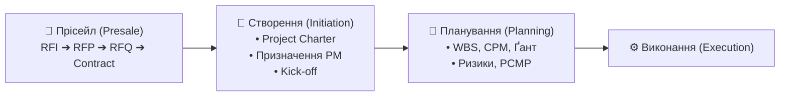
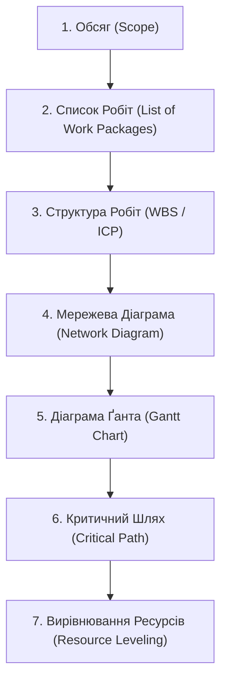
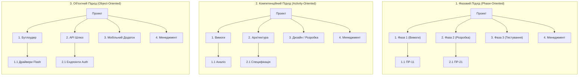
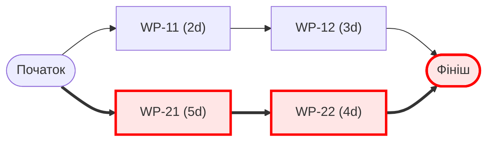
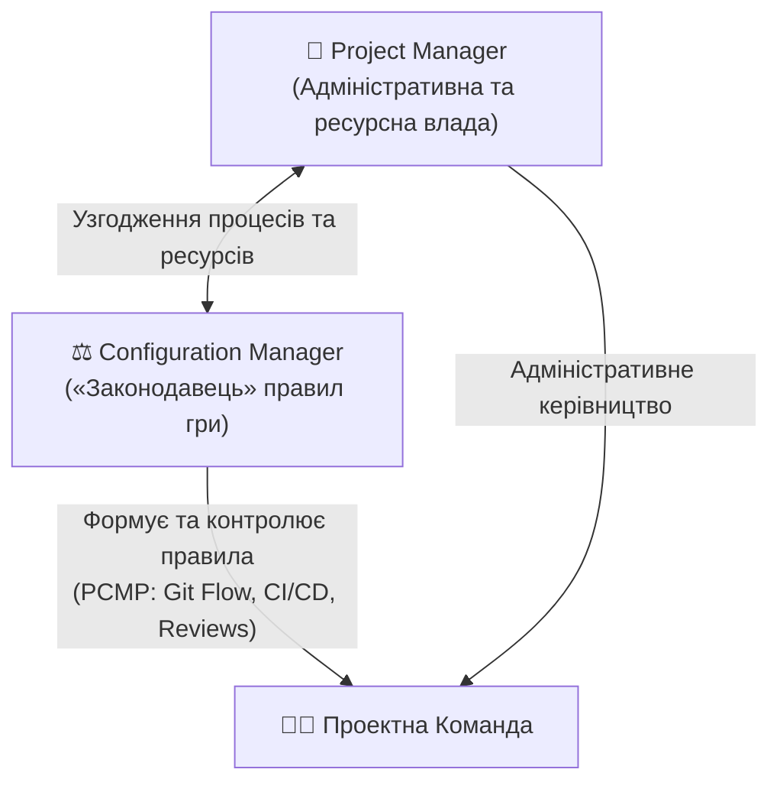

# 🚀 Лекція 5: Створення Проекту, Планування, Ризики та Конфігурація

> **Курс:** Проектний Менеджмент в ІТ (*Project Management in IT*)  
> **Лектор:** Ярослав Олексюк (2026)  
> **Документ:** `YO-NK01-D105_01`  
> **Попередній матеріал:** [Лекція 4: Прісейл, Оцінка Проекту, Ресурси та Фінанси](../l4/index.md)  
> **Шпаргалка:** [Шпаргалка до лекції 5 (Cheat Sheet)](cheat-sheet.md)  
> **Q&A:** [Запитання та Відповіді](questions.md)

---

## 📌 Навігація
- [1. Створення Проекту (Project Initiation)](#1-створення-проекту-project-initiation)
  - [1.1 Передумови та процес створення проекту](#11-передумови-та-процес-створення-проекту)
  - [1.2 Ідентифікація проекту та роль Project Manager](#12-ідентифікація-проекту-та-роль-project-manager)
  - [1.3 Статут Проекту (Project Charter)](#13-статут-проекту-project-charter)
  - [1.4 Установча нарада: Старт Проекту (Kick-off)](#14-установча-нарада-старт-проекту-kick-off)
- [2. Планування Проекту (Project Planning)](#2-планування-проекту-project-planning)
  - [2.1 Сутність, фази та послідовність планування](#21-сутність-фази-та-послідовність-планування)
  - [2.2 Структура Робіт (WBS): Фазовий, Компетенційний та Об'єктний підходи](#22-структура-робіт-wbs-фазовий-компетенційний-та-обєктний-підходи)
  - [2.3 Мережева Діаграма (Network Diagram)](#23-мережева-діаграма-network-diagram)
  - [2.4 Діаграма Ґанта (Gantt Chart) та типи зв'язків (FS, SS, FF, Lag, Lead)](#24-діаграма-ґанта-gantt-chart-та-типи-звязків-fs-ss-ff-lag-lead)
  - [2.5 Метод Критичного Шляху (Critical Path Method, CPM)](#25-метод-критичного-шляху-critical-path-method-cpm)
  - [2.6 Вирівнювання Ресурсів (Resource Leveling / Equaling)](#26-вирівнювання-ресурсів-resource-leveling--equaling)
  - [2.7 Глибина планування та Планування Хвилею (Rolling Wave Planning)](#27-глибина-планування-та-планування-хвилею-rolling-wave-planning)
  - [2.8 Тейлоринг Процесів (Process Tailoring)](#28-тейлоринг-процесів-process-tailoring)
  - [2.9 Документація та інструменти планування](#29-документація-та-інструменти-планування)
- [3. Управління Ризиками (Risk Management)](#3-управління-ризиками-risk-management)
  - [3.1 Визначення ризику за IPMA та PMI. Ризики vs Можливості](#31-визначення-ризику-за-ipma-та-pmi-ризики-vs-можливості)
  - [3.2 Ідентифікація ризиків, Реєстр (Risk Register) та Матриця (Risk Matrix)](#32-ідентифікація-ризиків-реєстр-risk-register-та-матриця-risk-matrix)
  - [3.3 Стратегії роботи з ризиками: Запобігання vs Реагування (Avoid, Mitigate, Transfer, Accept)](#33-стратегії-роботи-з-ризиками-запобігання-vs-реагування-avoid-mitigate-transfer-accept)
  - [3.4 Аналіз видів і наслідків відмов: FMEA та розрахунок RPN](#34-аналіз-видів-і-наслідків-відмов-fmea-та-розрахунок-rpn)
  - [3.5 Ризики та планування: Резерви на ризики (Contingency Buffer)](#35-ризики-та-планування-резерви-на-ризики-contingency-buffer)
- [4. Конфігурація Проекту (Project Configuration Management)](#4-конфігурація-проекту-project-configuration-management)
  - [4.1 Визначення та роль Configuration Manager](#41-визначення-та-роль-configuration-manager)
  - [4.2 План Керування Конфігурацією (Project Configuration Management Plan, PCMP)](#42-план-керування-конфігурацією-project-configuration-management-plan-pcmp)
- [📊 Зведена таблиця та підсумок лекції](#-зведена-таблиця-та-підсумок-лекції)

---

## 🎯 Мета та ключові питання лекції

1. **Як офіційно народжується проект?** Перехід від фази прісейлу до ініціації, призначення Project Manager, призначення Project ID, складання Статуту Проекту (*Project Charter*) та проведення установчої зустрічі (*Kick-off*).
2. **Як декомпонувати та розпланувати обсяг робіт?** Побудова структури робіт WBS трьома підходами (*Phase, Activity, Object-oriented*), створення мережевих графіків, побудова діаграми Ґанта із правильними зв'язками (*FS, SS, FF, Lag, Lead*).
3. **Як знайти та контролювати Критичний Шлях і не допустити перевантаження команди?** Розрахунок *Critical Path*, виявлення часових резервів завдань, виконання вирівнювання ресурсів (*Resource Leveling*) та застосування техніки планування набігаючою хвилею (*Rolling Wave Planning*).
4. **Як системно керувати невизначеністю?** Ідентифікація ризиків, розрахунок коефіцієнтів у Реєстрі Ризиків, розмежування заходів запобігання (*Mitigation*) та реагування (*Response*), застосування інженерної методики FMEA з розрахунком числа RPN та закладання часових буферів (*Contingency Buffer*).
5. **Що таке конфігурація проекту та навіщо потрібен PCMP?** Роль Менеджера Конфігурації як «законодавця» процесів та стандартизація життєвого циклу розробки через офіційний план конфігурації.

---

## 1. Створення Проекту (Project Initiation)

### 1.1 Передумови та процес створення проекту

Створення проекту (*Project Initiation*) — це формальний перехід від передконтрактних домовленостей до офіційного старту діяльності організації з виконання взятих на себе зобов'язань.



#### Ключові передумови створення проекту:
1. **Підписано Контракт (*Contract signed*):** Юридичне закріплення комерційної та технічної угоди між Замовником та Виконавцем.
2. **Затвердження Власником Проекту (*Project Owner / Executive Management Approval*):** Вище керівництво організації формально санкціонує запуск внутрішнього проекту.
3. **Синхронізація зі стратегічними цілями:** Проект повинен відповідати стратегії розвитку компанії (наприклад, вихід на ринок Embedded Automotive, посилення AI-експертизи тощо).
4. **Фіксація базових параметрів та виділення ресурсів:** Погоджено попередній обсяг (*Scope*) та графік (*Schedule*), а також офіційно виділено бюджет (*Budget Allocation*).

---

### 1.2 Ідентифікація проекту та роль Project Manager

Після офіційного схвалення проект набуває інституційного статусу всередині організації:

* **Ідентифікація Проекту (*Project ID*):** Проекту присвоюється унікальний буквено-цифровий код відповідно до внутрішнього регламенту компанії (наприклад, `PRJ-AUTO-2026-042`), офіційна назва та бухгалтерський код для обліку прямих витрат (*Cost Center*).
* **Призначення Проектного Менеджера (*Project Manager Assignment*):** Одним із перших наказів керівництва призначається відповідальний PM.
  * *Створення інфраструктури:* налаштування просторів у Jira/Confluence, репозиторіїв GitLab/GitHub, каналів зв'язку Teams/Slack.
  * *Формування команди:* залучення співробітників з функційних підрозділів через ресурсних менеджерів або узгодження вакансій із HR.
  * *Встановлення комунікації:* запуск регулярних ліній зв'язку зі стейкхолдерами клієнта та топ-менеджментом.

---

### 1.3 Статут Проекту (Project Charter)

**Статут Проекту (*Project Charter*)** — це основоположний управлінський документ, який офіційно санкціонує існування проекту та наділяє керівника проекту повноваженнями задіювати ресурси організації.

```
┌─────────────────────────────────────────────────────────────────┐
│                    СТАТУТ ПРОЕКТУ (Project Charter)             │
├─────────────────────────────────────────────────────────────────┤
│ 1. Ідентифікатор та назва проекту (Project ID, Official Name)    │
│ 2. Бізнес-обґрунтування та зв'язок зі стратегією компанії       │
│ 3. Мета проекту та вимірні критерії успіху (SMART Objectives)   │
│ 4. Верхньорівневий Обсяг (Scope Description & High-level WBS)   │
│ 5. Затверджений бюджет та граничні обмеження вартості            │
│ 6. Ключові дати, контрольні точки та майлстоуни (Milestones)     │
│ 7. Реєстр головних Стейкхолдерів (Stakeholder List)             │
│ 8. Призначений Project Manager та межі його повноважень         │
│ 9. Підписи спонсора / Project Owner та топ-менеджменту          │
└─────────────────────────────────────────────────────────────────┘
```

> 💡 **Інтуїція: Паспорт проекту**  
> Статут проекту — це «паспорт та довіреність» PM-а. Без підписаного чартера будь-який функційний менеджер може відмовитися виділяти інженерів у команду. Статут чітко фіксує: хто платить, навіщо проект робиться, хто ним керує та які повноваження має PM.

---

### 1.4 Установча нарада: Старт Проекту (Kick-off)

**Kick-off нарада (*Установча зустріч*)** — це офіційна перша нарада проектної команди та ключових стейкхолдерів, яка знаменує закінчення фази ініціації та перехід до активного детального планування й виконання.

* **Учасники:** Керівник проекту, Project Owner / Спонсор, замовник (якщо це зовнішній Kick-off), ліди технічних напрямків, уся проектна команда.
* **Цілі та порядок денний Kick-off зустрічі:**
  1. *Ознайомлення:* представлення команди, ролей та зон відповідальності.
  2. *Бачення проекту:* презентація бізнес-мети, контексту продукту та очікуваного кінцевого результату.
  3. *План верхнього рівня:* розгляд головних фаз, цільових дедлайнів та майлстоунів.
  4. *Правила гри (Way of Working):* опис прийнятих процесів, каналів зв'язку, інструментів (Jira, Git, Teams) та регламентів звітності.
  5. *Перші завдання:* формулювання негайних кроків на найближчі 1–2 тижні.
* **Kick-off як Майлстоун:** Зустріч Kick-off часто розглядається як перший формальний майлстоун проекту ($M_0$ або $M_1$), що підтверджує наявність базової інфраструктури та готовність команди до роботи.

---

## 2. Планування Проекту (Project Planning)

### 2.1 Сутність, фази та послідовність планування

**Планування Проекту (*Project Planning*)** — це процес структурування обсягу робіт, визначення залежностей між завданнями, розрахунку необхідного часу й ресурсів та їх оптимізації для досягнення цілей проекту.

Логічний ланцюжок інженерного планування:



1. **Список Робіт (*List of Work Packages*):** Перелік узагальнених пакетів робіт із їх попередніми технічними оцінками тривалості та трудовитрат.
2. **План Фаз Проекту (*Phase Plan*):** Верхньорівнева розбивка життєвого циклу проекту на великі етапи (наприклад: *Discovery $\to$ Architecture $\to$ Implementation $\to$ Verification $\to$ Deployment*).
3. **План Майлстоунів (*Milestone Plan*):** Список контрольних точок із фіксованими календарними датами перевірки значущих проміжних результатів.

---

### 2.2 Структура Робіт (WBS): Фазовий, Компетенційний та Об'єктний підходи

**Ієрархічна Структура Робіт (*Work Breakdown Structure, WBS / ІСР*)** — це ієрархічна декомпозиція всього обсягу робіт, необхідних для досягнення цілей проекту та створення результатів.

> ⚠️ **Важлива особливість WBS:**  
> WBS відображає **структуру та ієрархію обсягу робіт**, але **НЕ показує їх розподіл у часі чи послідовність виконання**. Хронологія та календар з'являються пізніше — у мережевих діаграмах та діаграмі Ґанта!

Лекція виділяє **3 фундаментальні підходи** до побудови WBS:



| Підхід до WBS | Критерій розбивки 1-го рівня | Плюси підходу | Мінуси / Ризики | Коли застосовувати |
| :--- | :--- | :--- | :--- | :--- |
| **Фазовий (*Phase-Oriented*)** | Етапи життєвого циклу (*Inception, Elaboration, Construction*) | Природна прив'язка до календаря та майлстоунів | Може розмивати цілісність архітектурних модулів | Waterfall-проекти, класичний V-Model, промислова інженерія |
| **Компетенційний (*Activity-Oriented*)** | Функційні напрямки / активності (*Systems Eng, Backend, QA*) | Зручно розподіляти роботи між спеціалізованими відділами | Створює функційні «колодязі» (*Silos*), втрачається фокус на цінності | Матричні організації зі сталими центрами компетенцій |
| **Об'єктний (*Object-Oriented*)** | Фізичні чи логічні підсистеми продукту (*Bootloader, Hardware, Cloud*) | Чітка інженерна модульність, ізоляція компонентів | Потребує наскрізного управління інтеграцією | Комплексні системи, Embedded / IoT, мікросервісні архітектури |

> 📌 **Правило 100%:** WBS повинна охоплювати 100% обсягу проекту (включаючи обов'язковий пакет «Управління проектом / Management») і нічого зайвого поза скоупом.

---

### 2.3 Мережева Діаграма (Network Diagram)

**Мережева Діаграма (*Network Diagram*)** — це графічне представлення логічних зв'язків та послідовності виконання робочих пакетів:

1. **Мережева діаграма без тривалостей:** Відображає виключно топологію зв'язків між пакетами робіт: які роботи мають передувати іншим, які можуть виконуватися паралельно, які точки є точками сходження (*Convergence*).
2. **Мережева діаграма з тривалостями:** Біля кожного вузла чи стрілки фіксується тривалість пакета ($t$ у днях/тижнях), що дозволяє розрахувати загальну тривалість гілок та знайти найдовший шлях.

```text
                  ┌─────────┐     ┌─────────┐
             ┌───►│  WP-11  ├───► │  WP-12  │───┐
             │    │ (3 дні) │     │ (4 дні) │   │
             │    └─────────┘     └─────────┘   ▼
┌──────────┐ │                                ┌─────────┐     ┌───────────┐
│ Kick-off ├─┼───────────────────────────────►│  WP-32  ├───► │  Outcome  │
└──────────┘ │                                │ (2 дні) │     └───────────┘
             │    ┌─────────┐     ┌─────────┐   ▲
             └───►│  WP-21  ├───► │  WP-22  │───┘
                  │ (5 днів)│     │ (3 дні) │
                  └─────────┘     └─────────┘
```

---

### 2.4 Діаграма Ґанта (Gantt Chart) та типи зв'язків (FS, SS, FF, Lag, Lead)

**Діаграма Ґанта (*Gantt Chart*)** транслює мережеву діаграму на горизонтальну календарну шкалу часу. Кожен робочий пакет відображається смугою, позиція і довжина якої залежать від дати старту, тривалості та обмежень зв'язків.

#### 4 типи залежностей між завданнями (Dependencies):

```mermaid
flowchart TD
    subgraph FS ["Finish-to-Start (FS)"]
        direction LR
        A1["Task A"] -->|"Кінець A запускає початок B"| B1["Task B"]
    end

    subgraph SS ["Start-to-Start (SS)"]
        direction LR
        A2["Task A"] -.->|"Старт A дозволяє старт B"| B2["Task B"]
    end

    subgraph FF ["Finish-to-Finish (FF)"]
        direction LR
        A3["Task A"] ==="Кінець A дозволяє кінець B"===> B3["Task B"]
    end

    subgraph SF ["Start-to-Finish (SF)"]
        direction LR
        A4["Task A"] -.-x|"Старт A дозволяє фініш B (рідко)"| B4["Task B"]
    end
```

* **Finish-to-Start (FS):** Найбільш природний та поширений зв'язок. Робота $B$ не може початися, доки не закінчена робота $A$ (наприклад: *Написання коду $\to$ Code Review*).
* **Start-to-Start (SS):** Робота $B$ може стартувати лише після того, як стартувала робота $A$. Дозволяє паралелити процеси (наприклад: *Старт розробки модулів $\to$ Старт написання документації*).
* **Finish-to-Finish (FF):** Робота $B$ не може завершитися, доки не завершиться робота $A$ (наприклад: *Завершення рефакторингу $\to$ Завершення регресійного тестування*).
* **Start-to-Finish (SF):** Робота $B$ не може завершитися, поки робота $A$ не почалася (наприклад: зміна варти охорони — старий черговий не може піти, доки новий не заступив).

#### Зсуви: Затримка (Lag) та Випередження (Lead)

* **Затримка (*Lag / +Lag*):** Обов'язкова пауза між завершенням попередника та стартом наступника:
  $$\text{Start}(B) = \text{Finish}(A) + \text{Lag}$$
  *Приклад:* замовлення серверів ($A$) $\xrightarrow{FS + 14\text{d}}$ налаштування інфраструктури ($B$) — 14 днів очікування доставки.
* **Випередження (*Lead / -Lead*):** Достроковий старт наступника до повного фінішу попередника:
  $$\text{Start}(B) = \text{Finish}(A) - \text{Lead}$$
  *Приклад:* тестування фічі може розпочатися за 2 дні до повного завершення написання коду на підставі проміжних білдів.

---

### 2.5 Метод Критичного Шляху (Critical Path Method, CPM)

**Критичний Шлях (*Critical Path*)** — це найдовша безперервна послідовність залежних робіт від старту проекту до його завершення, яка визначає **найкоротший можливий календарний термін виконання проекту**.



#### Ключові властивості Критичного Шляху:
1. **Нульовий резерв часу (*Zero Float / Slack*):** Роботи на критичному шляху мають нульовий часовий запас ($Float = 0$).
2. **Прямий вплив на дедлайн:** Затримка будь-якого елемента на критичному шляху навіть на 1 день **автоматично відсуває дату завершення проекту на 1 день**.
3. **Некритичні завдання та часовий резерв (*Float / Slack*):**
   * Завдання, що лежать поза критичним шляхом, мають запас часу:
     $$\text{Total Float} = LS - ES = LF - EF$$
     (де $ES/EF$ — ранні дати старту/фінішу, $LS/LF$ — пізні дати старту/фінішу).
   * Помірні затримки некритичних завдань у межах їх резерву **не впливають** на дату фінального релізу.
4. **Фокус контролю PM-а:** Під час виконання проекту керівник зобов'язаний тримати роботи критичного шляху під щоденним моніторингом.

---

### 2.6 Вирівнювання Ресурсів (Resource Leveling / Equaling)

При первинному розміщенні завдань на діаграмі Ґанта часто виникає ситуація **ресурсного дисбалансу**:

* **Перевантаження (*Overload*):** Спеціаліст призначений на 2 чи 3 паралельні задачі одночасно (вимагається 160–200% робочого часу на день). Це веде до вигорання, помилок та затримок.
* **Простій (*Idling*):** Інженер чекає вхідних результатів від суміжників і не має активних проектних завдань.

```
НЕВИРІВНЯНИЙ ПЛАН:
Інженер 1:  [ WP-11 ] [ WP-23 (OVERLOAD!) ] [ WP-33 ]
                      [ WP-32 (OVERLOAD!) ]
Інженер 2:  [ WP-12 ] ......... (ПРОСТІЙ) ...........

ПІСЛЯ ВИРІВНЮВАННЯ (Resource Leveling):
Інженер 1:  [ WP-11 ] [ WP-23 ]             [ WP-33 ]
Інженер 2:  [ WP-12 ]           [ WP-32 ]
                     ▲ Перепризначено завдання WP-32 на вільного Інженера 2!
```

#### Способи усунення ресурсних конфліктів:
1. **Перепризначення виконавця (*Reassignment*):** Передача задачі менш завантаженому спеціалісту відповідної кваліфікації.
2. **Зсув завдання в межах резерву часу (*Shifting within Float*):** Перенесення некритичної задачі вперед або назад без зміни загального дедлайну проекту.
3. **Розбиття робіт (*Splitting tasks*):** Виконання частини задачі зараз, а решти — після вивільнення ресурсів.
4. **Зсув дедлайну вправо (*Schedule Extension*):** Якщо резервів немає і залучити нових людей неможливо, перевантаження усувається за рахунок продовження терміну проекту.

---

### 2.7 Глибина планування та Планування Хвилею (Rolling Wave Planning)

На початку проекту відомі стратегічні цілі, але детальний зміст робіт на 12–24 місяці вперед має високу невизначеність. Спроба деталізувати кожен день віддаленого майбутнього є марною тратою часу через неминучі зміни вимог та ризики.

```
       ГОРИЗОНТ ЧАСУ ──►
┌────────────────────────┬───────────────────────────────────────────┐
│     БЛИЖЧІ ФАЗИ        │               НАСТУПНІ ФАЗИ               │
│   (Висока певність)    │             (Низька певність)             │
├────────────────────────┼───────────────────────────────────────────┤
│ • Детальні Завдання    │ • Заплановані лише на рівні Фаз           │
│   (Tasks на 1-2 тижні) │   та цільових Майлстоунів                 │
│ • Точні Робочі Пакети  │ • Оцінені укрупнено (Rough Order)         │
│   (Work Packages)      │ • Уточнюються в міру наближення           │
└────────────────────────┴───────────────────────────────────────────┘
```

* **Планування Хвилею (*Rolling Wave Planning*):** Техніка ітеративного планування, коли найближчий часовий горизонт (наприклад, поточний або наступний квартал/спринт) розплановується в деталях (до задач тривалістю 1–3 дні), а віддалені фази представлені лише великими блоками та майлстоунами.
* У міру завершення поточної фази наступний пласт робіт потрапляє під «гребінь хвилі» та деталізується на основі вже здобутих артефактів.
* **Ієрархія глибини:**
  $$\text{Фази (Phases)} \longrightarrow \text{Майлстоуни (Milestones)} \longrightarrow \text{Пакети Робіт (Work Packages)} \longrightarrow \text{Завдання (Tasks)}$$

---

### 2.8 Тейлоринг Процесів (Process Tailoring)

**Тейлоринг (*Tailoring / Адаптація*)** — це свідоме та обґрунтоване налаштування корпоративного процесу розробки під специфічні характеристики, масштаби та ризики конкретного проекту.

* Жоден стандартний фреймворк компанії не може ідеально підходити як для 2-місячного пілотного PoC, так і для 5-річного проекту створення автомобільного автопілота рівня безпеки ASIL-D.
* **Що підлягає тейлорингу:**
  * Кількість та склад обов'язкових фаз і майлстоунів.
  * Перелік робочих продуктів (*Work Products*) та проектних документів (наприклад, чи потрібен окремий звіт безпеки або архітектурний опис за ISO 26262).
  * Глибина формалізму в рев'ю коду та тестуванні.
* **Головні правила тейлорингу:**
  1. Тейлоринг виконується **тільки в тих межах, які прямо дозволені процесом організації**.
  2. Будь-яке виключення обов'язкового кроку має бути **задокументоване та письмово аргументоване**.
  3. Тейлоринг є відповідальністю PM, але обов'язково **затверджується вищим керівництвом чи відділом якості (Quality Assurance)**.

---

### 2.9 Документація та інструменти планування

| Категорія | Інструмент / Документ | Характеристика та призначення |
| :--- | :--- | :--- |
| **Документи** | **План Проекту (*Project Plan / Schedule*)** | Офіційний затверджений розклад робіт, зв'язків та ресурсів. |
| | **План Релізів (*Release Plan*)** | Календарний графік випуску версій продукту для клієнта. |
| | **План Спринтів (*Sprint Plan*)** | Деталізований набір задач на фіксовану ітерацію (1–4 тижні) в Agile. |
| | **Беклог (*Product / Sprint Backlog*)** | Пріоритизований список вимог, історій користувачів та багів. |
| **Інструменти** | **MS Project, ProjectLibre** | Програми на основі діаграми Ґанта; автоматичний розрахунок CPM та вирівнювання навантаження. |
| | **Jira, Azure DevOps** | Орієнтовані на гнучке планування (Scrum/Kanban беклоги, дошки, спринти, Roadmap). |
| | **MS Excel / Google Sheets** | Швидке верхньорівневе планування, формування списків робіт та фінансових оцінок. |

---

## 3. Управління Ризиками (Risk Management)

### 3.1 Визначення ризику за IPMA та PMI. Ризики vs Можливості

Стандарти проектного менеджменту дають гармонізоване визначення ризику:

> «Під ризиком розуміється невизначена подія або обставина, яка, у разі її настання, може мати **позитивний або негативний вплив** на досягнення цілей проекту.»  
> — *IPMA ICB 4.0 (2015)*

> «An uncertain event or condition that, if it occurs, has a positive or negative effect on one or more project objectives. Negative risks (threats) and positive risks (opportunities).»  
> — *PMI PMBOK Guide 7th Edition*

```
                           ПОДІЯ У ПРОЕКТІ
                                  │
                 ┌────────────────┴────────────────┐
                 ▼                                 ▼
      Невизначена подія (p < 50%)       Визначена подія (p ≥ 50%)
                 │                                 │
        ┌────────┴────────┐                        ▼
        ▼                 ▼               ЦЕ НЕ РИЗИК!
     Загроза           Можливість         Це планова задача або факт,
    (Threat)         (Opportunity)        який вноситься в скоуп/план
  Негативний          Позитивний
    вплив               вплив
```

* **Поріг визначеності:** Якщо ймовірність настання події перевищує 50% (або наближається до 100%), вона **перестає бути ризиком** і перетворюється на об'єктивний факт (проблему — *Issue*), під який потрібно планувати конкретні проектні роботи.
* **Джерела ризиків в IT:**
  * *Технічні та Архітектурні:* нова неперевірена бібліотека, низька продуктивність бази даних.
  * *Технологічні:* затримки у випуску драйверів вендором чіпів, несумісність API.
  * *Ресурсні:* раптове звільнення ключового Senior-розробника, тривалий найм фахівців.
  * *Проектні:* роздування скоупу (*Scope Creep*), помилки в оцінці WBS.
  * *Економічні та Політичні:* інфляція, валютні коливання, регуляторні зміни (GDPR).

---

### 3.2 Ідентифікація ризиків, Реєстр (Risk Register) та Матриця (Risk Matrix)

**Реєстр Ризиків (*Risk Register*)** — це формальний документ, що ведеться PM-ом протягом усього життєвого циклу проекту і містить перелік усіх ідентифікованих загроз та можливостей.

Формулювання ризику будується за принципом причинно-наслідкового зв'язку:

$$\mathbf{Причина\ (Cause)} \longrightarrow \mathbf{Ризик\ (Uncertain\ Event)} \longrightarrow \mathbf{Наслідок\ (Effect)}$$

* *Приклад:* Неповнота документації на успадкований код (*Cause*) $\to$ розробники можуть невірно зрозуміти логіку роботи шини (*Risk*) $\to$ зрив термінів релізу на 3 тижні та перевитрата бюджету (*Effect*).

#### Оцінка ризиків та Матриця Ризиків (Risk Matrix):
Кожен ризик оцінюється за двома осями (шкала *Low, Medium, High* або числова 1..5):
1. **Ймовірність (*Probability, P*):** Шанс настання події.
2. **Вплив / Тяжкість (*Impact / Severity, S*):** Ступінь збитків для термінів, вартості чи якості.

$$\text{Коефіцієнт Ризику (Risk Score)} = \text{Probability} \times \text{Impact}$$

```text
ІМОВІРНІСТЬ (Probability)
  ▲
H │   [ Р-4 ]           [ Р-1 ]       [ Р-5 ]   ◄ КРИТИЧНА ЗОНА (High Risk)
  │
M │                     [ Р-2 ]
  │
L │   [ Р-3 ]
  └─────────────────────────────────────────►
        Low             Medium          High
                                ВПЛИВ (Severity / Impact)
```

> ⚠️ **Реєстр ризиків — це живий документ!**  
> Реєстр не складається раз і назавжди на початку проекту. Він регулярно оновлюється на кожному статусному мітингу, а його актуальний стан перевіряється на кожному майлстоуні.

---

### 3.3 Стратегії роботи з ризиками: Запобігання vs Реагування (Avoid, Mitigate, Transfer, Accept)

Робота з ризиками ділиться на два часові горизонти:

```
            ДО НАСТАННЯ ПОДІЇ                 ПІСЛЯ НАСТАННЯ ПОДІЇ
┌───────────────────────────────────────┐   ┌───────────────────────┐
│     ЗАПОБІГАННЯ (Mitigation)          │   │ РЕАГУВАННЯ (Response) │
│ • Діє превентивно                     │   │ • Діє постфактум      │
│ • Знижує ймовірність (P) та/або       │ ═►│ • Знижує тільки       │
│   вплив (S)                           │   │   наслідки збитків (S)│
│ • Усуває корінні причини              │   │ • Коригувальні заходи │
└───────────────────────────────────────┘   └───────────────────────┘
```

#### 4 класичні стратегії реагування на негативні ризики (Threat Strategies):

1. **Уникати (*Avoid*):** Повна зміна плану, технології чи архітектури, яка на 100% ліквідує джерело загрози.  
   *Приклад:* Відмова від використання сирої бета-версії фреймворку на користь перевіреного стабільного рішення.
2. **Зменшувати / Запобігати (*Mitigate / Reduce*):** Проведення проактивних заходів для зниження ймовірності виникнення та/або важкості наслідків.  
   *Приклад:* Написання автоматизованих тестів, навчання команди, проведення стрес-тестування архітектури на ранньому етапі.
3. **Переносити (*Transfer*):** Передача відповідальності та фінансового тягаря третій стороні.  
   *Приклад:* Оформлення страхового полісу, залучення зовнішнього субпідрядника за моделлю Fixed Price із гарантіями, використання надійного хмарного SLA від AWS замість власного «заліза».
4. **Прийняти (*Accept*):** Свідоме рішення не вживати жодних активних превентивних дій.
   * *Пасивне прийняття:* нічого не робимо, розбираємося по факту, якщо станеться.
   * *Активне прийняття:* створення резерву часу та грошей (*Contingency Reserve*), який буде активовано у разі матеріалізації ризику.

---

### 3.4 Аналіз видів і наслідків відмов: FMEA та розрахунок RPN

**FMEA (*Failure Modes and Effects Analysis*)** — структурована інженерна методика виявлення потенційних відмов у продукті або процесі, оцінки їхніх наслідків та пріоритизації коригувальних дій.

#### Термінологія FMEA:
* **Failure Mode (*Вид відмови*):** Спосіб, у який система або компонент може вийти з ладу чи не виконати свою функцію.
* **Effect (*Наслідок*):** Вплив відмови на роботу кінцевого користувача чи всієї системи.
* **Cause (*Причина*):** Фізичний або проектний дефект, що призводить до відмови.

#### Розрахунок Risk Priority Number (RPN):
Кожна відмова оцінюється експертно за трьома критеріями за шкалою від $1$ до $10$:

1. **Severity ($S$, 1..10) — Важкість наслідків:** Наскільки критичною є аварія для користувача ($1$ — непомітна косметична дія, $10$ — катастрофічний збій, загроза життю чи повна втрата даних).
2. **Occurrence ($O$ або $P$, 1..10) — Ймовірність виникнення:** Як часто дефект може виникати ($1$ — майже неможливо, $10$ — майже неминуче).
3. **Detection ($D$, 1..10) — Можливість виявлення:** Здатність існуючих засобів контролю/тестування засікти дефект **до того, як він потрапить клієнту** ($1$ — дефект буде гарантовано виявлений автоматичним тестом, $10$ — прихована помилка, яку неможливо засікти до релізу).

Пріоритетне Число Ризику (*RPN*):

$$\mathbf{RPN} = S \times O \times D \quad (1 \le \text{RPN} \le 1000)$$

```text
КРИТЕРІЇ ДІЙ У FMEA:
• RPN ≥ 100 ────► ОБОВ'ЯЗКОВЕ впровадження превентивних інженерних заходів
                   для зниження показників (перепроектування, автотести).
• S ≥ 9 ────────► КРИТИЧНИЙ РИЗИК БЕЗПЕКИ (Safety Risk)!
                   Вимагає негайного усунення незалежно від загального RPN!
```

#### Види FMEA:
* **System FMEA (SFMEA):** Аналіз функціонування системи на верхньому рівні міжсистемних взаємодій.
* **Design FMEA (DFMEA):** Аналіз інженерних рішень, схемотехніки та архітектури самого виробу.
* **Process FMEA (PFMEA):** Аналіз технологічних збоїв на етапі виробництва та складання продукту.

> 💡 **Юридична роль FMEA:**  
> У разі виникнення збоїв або аварій у клієнта саме заповнений протокол FMEA є для суду та аудиторів доказом того, що виробник діяв добросовісно (*Due Diligence*) і зробив усе можливе для передбачення можливих відмов.

---

### 3.5 Ризики та планування: Резерви на ризики (Contingency Buffer)

Результати оцінки ризиків безпосередньо впливають на календарний розклад та бюджет. Якщо ризик має відчутну ймовірність, до плану закладається **Резерв на Ризики (*Contingency Buffer*)**.

```
ДІАГРАМА З БУФЕРАМИ:
[ WP-11 ] ──► [ WP-12 ] ──► [ CB-1: Буфер на затримку ліцензій (5д) ] ──► [ Milestone 1 ]
[ WP-21 ] ──► [ WP-22 ] ──► [ CB-2: Буфер на інтеграцію (7д) ] ────────► [ Фінальний Реліз ]
```

* **Часовий буфер (*Schedule Contingency Buffer*):** Спеціальний часовий блок перед релізом чи майлстоуном, який витрачається лише тоді, коли матеріалізуються передбачені ризики.
* **Фінансовий буфер (*Contingency Reserve*):** Грошовий фонд, закладений у кошторис для покриття витрат на усунення наслідків відомих ризиків (*Known Unknowns*).

---

## 4. Конфігурація Проекту (Project Configuration Management)

### 4.1 Визначення та роль Configuration Manager

**Конфігурація Проекту (*Project Configuration*)** — це формалізований опис усіх процесів, методологій, стандартів, інструментів та середовищ, які є обов'язковими для застосування всіма учасниками проекту.

* У невеликих проектах за конфігурацію відповідає безпосередньо Project Manager або технічний лід.
* У великих складних інженерних та Enterprise-проектах призначається окрема ключова роль — **Менеджер Конфігурації (*Configuration Manager, CM*)**.



> 💡 **Інтуїція: Configuration Manager — це «Законодавець» проекту**  
> Менеджер Конфігурації не роздає щоденних тасок інженерам і не керує бюджетом (у нього немає адміністративної влади над людьми). Проте він відіграє роль **Законодавчої Влади**: він створює «конституцію» інженерної роботи команди, затверджує інструменти, схеми гілкування коду, правила проходження тестів та рев'ю. Порушувати правила конфігурації не має права навіть PM!

---

### 4.2 План Керування Конфігурацією (Project Configuration Management Plan, PCMP)

**PCMP (*Project Configuration Management Plan*)** — це головний офіційний документ, що регламентує внутрішні технічні та управлінські стандарти роботи в проекті. Він є **суворо обов'язковим до виконання**.

```
┌────────────────────────────────────────────────────────────────────────┐
│        ПЛАН УПРАВЛІННЯ КОНФІГУРАЦІЄЮ (Project Configuration Plan)       │
├────────────────────────────────────────────────────────────────────────┤
│ 1. Стандарти розробки: посилання на корпоративні та міжнародні         │
│    стандарти (ISO 9001, Automotive SPICE, IEEE, MISRA C).              │
│ 2. Стратегія розробки коду (Code Development Strategy):                │
│    правила гілкування (GitFlow, Trunk-based), формат коміт-повідомлень.│
│ 3. Автоматизація збірки та релізів (CI/CD): пайплайни перевірки.      │
│ 4. Регламент Рев'ю: Code Review, Архітектурне та Документарне рев'ю.   │
│ 5. Управління релізами (Release Management): правила версіонування     │
│    (SemVer), підписання білдів, артефакторій релізів.                  │
│ 6. Управління завданнями (Tasks Management): схема статусів у Jira,   │
│    критерії Definition of Done (DoD) та Definition of Ready (DoR).    │
│ 7. Система передачі продукту клієнтові (Customer Delivery System).     │
│ 8. Реєстрація та вирішення дефектів (Defect / Problem Tracking).      │
└────────────────────────────────────────────────────────────────────────┘
```

#### Чому PCMP є критичним:
1. **Єдине джерело правди (*Single Source of Truth*):** Знімає будь-які суперечки всередині команди про те, «як правильно комітити код», «хто має підписувати реліз» чи «як оформлювати баг».
2. **Аудитопридатність (*Audit Readiness*):** Зовнішні клієнти та сертифікаційні органи вимагають пред'явлення PCMP як доказу контрольованості та повторюваності процесів розробки.
3. **Безшовний онбординг (*Team Onboarding*):** Новий інженер вивчає PCMP і одразу знає всі робочі інструменти та правила компанії без потреби відволікати колег.

---

## 📊 Зведена таблиця та підсумок лекції

| Тема / Елемент | Ключова сутність | Інженерне правило / Стандарт |
| :--- | :--- | :--- |
| **Project Initiation** | Створення проекту | Проект затверджується після контракту; отримує Project ID, Статут (*Project Charter*) та проводить Kick-off. |
| **WBS (ІСР)** | Ієрархія робіт | 3 підходи: *Фазовий*, *Компетенційний*, *Об'єктний*. Показує обсяг робіт, але **не час**. |
| **Діаграма Ґанта** | Календарне планування | Відображає роботи в часі. Типи зв'язків: **FS** (базовий), **SS** (паралелізм), **FF**, а також **Lag** (пауза) і **Lead** (випередження). |
| **Критичний Шлях (CPM)** | Найдовший ланцюг залежностей | Завдання на КП мають нульовий резерв часу ($Float = 0$); затримка веде до зриву дедлайну всього проекту. |
| **Resource Leveling** | Вирівнювання навантаження | Усуває перевантаження (*Overload*) та простої (*Idling*) через перепризначення задач або зсув у межах резерву. |
| **Rolling Wave** | Планування хвилею | Детальний розклад на найближчий горизонт (спринт/квартал) + укрупнений план на віддалені фази. |
| **Тейлоринг** | Адаптація процесу | Свідоме скорочення/налаштування корпоративного процесу під проект; відповідальність PM із затвердженням топ-менеджментом. |
| **Ризик (Risk)** | Невизначена подія ($P < 50\%$) | Має вплив на цілі (загроза або можливість). Якщо $P \ge 50\%$ — це плановий факт/проблема. |
| **Стратегії для ризиків** | Avoid, Mitigate, Transfer, Accept | **Mitigation** діє до настання (знижує P і S), **Response** діє після настання (знижує тільки S). |
| **Методика FMEA** | $\text{RPN} = S \times O \times D$ | Оцінка за Severity ($S$), Occurrence ($O$), Detection ($D$). Якщо $\text{RPN} \ge 100$ або $S \ge 9$ — обов'язкові превентивні дії! |
| **Конфігурація (PCMP)** | Опис процесів та інструментів | Офіційний обов'язковий план; Configuration Manager виступає як «законодавець» правил розробки. |

---

[⬅️ Попередня лекція](../l4/index.md) | [🏠 Головний зміст](../../README.md) | [⚡ Відкрити Cheat Sheet](cheat-sheet.md) | [❓ Q&A](questions.md)
